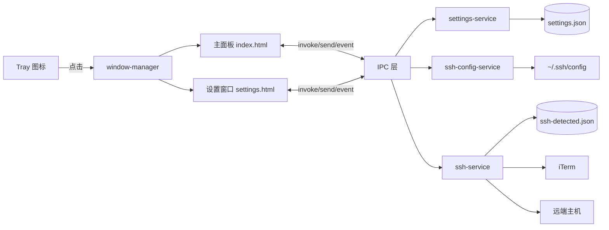
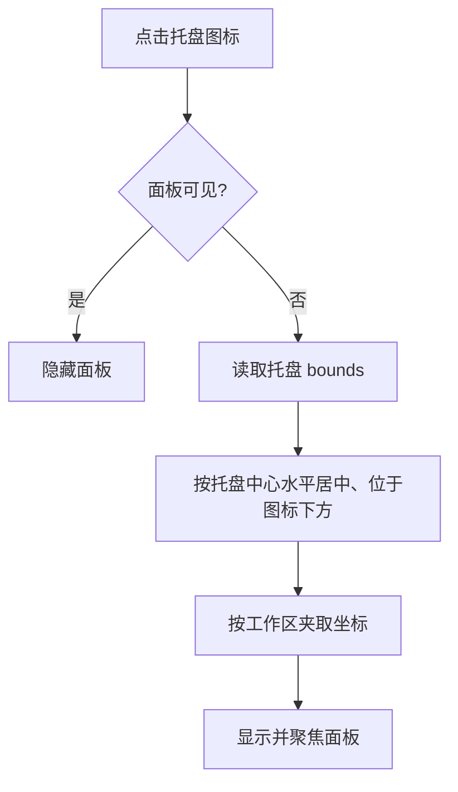
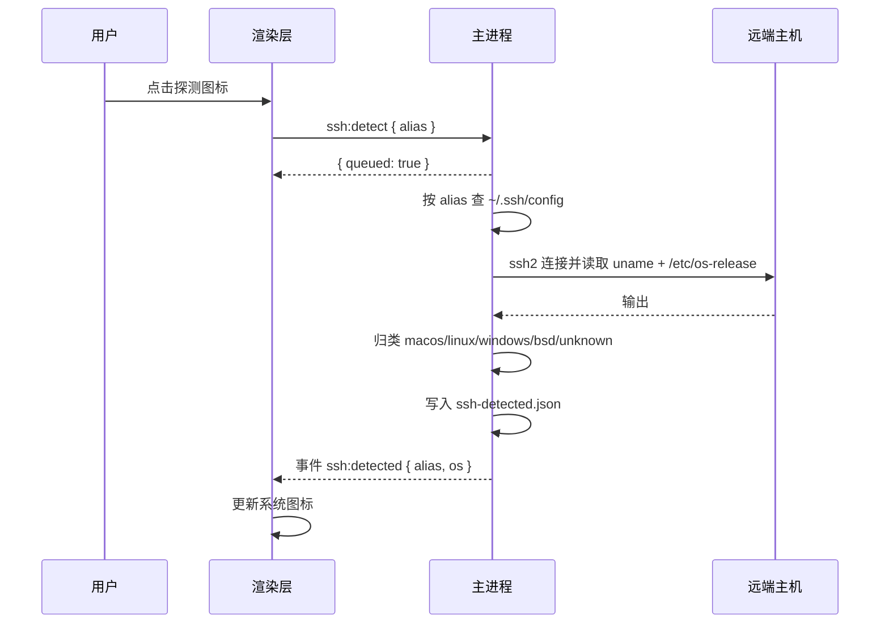
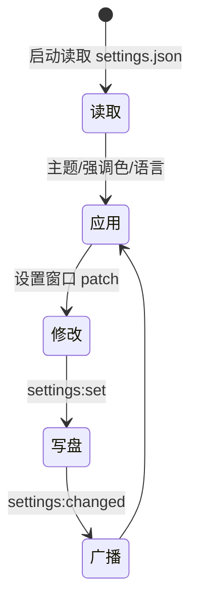
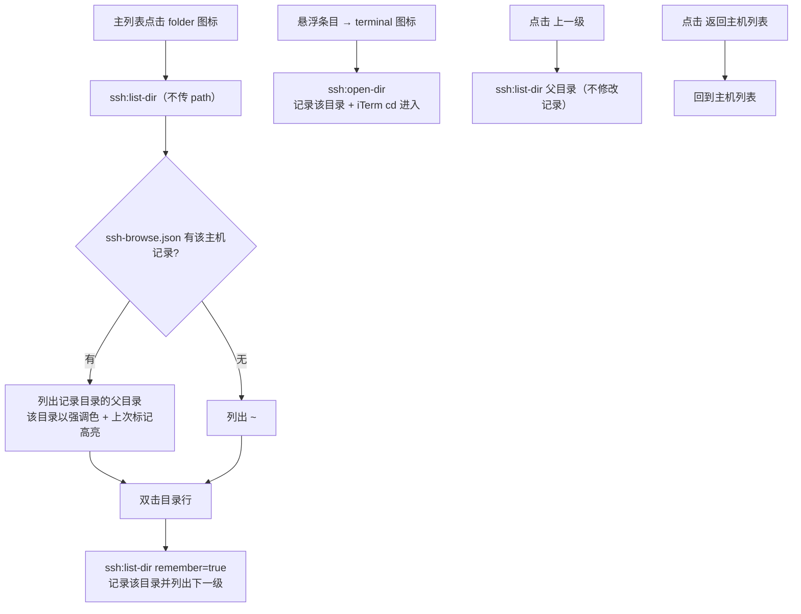

# Ships 产品需求文档（PRD）

| 项目 | 说明 |
| --- | --- |
| 产品名称 | Ships |
| 产品定位 | 面向开发者的 macOS 菜单栏（Tray）工具箱，点击托盘图标在下方展开轻量面板 |
| 技术栈 | Electron 44（主进程）+ Tailwind CSS 3（界面样式）+ 原生 JavaScript（渲染层，无打包器）+ ssh2（SSH 探测）+ electron-liquid-glass（macOS 26+ 原生 Liquid Glass，可选）+ 本地 geoip.json（IP 归属地） |
| 支持平台 | macOS（arm64 / x64；当前主要面向 arm64） |
| 当前版本 | 1.4.0 |
| 发布方式 | 本地/CI 通过 `electron-builder` 打包 macOS arm64 DMG（`pnpm dist:mac`）；暂未签名 / 公证 |

**核心设计**：应用常驻系统托盘、不占用 Dock；点击托盘图标在图标正下方弹出 400×500 的圆角面板，面板内以顶部 TAB 切换工具、底部显示版本与设置入口；所有输入实时反馈，无需点击“计算”按钮。

---

## 1.1 阅读与维护规则

- 本文件是 Ships 行为的**唯一事实来源**：先读本文件、再读代码，不凭猜测改代码。
- **改代码必须同步改文档**，不得只改其一；文档与实现不一致时**以代码为准**（先核对主进程 / 预加载 / 渲染层入口，再修文档）。
- 对外接口必须写清：**签名、可用范围、是否持久（刷新 / 重启是否丢失）、副作用条件与示例**。
- 版本号变更时，同步更新本文件内所有版本引用（含示例）。

### 变更类型 → 需同步章节

| 变更类型 | 需同步章节 |
| --- | --- |
| 新增 / 删除工具 | §4 主要功能清单、§11 GUI 与布局规范 |
| 修改现有工具的交互 / 控件 | §4 主要功能清单、§11 GUI 与布局规范 |
| 新增 / 修改 IPC 通道 | §5.2 IPC 通道三张表、§2.1 安全模型、对应流程 |
| 修改窗口行为 / 尺寸 | §2.1 进程模型、§4、§8 主界面布局、§11 GUI 与布局规范、`package.json` 的 `ships` 配置 |
| 修改设置项 | §3 核心流程、§5.1 本地数据、§4 功能清单 |
| 修改 SSH 相关行为 | §3 核心流程、§5.1 本地数据、§5.2、§6 流程图 |
| 修改样式常量 | §11 GUI 与布局规范、`src/renderer/styles/constants.css` |
| 新增 / 修改图标 | §8.3 图标与资源、`assets/icons/`（SVG）与 `assets/imgs/`（位图） |
| 修改 GeoIP / 国旗 | §2.1 项目结构、§5.2 `geo:lookup`、§8.3、`assets/geoip.json` / `assets/flags/` |
| 修改构建 / 脚本 / 依赖 / CI | §7 构建与发布、`package.json`、`pnpm-lock.yaml`、`.github/workflows/*.yml` |

---

## 2. 项目概述

- **产品定位**：一个常驻 macOS 菜单栏的开发者工具箱，把高频小工具与 SSH 管理收纳进一个托盘弹出的面板。
- **技术栈**：Electron 44；界面使用 Tailwind CSS 3 编译产物 + 原生 JS（`window.Ships*` 命名空间）；SSH 探测使用 `ssh2`；原生玻璃使用 `electron-liquid-glass`（N-API 原生插件，macOS 26+ 生效，旧系统 / 非 macOS 由主进程回退，见 §8.1）。
  - 说明：AGENTS 建议界面优先 Vue 3；当前实现选用**无打包器的原生 JS + Tailwind**，以减小体积、避免引入前端构建链，后续如需可平滑替换为 Vue 3。
- **支持平台**：macOS（Darwin）。代码通过 `process.platform` 判断，非 macOS 下托盘行为与登录项设置自动降级。
- **当前版本**：1.4.0。
- **发布方式**：通过 `electron-builder` 打包 macOS arm64 DMG，见 §7。

### 2.1 架构原理

**进程模型**

- **主进程**（`src/main/`）：创建托盘与窗口、读写本地数据、解析 `~/.ssh/config`、执行 iTerm 连接与 SSH 探测、注册 IPC。
- **预加载脚本**（`src/preload/`）：在 `contextIsolation: true`、`nodeIntegration: false`、`sandbox: false` 下运行，用 `contextBridge` 暴露白名单 API（主面板用 `main-preload.js`，设置窗口用 `settings-preload.js`）。
- **渲染进程**（`src/renderer/`）：两个页面 —— 托盘主面板 `index.html` 与设置窗口 `settings.html`；不含 Node 能力，仅通过 `window.ships`（能力）、`window.shipsIcons`（内部 SVG 图标）与 `window.shipsFlags`（国旗 SVG）与主进程 / 预加载通信。
- **无 Webview**：不内嵌远程 Web，无 guest 进程。

**项目结构**

```
Ships/
├── package.json                 # 依赖、脚本、ships 系统配置段
├── tailwind.config.js           # Tailwind：颜色/圆角/阴影/字体均映射到 CSS 变量
├── AGENTS.md                    # 客户端设计与编码约定
├── README.md                    # 应用图标 + 一句话概述
├── docs/PRD.md                  # 本文件
├── assets/
│   ├── icons/                   # 应用内部使用的 SVG 图标（kebab-case，统一由预加载读取）
│   ├── imgs/                    # 位图资源：应用图标 / 托盘 / 打包
│   │   ├── trayTemplate.png     # 托盘模板图标（18/36/54 @1x/@2x/@3x）
│   │   ├── app.png              # 应用图标（512，README 引用）
│   │   └── icon.icns            # 打包用 macOS 图标
│   ├── flags/                   # 国旗图标（`<CC>.svg` 长方形 / `<CC>_1x1.svg` 方形）
│   └── geoip.json               # IP 归属地数据库（单行大文件，由 geo-service `require`）
├── .github/workflows/build-mac.yml  # CI：构建 macOS arm64 DMG
├── scripts/                     # 构建 / 工具脚本（不打包进产物）
│   ├── capture.cjs              # 开发用 UI 截图 / 操作脚本
│   ├── dist-mac.sh              # dist:mac 包装脚本：选择签名方式
│   ├── after-pack.cjs           # electron-builder afterPack：asar 加固 + fuses + ad-hoc 签名
│   ├── adhoc-sign.sh            # 未配置正式签名时对 .app 做 ad-hoc 签名
│   ├── notarize.cjs             # electron-builder afterSign：按需公证
│   └── gen-icons.mjs            # 零依赖 PNG / icns 图标生成脚本
└── src/
    ├── shared/constants.js      # 主进程与预加载共享：IPC 通道、窗口配置、默认设置
    ├── main/
    │   ├── main.js              # 应用入口：单实例、Dock 隐藏、注册 IPC、创建托盘
    │   ├── tray.js              # 托盘图标与右键菜单
    │   ├── window-manager.js    # 主面板 / 设置窗口创建、定位、显隐、广播
    │   ├── ipc/                 # IPC 处理器（app / settings / window / ssh / geo / clipboard / hash / net-test）
    │   ├── services/            # settings / ssh-config / ssh / ssh-browse / iterm / net-test / geo / clipboard / hash 服务
    │   └── utils/               # logger / json-store / paths / ls-listing（远端 `ls -l` 解析）/ utf8（UTF-8 保真解码 + 非法字节转义）/ net-test（网络测试命令与校验）
    ├── preload/                 # main-preload.js / settings-preload.js / icons.js（assets/icons/*.svg）/ flags.js（assets/flags/*.svg）
    └── renderer/
        ├── index.html           # 托盘主面板
        ├── settings.html        # 设置窗口
        ├── scripts/             # theme / i18n / ui / registry / tool-order / app / settings
        │   ├── tools/           # 每个工具一个文件，注册进 ShipsToolRegistry
        │   └── settings/        # 设置分区，注册进 ShipsSettingsRegistry
        └── styles/              # constants.css（设计变量）+ tailwind.css（入口）
```

**安全模型**

- 渲染层隔离：`contextIsolation: true`、`nodeIntegration: false`；能力仅经 `contextBridge` 白名单暴露。
- 来源校验：主进程处理 SSH 连接 / 探测时**不信任渲染层传入的主机字段**，仅以 `alias` 在 `~/.ssh/config` 中查表后使用配置值（见 `ssh-ipc.js`）。
- 打开外链仅允许 `http(s)` 协议（`app:open-external`）。
- 数据落盘：设置与探测结果均为**非机密 JSON**，位于用户数据目录；`~/.ssh/config` 仅由用户本机维护。
- 日志：详细日志仅在调试模式（`SHIPS_DEBUG=1` 或 `--debug`）输出；启动时始终打印数据文件清单与绝对路径。
- 登录项：仅在值发生变化时调用 `app.setLoginItemSettings`，避免无意义报错。

**来源标识注入 / 常驻与托盘**

- 不涉及来源标识注入（无 Webview）。
- 常驻托盘：`app.dock.hide()`（由 `ships.showDockIcon` 控制）后仅保留 Tray；`window-all-closed` 不退出应用；主面板关闭（隐藏）不影响进程。

---

## 3. 核心流程

### 3.1 启动

1. 请求单实例锁；已存在实例时聚焦主面板并退出新实例。
2. `app.whenReady()` 后：按需隐藏 Dock → 注册全部 IPC → 创建主面板（`show:false`）→ 创建托盘。
3. 打印版本、平台与数据文件清单。
4. 不显示任何窗口，仅托盘图标可见。

### 3.2 面板显示 / 隐藏（点击托盘）

1. 点击托盘图标 → 记录托盘 `getBounds()`。
2. 计算 `x = 托盘中心 - 面板宽/2`，`y = 托盘底部 + gapBelowTray`（`package.json` 的 `ships.window.gapBelowTray`，当前 **2px**，使面板紧贴菜单栏），并按所在显示器工作区夹取。
3. 显示并聚焦主面板。
4. 再次点击、或面板失焦（点击别处）时隐藏；`Escape` 亦隐藏。
5. 打开设置窗口会使主面板失焦并隐藏（与设置互斥）。
6. **固定悬浮**（底部栏图钉，对应 `settings.pinWindow`）：开启后失焦不再隐藏、保持置顶，并允许通过顶部左侧「应用图标 + 名称」拖动窗口，位置在多次显示间保留；再次点击取消时会立即隐藏，且下次显示重新回到托盘下方默认位置（未固定时窗口不可移动，始终吸附托盘）。

### 3.3 打开设置

1. 点击主面板右下角设置按钮，或托盘右键菜单“打开设置”。
2. 主进程先隐藏主面板，再创建/聚焦设置窗口（`titleBarStyle: hiddenInset`，普通可缩放窗口）。

### 3.4 SSH 连接

1. 工具列表点击某主机的连接图标 → `ssh:connect`（仅传 `alias`）。
2. 主进程按 alias 查询 `~/.ssh/config`，拼装命令：`ssh [-p 端口] [-i 私钥] [-J 跳板机] [user@]host`（端口为 22 时省略 `-p`）；当私钥为默认的 `~/.ssh/id_ed25519` 或 `~/.ssh/id_rsa`（含展开后的绝对路径）时**省略 `-i`**（ssh 会自动使用默认密钥）。
3. 通过 `osascript` 让 **iTerm** 新建窗口并执行该命令。
4. 成功 / 失败在主面板顶部临时提示。

### 3.5 SSH 操作系统探测

1. 入口：设置 → SSH 管理 表单内的「探测系统」按钮（`ssh:detect-host`，可对**尚未保存**的主机探测）；主面板列表不再提供探测按钮。
2. 使用 `ssh2` 连接：代理 socket 先取 `SSH_AUTH_SOCK`，无则回退 `launchctl getenv SSH_AUTH_SOCK`（GUI 从 Finder 启动时不继承 shell 环境）；有 `IdentityFile` 时读取私钥。执行 `uname -s; echo '|||'; cat /etc/os-release`；识别不到时回退 `cmd /c ver`。
3. 归类到具体系统 / 发行版：Linux 读取 `/etc/os-release` 的 `ID`（如 `ubuntu` / `fedora` / `arch` / `centos` / `debian` / `rhel` / `alpine` …），macOS 为 `macos`，BSD 为 `freebsd` / `openbsd` 等，Windows 为 `windows`；同时给出 `family`（`macos`/`linux`/`windows`/`bsd`/`unknown`）与显示名 `label`。
4. 结果（`{ os, family, label, at }`）写入 `ssh-detected.json` 并广播 `ssh:detected` 事件；渲染层据此更新左侧彩色系统图标与提示。
5. 表单内探测期间按钮显示「探测中…」且禁用；**探测成功后**才启用「保存」。
6. **日志**：探测的每一步（开始、目标、认证方式、执行命令、stdout/stderr、解析结果、连接报错）都会追加写入 `ships.log`（设置 → 开发者 → 日志文件可打开）；便于排查本地网络 / 权限问题。
7. **macOS 本地网络权限**：Info.plist 含 `NSLocalNetworkUsageDescription`。macOS 15+ 首次访问局域网（如 192.168.x / 10.x）时会弹「本地网络」授权，需允许 Ships，否则连接会被系统拦截（表现即“没有本地 SSH 探测权限”）；可在「系统设置 → 隐私与安全性 → 本地网络」中开启。

### 3.6 修改设置

1. 设置窗口任一控件变更 → `settings:set`（增量 patch）。
2. 主进程合并写入 `settings.json`，必要时应用登录项，并广播 `settings:changed`。
3. 主面板与设置窗口同步应用主题 / 强调色 / 语言；主题为“跟随系统”时监听 `nativeTheme` 的 `updated` 事件（广播 `theme:changed`）。
4. 副作用：`pinWindow` → `applyPin`；`vibrancy` → `applyVibrancy`（销毁并按新配置重建主面板，使原生 `vibrancy` 与 `roundedCorners` 同时生效），主面板同时更新 `<html data-vibrancy="on|off">`；`theme` → `nativeTheme.themeSource`（使原生材质与应用主题一致）。

---

### 3.7 SSH 目录浏览（仅主面板）

1. **入口**：主面板「SSH 管理」每行的 `folder` 图标（`ssh:list-dir` 不传 `path`）；设置窗口无此入口。顶栏在「返回主机列表」「上一级」右侧另有 `/root`、`/tmp` 两个**图标按钮**（无文字，悬浮提示「进入 <path>」）：`/root` 用小房子 `home.svg`、`/tmp` 用「带时钟的文件」`temp-file.svg`；列表来自 `src/renderer/scripts/constants.js` 的 `SSH_QUICK_PATHS`（`[{ path, icon }, …]`，按顺序渲染，可增删改），点击直接进入该目录。
2. **起始目录**：主进程读取 `ssh-browse.json` 中该主机的「上次打开的目录」，列出它的**父目录**（父目录列表中该目录**整行高亮**：强调色淡底 + 淡描边，文件名加粗并带「上次」标签）；无记录时列出 `~`。
3. **列目录**：复用或新建该主机的 ssh2 连接，执行 `sh -c 'cd <dir> 2>/dev/null || exit 3; pwd -P || exit 4; LC_ALL= LC_TIME=C ls -l --quoting-style=literal 2>/dev/null || LC_ALL= LC_TIME=C ls -l || exit 5'`（外层用 `sh -c` 包一层，远端登录 shell 是 fish / csh 等非 POSIX shell 也不会失败；`--quoting-style=literal` 是 GNU 选项，BSD/macOS 上自动回退普通 `ls -l`，避免文件名被 shell 转义）；`pwd -P` 给出绝对路径，`ls -l` 解析为 `{ name, type: dir|file|link|other, size, target? }`。**排序 = 远端 `ls` 顺序 + 文件夹优先**：先按远端 `ls` 的输出顺序排列，再做一次**稳定分区**（`ls-listing.js` 的 `dirsFirst`）把目录整体提到最前面，组内顺序与 `ls` 完全一致、不按名称重排（日期字段固定为 C 语言以便解析，组内顺序仍由远端 locale 决定——远端 session 无 locale 时即 C 字节序，如 `Makefile` 在 `app` 之前；有 `en_US.UTF-8` 等 locale 时按该 locale 排序，如 `app` 在 `Dockerfile` 之前）；**`.` / `..` 与空白名一律忽略**（不显示、不计数）；**以 `.` 开头的隐藏项不列出**（`ls -l` 不含 `-A`）；单个目录最多 2000 条（按 `ls` 顺序截断），超出置 `truncated` 并提示「目录过大，仅显示部分内容」。**输出按 UTF-8 保真解码**（`src/main/utils/utf8.js` 的 `decodeUtf8WithEscapes`）：合法 UTF-8 原样保留，无法解码的字节、C0/C1 控制字符与 DEL 显示为 `\xNN`（换行 / 制表符保留，它们是输出的结构），因此坏字节呈现为 `oU\xd9\xfa\x7f` 而不再是 `�`；代价是这类名字无法原样回传（SSH 命令通道是字符串），进入这种目录会失败并以红闪提示。
4. **导航**：双击目录行 / **单击目录前的三角** / 点 `/root`、`/tmp` 快捷按钮 / 在路径栏回车 → 进入该目录并列下一级（`remember: true`，把该目录记为该主机的「上次打开的目录」）；顶栏「上一级」按父目录上跳（**不修改记录**）；「返回主机列表」回到主机列表；已处于 `/` 时「上一级」禁用。**路径栏可编辑**：输入后回车进入 —— 绝对路径 / `~` 原样提交，其它按「相对当前目录」解析（当前 `/tmp` 时输入 `www` → `/tmp/www`）；成功时输入框规范化为服务端返回的绝对路径，失败（目录不存在 / 无权限 / 连不上）**不进入**：**不显示任何文案、不改变布局**，保留原列表与已输入内容，只让路径框按 `ships-blink-error` **红闪 3 次**（0.24s × 3；边框 + 底色变红后自动恢复，动画结束即移除 `.blink-error`）；只有**首次加载就没有任何目录可显示**时，才在提示行显示 `无法打开目录：… · <输入的路径>`；`Esc` 或失焦恢复当前目录。
5. **打开 iTerm**：**目录**条目悬浮时右侧出现 `terminal` 图标 → `ssh:open-dir` → 记录该目录，并让 iTerm 新窗口执行 `ssh [-p 端口] [-i 私钥] [-J 跳板机] -t [user@]host 'cd <dir>; exec ${SHELL:-/bin/sh} -l'`（**选项 → 目标主机 → 远端命令**的顺序；登录 shell 直接落在该目录，等价于连上后手打 `cd <dir>`；`cd` 失败也仍会进入登录 shell）。条目**单击无任何效果**；**文件没有任何操作**（不出现悬浮图标、双击也不响应），只显示名称与体积。条目图标按类型取：目录 `folder.svg`；文件按 `src/renderer/scripts/constants.js` 的 `FILE_TYPE_ICONS`（扩展名）/ `FILE_NAME_ICONS`（无扩展名的文件名，如 Makefile）映射到 code / braces / terminal / doc / image / play / archive，未命中用 `file.svg`。
6. **连接复用**：每台主机缓存一条 ssh2 连接（`keepaliveInterval = 15000ms`），空闲 **2 分钟**关闭；命令超时 20s，执行失败时丢弃连接并用新连接**重试一次**；应用退出（`before-quit`）时全部关闭。
7. **失败提示**：连接失败 / 无权限 / 目录不存在等在主面板内红字提示（`无法打开目录：…`），并写入 `ships.log`。

---

### 3.8 网络测试（IP 工具，仅主面板）

1. **入口**：IP / 网段 工具底部的「网络测试」区块；设置窗口无此入口。
2. **IP**：默认取上方输入解析出的 **IPv4**（如 `192.168.1.10/24` → `192.168.1.10`）；选择**扫描主机**时默认改为该输入的**网段**（`192.168.1.0/24`），选择**扫描应用**时仍是该**主机地址**；上方为空 / 非法 / IPv6 时留空、按钮禁用；手动改过（包括直接填网段）之后不再跟随上方输入，清空并失焦会恢复为默认值。
3. **类型与端口**：**单行 TAB 式分段控件**（`ShipsUI.segmented` + `.segment-compact`，整行宽、7 段实测约 353px 不用滚动，必要时可横向滚动）选择 **TCP / UDP / HTTP / ICMP / ARP / 扫描应用 / 扫描主机**（短标签，完整含义与命令放在悬浮提示；列表在 `src/renderer/scripts/constants.js` 的 `NET_TEST_PROTOCOLS`，需与主进程 `src/main/utils/net-test.js` 的 `PROTOCOLS` 一致）；**ICMP / ARP / 扫描主机不使用端口 → 端口输入框禁用**（`.field:disabled`）；**扫描应用的端口可留空**（留空 = nmap 扫描该目标的常用端口，填了 = 精确扫该端口的 TCP + UDP，端口为空时输入框显示提示「留空则扫描该目标的常用端口」）；端口默认 **80**，只接受 1–65535，输入时自动剔除非数字；IP / 端口**不做历史记录**。**扫描主机需要网段** —— 判定来源有两处：**上方输入**里显式带掩码的网段（如 `192.168.1.10/24`），或**直接填在测试目标栏里的网段**（如 `172.16.3.0/24`）；都不满足时该段置灰不可点选、按钮禁用并提示「需要网段才能扫描：请在上方或 IP 地址里填如 192.168.1.0/24」。**扫描应用不限制网段**：单地址（如 `172.16.3.155`）或网段（`172.16.3.0/24`）都可以；网段时前缀仍限 `16–30`，超范围时提示「网段前缀需在 16–30 之间（如 192.168.1.0/24）」。
4. **执行**：点「测试」→ `net-test:run`（`{ protocol, ip, port }`）。主进程先校验（IPv4 正则 / 端口范围 / 协议白名单，非法直接拒绝、绝不拼接命令），再由 `iterm-service.openCommand()` 在新 iTerm 窗口执行：
   - `tcp` → `nc -vz -w 3 <ip> <port>`
   - `udp` → `nc -uzv -w 3 <ip> <port>`（UDP 无握手，只能证明报文可发出）
   - `http` → 端口 443 用 `curl -Ikm8 https://<ip>:443/`，其它端口用 `curl -Im8 http://<ip>:<port>/`（短参数拼接：`-I` HEAD、`k` 忽略证书、`m8` 超时 8s）
   - `icmp` → `ping -c 4 <ip>`
   - `arp` → `arp -n <ip>`（仅同网段有意义）
   - `scan-host`（扫描主机）→ `nmap -sn <网段>`（nmap ping 扫描，做主机发现）
   - `scan-app`（扫描应用）→ **端口留空** 时 `nmap <目标>`（nmap 默认的常用端口，回答「哪些端口是开的」）；**填了端口** 时 `sudo nmap -sS -sU -p <port> <目标>`（该端口的 TCP + UDP 精确扫描；`-sS` / `-sU` 需要 root，故带 `sudo`，iTerm 会提示输入密码）；`<目标>` 可以是单个 IP，也可以是网段
   主机类命令全部是 **macOS 自带**（`nc` / `curl` / `ping` / `arp`）；两个扫描类型依赖 **nmap**（非系统自带，未安装时先 `brew install nmap`，选中扫描类型时提示行会给出该提示）。iTerm 打开失败时区块底部红字提示 `无法打开 iTerm：…`。
5. **提示行**：就绪时显示「点击测试会在 iTerm 新窗口执行对应命令…」，执行成功显示「已在 iTerm 中执行：<命令>」，缺 IP / 端口时显示「需要有效的 IPv4 地址与端口」；结果本身在 iTerm 窗口里查看。

---

## 4. 主要功能清单

| 功能 | 说明 | 默认值 / 条件 |
| --- | --- | --- |
| 时间戳转换 | 秒 / 毫秒 / 纳秒与日期互转；顶部实时当前时间，纳秒用 `performance.timeOrigin + performance.now()` 高精度计算（约 50ms 刷新，非固定 `000000`）；时间戳单位**自动识别**（≤11 位为秒、≤15 位为毫秒、否则纳秒），无单位选择框；**时间戳 → 日期**与**日期 → 时间戳**的输入框**同一行右侧**各有一个**偏移输入框**（普通文本输入，无下拉预设，见 §11），可输入 `-30m` / `+2h` / `90`（纯数字按秒；单位 `s`/`m`/`h`/`d`/`w`/`mo`，月按 30 天），带符号表示「前（-） / 后（+）」，输出结果叠加该偏移，**默认值为 `+0s`（时间不变）**，清空时同样按无偏移计算；偏移文本非法时输入框描红（`.invalid`）且按无偏移计算；**底部「时间戳差值」**输入两个时间戳 A / B（各自自动识别单位，可混用），实时输出「时间差（秒）」（带符号，最多 9 位小数、去尾零）与「时间差（格式化）」（`天 / 小时 / 分钟 / 秒 / 毫秒` 非零项拼接，负数前置 `-`），按 **B − A** 计算、纯数字运算不经过浮点 | 实时；不可识别的时间戳显示错误；输入与偏移不做历史记录、不落盘 |
| IP / 网段与掩码 | 输入 `IP`、`IP/前缀`、`IP 掩码`、纯数字或 `0x` 十六进制；自上而下显示：**归属地** → **IP 进制（十进制 / 十六进制 / 二进制）** → 网段结果（网络地址、广播地址、可用范围、主机数、掩码、反掩码、前缀、掩码二进制、地址类型）；IPv6 仅显示 IP 进制；底部 **网络测试**：IP 默认取上方解析结果（可改；选扫描类类型时默认为该网段），类型 TCP / UDP / HTTP(S) / ICMP / ARP / 扫描应用 / 扫描主机（扫描主机需输入网段、16–30 位才可选；扫描应用单地址或网段都行、端口可留空扫可用端口），选 ICMP / ARP / 扫描主机时禁用端口，点「测试」在 iTerm 执行 `nc -vz -w 3` / `nc -uzv -w 3` / `curl -Ikm8` / `ping -c 4` / `arp -n` / `nmap -sn` / `nmap`（可用端口）/ `sudo nmap -sS -sU -p`（主机类命令系统自带，扫描依赖 nmap，见 §3.8） | 未给掩码时按 `/24` 计算并提示；IPv6 不查归属地；归属地卡片固定高度，无运营商显示 `-`；网络测试默认端口 80、扫描默认目标为网段，IPv6 / 非法 IP 时按钮禁用、输入不落盘 |
| 进制转换 | 2/8/10/16 进制四行双向实时同步；另有 2–36 自定义进制（自绘下拉）；“位宽/字节”统计 | 任一行输入即联动其余 |
| JSON 格式化 | 粘贴/失焦后**原地格式化**（固定 4 空格缩进）并语法高亮；工具栏单行：文本/结构切换、键排序、复制、压缩、清空；错误定位（行列）；**结构查看**（可折叠树） | 超过 1MB 仅格式化不高亮；输入改变仅重高亮；编辑器高度 180px |
| SSH 管理 | 读取 `~/.ssh/config` 列表；每行显示系统图标、`user@host(:port)`（22 不显示端口）、别名与**连接按钮**；**双击条目（按钮除外）等同于连接**；列表在打开面板时自动刷新（无手动刷新按钮）；系统图标来自缓存的探测结果（品牌彩色图标，探测在「设置 · SSH 管理」进行）；行内 `folder` 图标进入**目录浏览**（见 §3.7）：列出该主机目录、双击目录进入下一级、悬浮目录条目用 iTerm 打开并 `cd`（文件仅显示体积、无操作）、顶栏可返回上一级 / 返回主机列表 | 忽略通配符主机（如 `Host *`）；未探测显示通用主机图标 |
| 剪贴板 | 主进程按设置周期轮询系统剪贴板，展示最近 N 条记录（默认 **3**，可在设置调整）；文本固定 2 行截断预览，图片渲染为小缩略图，**SVG 代码也渲染为小图（固定 64×64 框内等比缩放）**；每条可复制，支持一键清空历史 | 历史仅存内存、退出即清空；文本超 10 万字截断；图片按「大小+哈希」去重；SVG 超 20 万字符按文本处理 |
| 编码转换 | 字符串 / Base64 / 十六进制 / URL 编码 / ASCII 十进制 五个字段双向实时同步（UTF-8） | 输入非法时标红不联动 |
| 哈希计算 | 计算 **MD5 / SHA1 / SHA256**；支持输入字符串或**选择本地文件**（流式计算，适合大文件）；切换类型时清空结果 | 字符串输入防抖 200ms；文件经系统对话框选择 |
| 营养成分 | 输入商品名与每 100g 的能量(kJ)/蛋白质/脂肪/碳水/钠及商品总重，实时换算：盐、千卡、千焦（含每日推荐 2250kcal / 9410kJ 对比与超出量）、慢跑与步行消耗（公里 / 分钟 / 步数）；底部提供**清空（图标）**与**一个复制按钮（复制输入与结果）** | 输入不做历史记录、不落盘，每次打开为默认值；不做历史列表与商品保存 |
| 设置 · Ships | 语言（自绘下拉）、外观（跟随系统/浅色/深色）、主题色、开机自启、固定悬浮（置顶常驻、失焦不隐藏）、**Liquid Glass**（主界面启用系统玻璃背景：macOS 26+ 用原生 Liquid Glass，旧系统回退 hud 毛玻璃，见 §8.1）、剪贴板条数、剪贴板轮询间隔、打开数据文件夹、关于、开发者（打开悬浮界面 / 设置界面 DevTools） | 见 §5.1 |
| 设置 · SSH 管理 | `~/.ssh/config` 主机的增删改（别名/HostName/User/Port/IdentityFile/ProxyJump）；列表左侧显示系统图标；新增时自动预填 **用户 root / 端口 22 / 私钥 `~/.ssh/id_ed25519`**，**私钥支持手动选择文件**（对话框默认 `~/.ssh`，选后转为 `~` 路径），保存时别名默认取主机地址；表单内含「探测系统」，**探测成功后才允许保存**，探测失败**保留表单内容**；支持**导出 config** | 别名与主机地址至少填一项；删除二次确认 |
| 底部栏 | 左显示版本号；右侧依次为**图钉（固定悬浮）**与设置入口 | 图钉状态取 `settings.pinWindow`；版本取 `package.json` |
| 通用交互 | 顶部栏左侧为 App 彩色图标 + 名称、右侧 TAB 右对齐；所有下拉框为 Tailwind 自绘（非系统 `<select>`）；TAB 与图标按钮悬浮显示提示；切换类组件均带过渡 / 入场动画；各工具输入不做历史记录、不落盘，面板切换 / 重启后不保留 | 见 §11 |

---

## 5. 数据与接口

### 5.1 本地数据与加密存储

| 文件 | 位置 | 结构 | 生命周期 |
| --- | --- | --- | --- |
| `settings.json` | `app.getPath('userData')`（macOS：`~/Library/Application Support/ships/settings.json`） | `{ locale, theme, accent, launchAtLogin, pinWindow, vibrancy, clipboardLimit, clipboardPollMs }` | 持久；重启保留 |
| `ships.log` | 同上目录 | 追加写入的文本日志（启动信息、SSH 探测过程 / 命令 / 输出 / 报错等） | 持久；用于排查本地网络与权限问题 |
| `ssh-detected.json` | 同上目录 | `{ [alias]: { os, family, label, at } }` | 持久；缓存探测结果 |
| `ssh-browse.json` | 同上目录 | `{ [alias]: "/abs/dir" }`（每台主机最近打开的目录） | 持久；由目录浏览写入，下次进入时列出其父目录 |
| 剪贴板历史 | 内存（不落盘） | 最近 5 条 `{ id, type, text?, thumb?, width?, height?, truncated?, at }` | 随进程退出丢失 |
| `~/.ssh/config` | 用户主目录 | 标准 OpenSSH 配置 | 由设置内 SSH 管理读写；未加密（非机密） |

- 机密数据：本应用不保存密码 / 令牌；SSH 私钥仍由用户自行管理与使用，不复制、不落盘到应用数据目录。
- 设置默认值来自 `package.json` 的 `ships.defaultLocale/defaultTheme/defaultAccent`。
- 启动时打印数据文件清单与绝对路径（`src/main/utils/paths.js` → `describeDataFiles`）。

### 5.2 IPC 通道

**invoke（渲染 → 主，返回 Promise）**

| 通道 | 参数 | 返回 | 说明 |
| --- | --- | --- | --- |
| `app:info` | — | `{ version, platform, arch, systemLocale, dataDir, dataFiles }` | 版本取 `package.json` |
| `app:open-data-folder` | — | `{ ok, error? }` | 打开数据目录 |
| `app:open-log` | — | `{ ok, error? }` | 在 Finder 中定位并打开 `ships.log` |
| `app:open-external` | `url` | `{ ok, error? }` | 仅允许 `http(s)` |
| `settings:get` | — | `settings` | |
| `settings:set` | `patch` | 合并后的 `settings` | 副作用：写盘 + 广播 + 可能修改登录项 |
| `ssh:list` | — | `{ hosts, detected }` | 读 `~/.ssh/config` |
| `ssh:connect` | `{ alias }` | `{ ok, command?, error? }` | 仅按 alias 查表 |
| `ssh:detect` | `{ alias }` | `{ queued }` | 异步，结果经 `ssh:detected` 回传（兼容保留） |
| `ssh:detect-host` | `{ alias?, hostName, user?, port?, identityFile?, proxyJump? }` | `{ ok, alias, info }` | 对任意主机（可尚未保存）同步探测，结果写入缓存并广播 |
| `ssh:get-detected` | — | `{ [alias]: { os, family, label, at } }` | 读取探测缓存 |
| `net-test:run` | `{ protocol, ip, port }` | `{ ok, command?, error? }` | 校验后在新 iTerm 窗口执行端口 / 连通性 / 扫描命令（`nc` / `curl` / `ping` / `arp` / `nmap`，见 §3.8）；协议白名单 `tcp`/`udp`/`http`/`icmp`/`arp`/`scan-host`/`scan-app`；扫描主机要求 `<ipv4>/<prefix>` 且前缀 16–30；扫描应用接受单地址或网段（网段同样限 16–30），端口可省略（省略即 `nmap <目标>`）；非法 IP / 端口 / 网段直接拒绝 |
| `ssh:list-dir` | `{ alias, path?, remember? }` | `{ ok, path?, parent?, entries?, truncated?, lastDir?, code?, error? }` | 列出远端目录：`path` 省略时取「上次目录的父目录」或 `~`；`remember: true` 时**仅在列出成功后**把实际路径记入 `ssh-browse.json`（输错路径不会被记住）；`code` ∈ `noDir`/`noPath`/`listFailed`/`timeout`/`connect` |
| `ssh:open-dir` | `{ alias, path }` | `{ ok, command?, error? }` | iTerm 打开并 `cd` 进该目录（副作用：记录该目录） |
| `ssh-config:read` | — | `hosts` | |
| `ssh-config:upsert` | `host` | 更新后的 `hosts` | 保留未管理指令与注释 |
| `ssh-config:remove` | `alias` | 更新后的 `hosts` | |
| `ssh-config:export` | — | `{ ok, path?, canceled?, error? }` | 经保存对话框导出 `~/.ssh/config` 副本 |
| `geo:lookup` | `ip`（IPv4 字符串） | `{ iso_3166, country, province, city, isp }` 或 `null` | 本地 `assets/geoip.json` 查询；内网返回 `{ isp: '保留地址' }` |
| `devtools:open` | `'main' \| 'settings'` | `{ ok }` | 打开对应窗口的开发者工具（detach 模式；主面板会先显示） |
| `clipboard:list` | — | `item[]`（最多 5 条） | 内存历史，含文本 / 图片缩略图 |
| `clipboard:copy` | `id` | `{ ok, error? }` | 文本用 `writeText`，图片用 `ClipboardItem` 写回 |
| `clipboard:clear` | — | `{ ok }` | 清空历史（不清空系统剪贴板） |
| `hash:text` | `text` | `{ md5, sha1, sha256 }` | 计算文本哈希 |
| `hash:file` | `file`（绝对路径） | `{ ok, hashes?, info?, error? }` | 流式计算文件哈希 |
| `dialog:open-file` | — | `{ path, name, size }` 或 `null` | 打开系统文件选择对话框 |

**send（渲染 → 主，单向）**

| 通道 | 说明 |
| --- | --- |
| `window:hide` | 隐藏主面板 |
| `window:open-settings` | 隐藏主面板并打开设置窗口 |
| `window:close-settings` | 关闭设置窗口 |

**事件（主 → 渲染）**

| 通道 | 负载 | 说明 |
| --- | --- | --- |
| `settings:changed` | `settings` | 设置变更后广播到两个窗口 |
| `theme:changed` | `{ shouldUseDarkColors }` | 系统主题变化 |
| `ssh:detected` | `{ alias, os, family, label, at }` | 探测完成 |
| `clipboard:changed` | `item[]` | 剪贴板历史变化（主进程每约 1.2s 轮询系统剪贴板） |

### 5.3 菜单与权限映射

- 托盘左键：切换主面板；托盘右键菜单：`打开设置`、`退出 Ships`。
- 不涉及系统权限申请（无摄像头/麦克风等）；SSH 连接依赖用户本机 iTerm 与 `~/.ssh/config`。

### 5.4 本地 HTTP API

- 无。应用不监听任何本地端口。

---

## 6. 流程图

### 6.1 总体架构



### 6.2 托盘面板显示流程



### 6.3 SSH 探测时序



### 6.4 设置变更生命周期



---

### 6.5 SSH 目录浏览



---

## 7. 构建与发布

- **包管理**：`pnpm`（锁文件 `pnpm-lock.yaml`）。安装：`pnpm install --frozen-lockfile`。
- **脚本**（`package.json`）：
  - `build:css`：Tailwind 编译 `src/renderer/styles/tailwind.css` → `tailwind.build.css`（压缩）。
  - `watch:css`：监听模式。
  - `start`：先 `build:css` 再 `electron .`。
  - `dev`：直接 `electron .`（需已有构建产物）。
  - `postinstall`：安装后自动 `build:css`。
  - `dist:mac`：执行 `scripts/dist-mac.sh` —— 先 `build:css`，再自动选择签名身份并 `electron-builder --mac --arm64`（实际调用 `npx electron-builder`），产出 **DMG**。
  - `pack:mac`：同上但加 `--dir`，仅产出 `.app`（调试用）。
- **打包配置**（`package.json` 的 `build` 段，electron-builder）：
  - `appId = com.ships.app`，`productName = Ships`；产物目录 `release/`。
  - `files`：`src/**/*`、`assets/**/*`、`package.json`；依赖由 electron-builder 自动收集（`asar: true`）。
  - **原生依赖 `electron-liquid-glass`**：N-API 预编译（含 `darwin-arm64` / `darwin-x64`），故 `npmRebuild: false` 无需重编；`build.asarUnpack` 把 `**/*.node` 与 `node_modules/electron-liquid-glass/**` 解包到 `app.asar.unpacked` 供加载（Liquid Glass 仅运行时 macOS 26+ 生效，旧系统由主进程回退）。
  - `npmRebuild: false`（`ssh2` 使用纯 JS 回退，无需重编原生模块）。
  - `compression: 'maximum'`；`electronLanguages: ['en', 'zh_CN']`（仅保留中英文 Electron 语言包，剔除约 220 个语言包、解包体积减少约 48MB）。
  - `mac.target`：**仅 arm64 的 dmg**；`mac.icon = assets/imgs/icon.icns`；`hardenedRuntime = true`、`gatekeeperAssess = false`；`extendInfo` 含 `LSUIElement = true`（纯菜单栏 Agent，无 Dock）与 `NSLocalNetworkUsageDescription`（本地网络授权说明）。
- **签名 / 公证（打包时自动）**：
  - 由 `scripts/dist-mac.sh` 判断：设置了 `CSC_LINK` / `APPLE_ID` / `CSC_NAME` 之一 → 视为**正式签名**，交给 electron-builder 在打包阶段用 Developer ID 签名（`.app` 与 `dmg`，`dmg.sign = true`）；否则设 `CSC_IDENTITY_AUTO_DISCOVERY=false`（避免误用钥匙串里的无关证书而失败）。
  - **ad-hoc 兜底**：`afterPack` 钩子 `scripts/after-pack.cjs` 调用 `scripts/adhoc-sign.sh`：仅当未配置正式签名（同上三个环境变量都为空）时执行 `codesign --force --deep --sign -` 并对 `.app` 校验，保证**未签名环境下应用仍可运行**；配置了正式签名时跳过，以免覆盖。
- **打包加固**（`afterPack` 内，顺序固定：**asar → 二进制 → 签名**）：
  - **asar 保护**：用 `asarmor` 给 `app.asar` 打 **bloat 补丁**（约 100GB 假条目），使 `asar extract` 解包时写出大量数据而失败（现代 `asar` 已使传统补丁失效，故采用 bloat 策略）。
  - **Electron Fuses**（`@electron/fuses`）：`RunAsNode=false`、`EnableNodeOptionsEnvironmentVariable=false`、`EnableNodeCliInspectArguments=false`、`EnableCookieEncryption=true`、`OnlyLoadAppFromAsar=true`；`EnableEmbeddedAsarIntegrityValidation=false`（与 asar 改写冲突）。
  - 加固依赖 `asarmor`、`@electron/fuses` 位于 `devDependencies`。
  - **公证**：`afterSign` 钩子 `scripts/notarize.cjs`，当设置 `APPLE_ID` / `APPLE_APP_SPECIFIC_PASSWORD` / `APPLE_TEAM_ID` 时自动公证（`SKIP_NOTARIZE=1` 可跳过）。
  - 产物命名：`Ships-v<version>-<arch>.dmg`（含 `.blockmap`）。
- **图标生成**：`node scripts/gen-icons.mjs` 在 `assets/imgs/` 生成 `trayTemplate*.png`、`app.png`，在 macOS 上经 `iconutil` 额外生成 `icon.icns`。
- **CI**（`.github/workflows/build-mac.yml`）：在 `macos-14` 上以 **pnpm 10 / Node 22** 安装并执行 `pnpm dist:mac`；签名/公证由 secrets 提供（`CSC_LINK` / `CSC_KEY_PASSWORD` / `APPLE_ID` / `APPLE_APP_SPECIFIC_PASSWORD` / `APPLE_TEAM_ID`，缺省则未签名构建）；上传 DMG artifact；打 `v*` tag 时发布到 GitHub Release。
- **版本对齐**：`package.json` 版本、本文件“当前版本”与产物文件名中的版本号保持一致。

---

## 8. 主界面布局

### 8.1 主面板（托盘弹出）

- 尺寸：**400 × 500**（`ships.window.width/height`），无边框、透明、不可缩放、置顶、不占 Dock。
- 结构：顶部栏（高 46px）：**左侧**为 App 彩色图标 + 名称（固定不压缩），**右侧**为 TAB 图标区（右对齐、超出可横向滚动；图标 22×22px、按钮 36×36px、间距 6px）→ 内容区（可滚动）→ 底部栏（高 34px）。
- TAB 工具顺序由单一文件 `src/renderer/scripts/tool-order.js` 的 `window.ShipsToolOrder` 数组决定（改数组即改顺序；未列出的工具按注册顺序追加到末尾）。
- 圆角：外层面板 `--radius-window`（10px），透明窗口使圆角外露；**主窗口无描边边框**（仅卡片/输入框有边框）。
- 底部栏：左侧版本号（`vX.Y.Z`），右侧依次为图钉（固定悬浮）与设置按钮（齿轮，均为 24×24px 图标按钮），两按钮**间距 12px**（按钮比顶部 TAB 小，间距放大后图标之间的留白与顶部观感一致）。
- `Escape` 隐藏面板；默认失焦自动隐藏；固定悬浮时保持显示并可通过顶部「应用图标 + 名称」区域拖动。
- **Liquid Glass（设置项 `Liquid Glass`，键 `settings.vibrancy`，仅 macOS）**：粒度分三档，由 `window-manager.js` 的 `glassMode()` 判定：
  - **`liquid`（macOS 26+，优先）**：用 `electron-liquid-glass` 在窗口内容后插入原生 `NSGlassEffectView`（Liquid Glass）。窗口 `transparent: true`、**不设 `vibrancy`**、`roundedCorners: false`，内容加载后 `liquidGlass.addView(win.getNativeWindowHandle(), { cornerRadius: WINDOW.cornerRadius })`（默认 10px）由玻璃自带圆角；**不叠加 tint，保持高透**（背景的 blur 与折射直接透出）。
  - **`vibrancy`（旧 macOS 回退）**：用系统 `hud` 材质（强透明，Control Center 那种通透感；`content` / `under-window` 会几乎不透或发灰，故不用），`visualEffectState: active`，并需 `roundedCorners: true` 让系统裁剪材质；常量见 `shared/constants.js` 的 `VIBRANCY`。
  - **`off`**：无玻璃，`roundedCorners: false`，由 CSS 圆角塑形。
  因 `roundedCorners` / `vibrancy` / 原生玻璃视图都是**创建期**行为，切换该设置时丢弃并按新配置**重建主面板**（此时面板隐藏，无闪烁；`main.js` 已订阅 `window-all-closed` 不退出）。`app.js` 在 macOS 下于 `<html>` 置 `data-vibrancy="on"`，`constants.css` 把 `--color-bg` 置 `transparent` 让玻璃透出（浅色下卡片 / 输入框保持不透明主题色，深色下沿用半透明 `--color-surface*`）；另由 `nativeTheme.themeSource` 使材质跟随应用主题。**仅作用于主面板**，设置窗口保持不透明；非 macOS 不生效（属性置 `off`，`glassMode()='off'`）。默认关闭。

### 8.2 设置窗口

- 尺寸：**720 × 520**（`ships.settingsWindow`），普通窗口，可缩放（最小 560×420），`titleBarStyle: hiddenInset`。
- 布局：**左右分栏** —— 左侧导航（宽 190px，含 Ships 设置、SSH 管理），右侧内容区。
- 顶部 52px 为可拖拽区域；`Escape` 关闭窗口。

### 8.3 图标与资源

- **SVG 图标**：所有界面图标以独立 `.svg` 文件存放于 `assets/icons/`（kebab-case 命名，如 `clock.svg`、`arrow-left.svg`、`arrow-up.svg`、`file.svg`、`doc.svg`、`image.svg`、`archive.svg`、`caret-right.svg`、`home.svg`、`temp-file.svg`），**代码中不硬编码** SVG 标记；由 `src/preload/icons.js` 在启动时读取目录、转成 camelCase 键名并经 `contextBridge` 暴露为 `window.shipsIcons`，渲染层 `ShipsUI.Icons[name](size)` 注入尺寸后使用（会先移除图标根标签上已有的 `width` / `height` 再注入，兼容自带尺寸的品牌图标）。新增 / 修改图标只需增删 / 编辑文件；系统品牌图标（`ubuntu.svg` / `fedora.svg` / `arch.svg` / `centos.svg` / `debian.svg` / `linux.svg` / `mint.svg` / `opensuse.svg` / `RHEL.svg` / `rocky.svg` / `windows.svg` 等）同样放在此处，用于 SSH 探测结果展示。
- **文件类型图标（目录浏览）**：按 `src/renderer/scripts/constants.js` 的 `FILE_TYPE_ICONS`（扩展名 → 图标名，92 项）与 `FILE_NAME_ICONS`（无扩展名的文件名，如 `Makefile` / `Dockerfile` / `LICENSE` / `README`）映射到 `code` / `braces` / `terminal` / `doc` / `image` / `play` / `archive`，未命中用 `DEFAULT_FILE_ICON = file`；目录固定 `folder`。未引入第三方图标库：远端文件只有文件名，没有类型探测，系统图标类库（读取本地文件图标）在此用不上。
- 位图资源（应用图标 / 托盘 / 打包）统一放在 `assets/imgs/`；`assets/icons/` 只保留 SVG 图标。
- **国旗图标**：`assets/flags/<CC>.svg`（长方形）与 `assets/flags/<CC>_1x1.svg`（方形）；由 `src/preload/flags.js` 按需读取并缓存，暴露为 `window.shipsFlags.get(code, shape)`（code 为两位国家码，shape 为 `rect`/`1x1`）。
- **归属地数据库**：`assets/geoip.json`（单行大文件），由主进程 `geo-service` 直接 `require`，不逐行读取；渲染层通过 `geo:lookup` 使用。
- 托盘图标：`assets/imgs/trayTemplate.png`（模板图，适配深浅菜单栏）。
- 应用图标：`assets/imgs/app.png`（README 引用）。
- 图标由 `scripts/gen-icons.mjs` 零依赖生成；也可手工替换同名文件。

### 8.4 SSH 主列表行

- 结构：`[系统图标] [user@host(:port)]` + 别名小字 → 右侧 `[目录] [连接]`（探测已移至设置）。
- 未探测时显示通用主机图标；探测完成后直接替换为对应系统品牌图标（如 `ubuntu.svg`、`windows.svg`）。
- 端口为 22 时省略；通配符主机不展示。
- **交互**：点击右侧「连接」按钮，或**双击条目**（按钮区域除外）均打开 iTerm 连接；点击「目录」按钮进入目录浏览视图；打开面板时自动刷新列表。
- **目录浏览视图**（独占内容区，替换主机列表，见 §3.7）：
  - 顶栏：`←` 返回主机列表、`↑` 上一级、`/root`（`home.svg`）与 `/tmp`（`temp-file.svg`）两个图标快捷按钮、**可编辑路径框**（等宽字体，回车进入、Esc / 失焦恢复）。目录打开失败时**不显示文案、不产生重排**，路径框红闪 3 次后恢复。
  - 条目：目录名前有**向右三角按钮**（`caret-right.svg`，图标 12px、按钮 13×20px 且内容靠左对齐；**单击即进入该目录**，悬浮提示「进入该目录」），文件不显示三角但保留同宽占位（13px），因此文件名称整体缩进（目录名与文件名左边界一致，实测距行左边缘 54px）；类型图标：目录 `folder.svg`，文件按扩展名映射到 code / braces / terminal / doc / image / play / archive（未命中 `file.svg`，见 §3.7）；符号链接按文件显示并附 `→ 目标`；文件名中的非法字节 / 控制字符以 `\xNN` 显示；文件显示人类可读体积（B / KB / MB / GB），目录不显示体积；顺序为**文件夹优先 + 组内沿用远端 `ls` 顺序**（见 §3.7）；**文件夹行底色比文件行略深**（`--color-row-dir-bg` = `color-mix(in srgb, var(--color-fg) 4%, var(--color-surface))`，浅色下约 `#f6f6f6` vs 文件行 `#ffffff`）。
  - 行高：条目比主机行紧凑（`.row-card.row-compact` → `gap-2 / px-2.5 / py-1`，类型图标框 `h-6 w-6`、悬浮操作按钮 `h-6 w-6`，三角占位 `w-3.5`），列表行距 `gap-2`；因 `html` 字号为 13px（`1rem = 13px`），实测条目行高约 28px、主机行约 38px。
  - 交互：目录**双击**进入下一级；条目**单击无效果**；**目录**悬浮时右侧出现 `terminal` 图标，点击后用 iTerm 打开并 `cd` 进入该目录；**文件无任何操作**（无悬浮图标、双击不响应）。
  - 高亮：「上次打开的目录」**整行换底色**（`.row-card.row-last` → `--color-last-bg` / `--color-last-border`），文件名加粗并带 `chip`「上次」标记。
  - 滚动：工具标题与顶栏（返回 / 上一级 / 路径）**固定不动**，只有条目列表在剩余高度内滚动；浏览时在 `#content` 上加 `.tool-fixed`，返回主机列表即移除（普通页面滚动恢复）。

---

## 9. 权限过滤

- 不适用：应用无账号 / 权限体系，未做权限过滤。

---

## 10. 连接测试

- **IP 工具 · 网络测试**（§3.8）：在 iTerm 中执行 `nc` / `curl` / `ping` / `arp` 完成 TCP / UDP / HTTP(S) / ICMP / ARP 测试，或用 `nmap` 做网段主机发现与端口扫描；校验与命令映射见 §3.8。
- **SSH 的可用性**通过 **SSH 管理 → 探测操作系统** 隐式验证（同时也是目录浏览所用连接）：
  - 步骤：点击探测 → 后台 `ssh2` 连接 → 读取 `uname -s` 与 `/etc/os-release`，识别到具体发行版。
  - 成功判定：连接建立且命令返回可识别系统。
  - 超时：`readyTimeout = 8000ms`；失败归类为 `unknown`。
- **目录浏览的可用性**：`ssh:list-dir` 的远端退出码映射为 `noDir`（3，目录不存在 / 无权限）、`noPath`（4，无法解析绝对路径）、`listFailed`（5，列目录失败），另有 `timeout`（20s 无响应）与 `connect`（连接 / 认证失败）；失败时主面板红字提示并写入 `ships.log`。

---

## 11. GUI 与布局规范

**字体**

- 无衬线：`--font-sans`（系统字体栈，含 PingFang SC）。
- 等宽：`--font-mono`（SF Mono 等），用于数值 / 地址 / 代码。

**颜色（`src/renderer/styles/constants.css`）**

| 变量 | 浅色 | 深色 |
| --- | --- | --- |
| `--color-bg` | `#ffffff` | `#1c1c1e` |
| `--color-surface` | `#ffffff` | `#2a2a2c` |
| `--color-surface-2` | `#fafafb` | `#333336` |
| `--color-surface-3` | `#f1f1f3` | `#3d3d41` |
| `--color-border` | `rgba(0,0,0,.09)` | `rgba(255,255,255,.1)` |
| `--color-fg` | `#1d1d1f` | `#f5f5f7` |
| `--color-fg-muted` | `#8a8a8f` | `#98989f` |
| `--color-accent` | 由设置决定（默认 `#2e6bfc`） | 同左 |
| `--color-danger` | `#e5484d` | `#ff6369` |
| `--color-success` | `#2f9e44` | `#4ade80` |

- JSON 语法色：`--color-json-key/str/num/bool/null`（深浅各一套）。
- **强调色使用范围**：`--color-accent` 仅用于高亮与控件（TAB 选中、分段控件、开关、焦点环、强调按钮、色板等），**不**用于卡片 / 输入框的边框与背景（这些保持中性色）；**唯一例外**是 SSH 目录浏览中「上次打开的目录」整行高亮（`.row-card.row-last`）。
- **目录浏览行底色 / 高亮色**：`constants.css` 的 `--color-row-dir-bg` = `color-mix(in srgb, var(--color-fg) 4%, var(--color-surface))`（文件夹行 `.row-card.row-dir`，浅色下约 `#f6f6f6`）；`--color-last-bg` = `color-mix(in srgb, var(--color-accent) 16%, var(--color-surface))`、`--color-last-border` = 35% 强调色 + `--color-border`（「上次打开的目录」整行高亮，浅色下 `#dee7ff`、深色下 `#2b344d`）；`.row-card.row-last` 在 `.row-card.row-dir` 之后声明，故高亮优先于文件夹底色 —— 改这几处即全局生效。
- **清晰度**：`theme.js` 按 `window.devicePixelRatio` 在 `<html>` 上设置 `data-dpr`（≥2 为 `2`，否则 `1`，并在 `resize` / 分辨率变化时更新）。仅当 `data-dpr="2"` 时，卡片 / 输入框 / 分段 / 下拉等使用 **0.5px 发丝线**、浅色卡片带轻微投影；非 HiDPI 下**不使用**这些效果。
- 强调色由设置写入 `:root` 的 `--color-accent`；TAB 选中、开关、按钮等统一引用。
- **Liquid Glass / 毛玻璃配色**：`[data-vibrancy='on']`（浅色）与 `[data-vibrancy='on'][data-theme='dark']`（深色）在 `constants.css` 中把 `--color-bg` 覆盖为 `transparent`，并把 `--color-surface/-2/-3` 调成**极淡的半透明白**（`0.08 / 0.12 / 0.22`）：卡片 / 输入框几乎不填色、仅留描边与极淡一层，让原生玻璃的 blur 与折射直接透出（贴近系统 Liquid Glass 应用）；同时**加深文字**（浅色 `--color-fg` 纯黑、`--color-fg-muted` 黑 55%；深色反之）保证可读性。弹层 `select-menu` 额外用 `--color-surface-3` 提高辨识度。属性由主面板 `app.js` 设置，设置窗口不设置（保持不透明）。材质明暗由主进程 `nativeTheme.themeSource`（取 `settings.theme`）控制。

**尺寸与圆角**

| 名称 | 值 |
| --- | --- |
| 面板尺寸 | 400 × 500 |
| 设置窗口尺寸 | 720 × 520 |
| `--tabbar-height` | 46px |
| `--footer-height` | 34px |
| `--radius-window` | 10px |
| `--radius-card` | 5px |
| `--radius-control` | 5px |
| `--radius-xs` | 2px |
| 间距 `--space-1..5` | 4 / 8 / 12 / 16 / 20px |

**组件**

- 输入 `field`、按钮 `btn` / `btn-accent`、图标按钮 `icon-btn`、结果行 `row-card`（目录浏览条目用 `row-card row-compact`，更紧凑）、TAB `tab` / `tab-active`、开关 `switch`、分段控件 `segment`、色块 `swatch`。
- **纵向间距统一 10px**：工具/设置分区用 `.section`（`gap: 10px`、`margin-bottom: 10px`）；结果行、输入、区块之间的间距均为 10px（不再混用 8/12/16px）。
- **统一标题**：每个工具内容区顶部由 `app.js` 渲染统一头部 `.tool-head`（标题取 `tools.<id>`、说明取 `toolDesc.<id>`）；切换 TAB 时内容区自动滚动回顶部。
- 自绘控件：下拉框 `select-trigger` / `select-menu` / `select-option`（`ShipsUI.createSelect`，替代系统 `<select>`）；悬浮提示 `ships-tip`（`ShipsUI.initTooltips`，元素加 `data-tip`，时间戳工具的偏移输入框用 `data-tip` 说明表达式语法）；JSON 覆盖式高亮编辑器 `json-editor` 与结构树 `json-tree`。
- 输入校验态：普通输入框加 `.invalid` 时描红（`border-color: var(--color-danger)`），时间戳工具的两个偏移输入框即用它表示偏移表达式非法；`.field:disabled` 半透明 + `not-allowed` 光标（IP 工具网络测试在 ICMP / ARP / 扫描主机下禁用端口输入）。
- 分段控件：`ShipsUI.segmented(options, value, onSelect, { className })` 支持选项 `disabled`（置灰不可点选，`.segment button:disabled` 透明 0.4）、`tip`（悬浮提示，配合 `data-tip`）与 `setOptions()`（原地重建，用于跟随状态变化）；`.segment-compact` 为单行多段变体（内边距 4px / 6px），IP 工具的网络测试类型切换即用它。
- 悬浮操作图标：目录浏览中**只有目录条目**用 `group` + `invisible group-hover:visible`（未悬浮时不可见，且不产生布局跳动；文件条目不加该图标）；「上次」标记用 `.chip`。
- 固定头部布局：`.tool-fixed`（由工具加在 `#content` 上）把内容区改为列方向 flex + `overflow: hidden`，`.tool-head` 不收缩、其后工具容器 `flex: 1 1 auto; min-height: 0`，工具自身再让列表 `flex: 1 1 0%; min-height: 0; overflow-y: auto` —— 顶部标题与工具顶栏固定，只有列表滚动。目前仅 SSH 目录浏览使用。
- 视觉点缀：不使用 emoji；SSH 探测结果直接使用 `assets/icons` 中的品牌彩色图标（Ubuntu/Fedora/Arch/CentOS/… 及 Windows），macOS 用灰色 command 图标；IP 归属地展示彩色国旗。
- **动效**：TAB 选中、分段控件、下拉菜单、开关、JSON 视图切换均有过渡 / 入场动画；工具与设置分区内容进入时带 `ships-fade-up`，下拉菜单与 TAB 选中带 `ships-pop`（详见 `styles/tailwind.css` 的 Motion 段）；SSH 目录浏览的失败反馈用 `ships-blink-error`（`.blink-error`，边框 + 底色红闪 3 次后自动移除，无文案、无重排）。
- 图标按钮与 TAB 一律通过 `data-tip` 提供悬浮说明。

**平台差异**

- 仅针对 macOS 优化（托盘定位、iTerm、登录项）；非 macOS 平台 Dock 隐藏与登录项自动跳过，托盘能力依赖 Electron 默认实现。

**主题**

- 支持浅色 / 深色 / 跟随系统；由 `data-theme` 属性与 CSS 变量驱动；跟随系统时监听 `prefers-color-scheme` 与主进程 `theme:changed`。
- 语言：`zh` / `en`，由渲染层 i18n 字典（`scripts/i18n.js`）提供；工具可 `extend` 扩展自己的文案。

---

## 12. 其余要点

- **数据位置**：应用数据在 `app.getPath('userData')`；日志 `ships.log` 同目录；SSH 配置在 `~/.ssh/config`。
- **调试开关**：`SHIPS_DEBUG=1` 或 `--debug` 输出详细日志；`SHIPS_SSH_CONFIG` 可覆盖 SSH 配置文件路径（测试用）。
- **开发辅助**：`scripts/capture.cjs` 可在 Electron 中加载真实界面、执行点击/输入并截图（环境变量 `OUT` / `SETTINGS_OUT` / `TAB` / `INPUT` / `PATCH` 等），不参与打包。
- **协议与端口提示**：应用不监听端口；SSH 默认端口 22。
