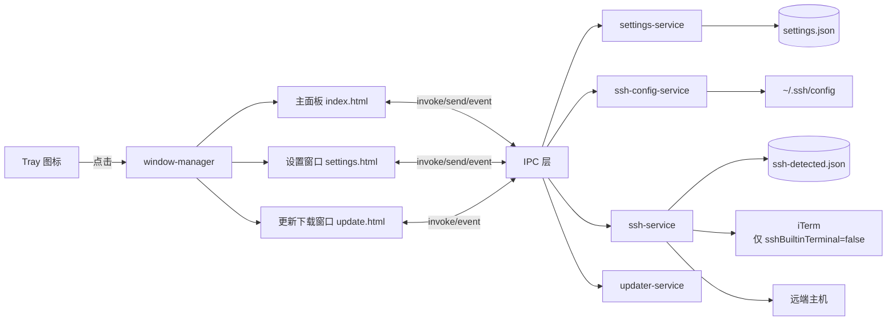
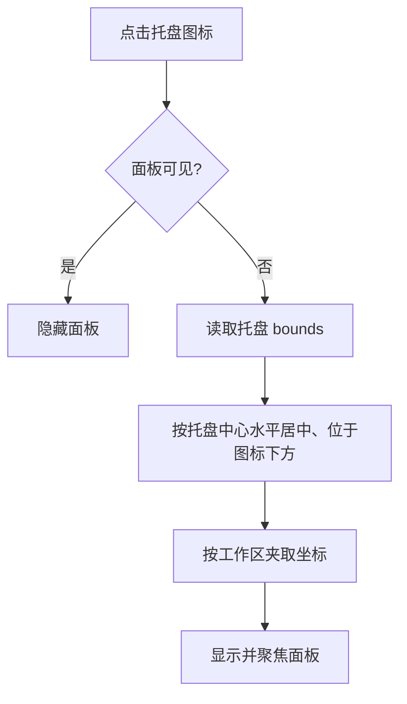
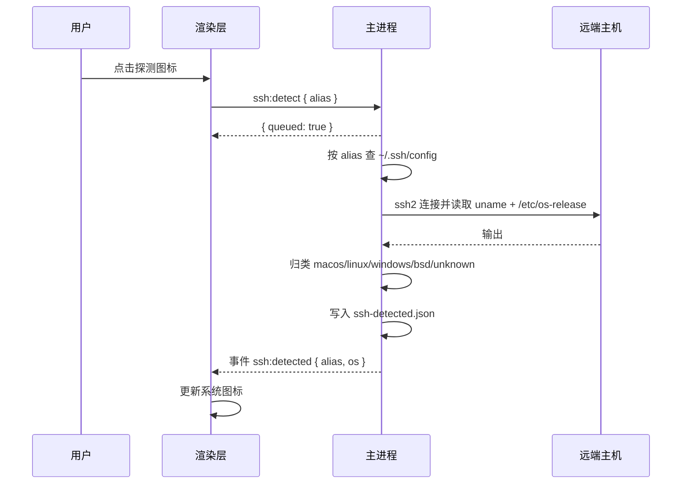
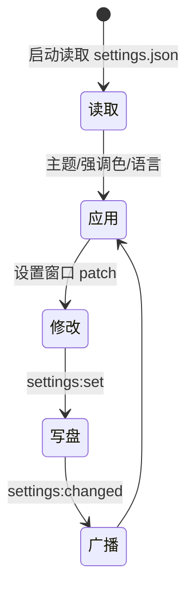
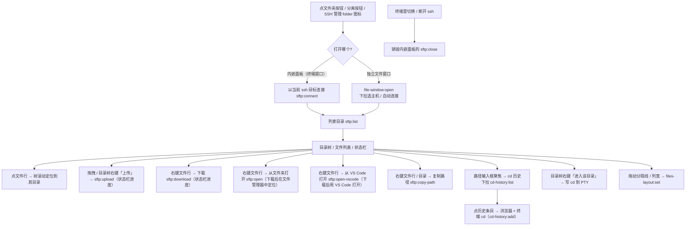
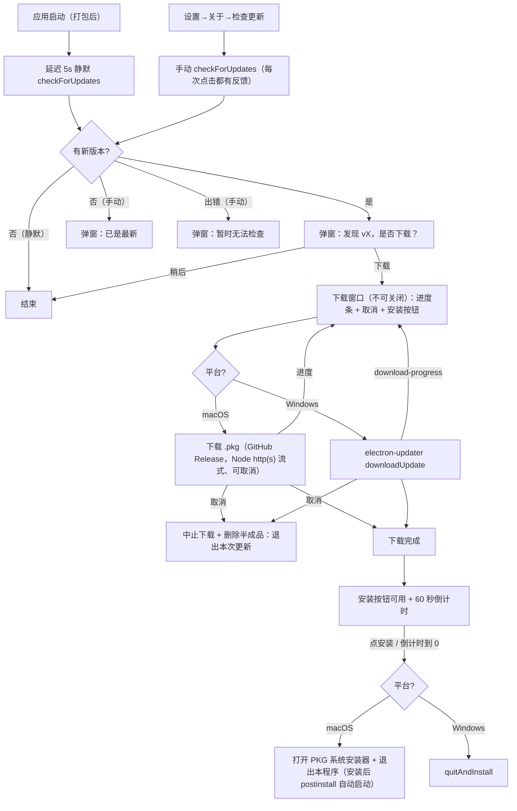

# Vessel 产品需求文档（PRD）

| 项目 | 说明 |
| --- | --- |
| 产品名称 | Vessel |
| 产品定位 | 面向开发者的 macOS 菜单栏（Tray）工具箱，点击托盘图标在下方展开轻量面板 |
| 技术栈 | Electron 44（主进程）+ Tailwind CSS 3（界面样式）+ 原生 JavaScript（渲染层，无打包器）+ ssh2（SSH 探测）+ qrcode-generator（二维码生成）+ bwip-js（Data Matrix 生成）+ electron-liquid-glass（macOS 26+ 原生 Liquid Glass，可选）+ electron-updater（自动更新）+ @xterm/xterm 与 @xterm/addon-fit（设置页内嵌终端）+ python3（PTY 桥接脚本）+ 本地 geoip.json（IP 归属地） |
| 支持平台 | macOS（arm64 / x64；当前主要面向 arm64） |
| 当前版本 | 4.3.0 |
| 发布方式 | 本地/CI 通过 `electron-builder` 打包 macOS arm64 **PKG**（`pnpm dist:mac`），安装完成后由 postinstall 自动启动；打 `v*` tag 时发布到 GitHub Releases；macOS 更新用 GitHub Releases API 检测并下载 PKG 打开安装器，Windows 走 `electron-updater` 自动安装（见 §7）；暂未签名 / 公证 |

**核心设计**：应用常驻系统托盘、不占用 Dock。主界面有**两种模式**（设置 → 应用 → 悬浮模式切换）：**窗口模式（默认）**为**固定 640×480（不可缩放）**的独立标准窗口，点托盘就在**当前桌面**显示 / 带到前台、打开期间不跨桌面跟随、**只记忆位置**（不记桌面 / 屏幕）；**悬浮模式**为托盘图标正下方弹出的 400×500 圆角面板。两种模式都以顶部 TAB 切换工具、底部显示版本与设置入口；所有输入实时反馈，无需点击“计算”按钮。

---

## 1.1 阅读与维护规则

- 本文件是 Vessel 行为的**唯一事实来源**：先读本文件、再读代码，不凭猜测改代码。
- **改代码必须同步改文档**，不得只改其一；文档与实现不一致时**以代码为准**（先核对主进程 / 预加载 / 渲染层入口，再修文档）。
- 对外接口必须写清：**签名、可用范围、是否持久（刷新 / 重启是否丢失）、副作用条件与示例**。
- 版本号变更时，同步更新本文件内所有版本引用（含示例）。

### 变更类型 → 需同步章节

| 变更类型 | 需同步章节 |
| --- | --- |
| 新增 / 删除工具 | §4 主要功能清单、§11 GUI 与布局规范 |
| 修改现有工具的交互 / 控件 | §4 主要功能清单、§11 GUI 与布局规范 |
| 新增 / 修改 IPC 通道 | §5.2 IPC 通道三张表、§2.1 安全模型、对应流程 |
| 修改窗口行为 / 尺寸 | §2.1 进程模型、§4、§8 主界面布局、§11 GUI 与布局规范、`package.json` 的 `vessel` 配置 |
| 修改设置项 | §3 核心流程、§5.1 本地数据、§4 功能清单 |
| 修改 SSH 相关行为 | §3 核心流程、§5.1 本地数据、§5.2、§6 流程图 |
| 修改样式常量 | §11 GUI 与布局规范、`src/renderer/styles/constants.css` |
| 新增 / 修改图标 | §8.3 图标与资源、`assets/icons/`（SVG）与 `assets/imgs/`（位图） |
| 修改 GeoIP / 国旗 | §2.1 项目结构、§5.2 `geo:lookup`、§8.3、`assets/geoip.json` / `assets/flags/` |
| 修改构建 / 脚本 / 依赖 / CI | §7 构建与发布、`package.json`、`pnpm-lock.yaml`、`.github/workflows/*.yml` |

---

## 2. 项目概述

- **产品定位**：一个常驻 macOS 菜单栏的开发者工具箱，把高频小工具与 SSH 管理收纳进一个托盘弹出的面板。
- **技术栈**：Electron 44；界面使用 Tailwind CSS 3 编译产物 + 原生 JS（`window.Vessel*` 命名空间）；SSH 探测使用 `ssh2`；原生玻璃使用 `electron-liquid-glass`（N-API 原生插件，macOS 26+ 生效，旧系统 / 非 macOS 由主进程回退，见 §8.1）。
  - 说明：AGENTS 建议界面优先 Vue 3；当前实现选用**无打包器的原生 JS + Tailwind**，以减小体积、避免引入前端构建链，后续如需可平滑替换为 Vue 3。
- **支持平台**：macOS（Darwin）。代码通过 `process.platform` 判断，非 macOS 下托盘行为与登录项设置自动降级。
- **当前版本**：4.3.0。
- **发布方式**：通过 `electron-builder` 打包 macOS arm64 PKG 安装包，见 §7。

### 2.1 架构原理

**进程模型**

- **主进程**（`src/main/`）：创建托盘与窗口、读写本地数据、解析 `~/.ssh/config`、执行 iTerm 连接与 SSH 探测、注册 IPC。
- **预加载脚本**（`src/preload/`）：在 `contextIsolation: true`、`nodeIntegration: false`、`sandbox: false` 下运行，用 `contextBridge` 暴露白名单 API（主面板用 `main-preload.js`，设置窗口用 `settings-preload.js`）。
- **渲染进程**（`src/renderer/`）：多个页面 —— 托盘主面板 `index.html`、设置窗口 `settings.html`、置顶终端窗口 `terminal.html`、独立文件窗口 `file-window.html`、更新下载窗口 `update.html`；不含 Node 能力，仅通过 `window.ships`（能力）、`window.shipsIcons`（内部 SVG 图标）与 `window.shipsFlags`（国旗 SVG）与主进程 / 预加载通信（更新下载窗口用独立预加载脚本，只暴露更新相关能力）。
- **无 Webview**：不内嵌远程 Web，无 guest 进程。

**项目结构**

```
Vessel/
├── package.json                 # 依赖、脚本、vessel 系统配置段
├── tailwind.config.js           # Tailwind：颜色/圆角/阴影/字体均映射到 CSS 变量
├── AGENTS.md                    # 客户端设计与编码约定
├── README.md                    # 英文说明（应用图标 + 简短概述，默认语言）
├── README.zh-CN.md              # 中文说明（同内容，与 README.md 顶部互相切换）
├── docs/PRD.md                  # 本文件
├── assets/
│   ├── icons/                   # 应用内部使用的 SVG 图标（kebab-case，统一由预加载读取）
│   ├── imgs/                    # 位图资源：应用图标 / 托盘 / 打包
│   │   ├── trayTemplate.png     # 托盘模板图标（18/36/54 @1x/@2x/@3x）
│   │   ├── app.png              # 应用图标（512，README 引用）
│   │   └── icon.icns            # 打包用 macOS 图标
│   ├── flags/                   # 国旗图标（`<CC>.svg` 长方形 / `<CC>_1x1.svg` 方形）
│   └── geoip.json               # IP 归属地数据库（单行大文件，由 geo-service `require`）
├── .github/workflows/build-mac.yml  # CI：构建 macOS arm64 PKG
├── scripts/                     # 构建 / 工具脚本（不打包进产物）
│   ├── capture.cjs              # 开发用 UI 截图 / 操作脚本
│   ├── dist-mac.sh              # dist:mac 包装脚本：选择签名方式
│   ├── after-pack.cjs           # electron-builder afterPack：asar 加固 + fuses + ad-hoc 签名
│   ├── adhoc-sign.sh            # 未配置正式签名时对 .app 做 ad-hoc 签名
│   ├── pkg-scripts/             # PKG 安装前退出已运行的 Vessel，安装后自动启动新版本
│   ├── notarize.cjs             # electron-builder afterSign：按需公证
│   └── gen-icons.mjs            # 零依赖 PNG / icns 图标生成脚本
└── src/
    ├── shared/constants.js      # 主进程与预加载共享：IPC 通道、窗口配置、默认设置
    ├── main/
    │   ├── main.js              # 应用入口：单实例、Dock 隐藏、注册 IPC、创建托盘
    │   ├── tray.js              # 托盘图标与右键菜单
    │   ├── window-manager.js    # 主面板 / 设置窗口 / 置顶终端窗口的创建、定位、几何记忆、显隐、广播
    │   ├── ipc/                 # IPC 处理器（app / settings / window / shortcut / ssh / geo / clipboard / hash / nutrient / twofa / net-test / terminal / sftp / file-window / update）
    │   ├── scripts/             # pty-bridge.py（PTY 桥接，交互终端用；打包时经 build.asarUnpack 解包到 app.asar.unpacked）
    │   ├── services/            # settings / ssh-config / ssh / iterm / terminal / sftp（文件管理 SFTP 会话）/ layout（文件管理布局）/ cd-history（cd 历史）/ vscode（用 VS Code 打开本地文件）/ hotkey / geo / clipboard / hash / nutrient（营养成分 / TDEE 记录）/ local-network（启动时请求本地网络权限）/ totp（2FA 动态验证码，密钥加密存储）/ updater（自动更新）服务
    │   └── utils/               # logger / json-store / paths / utf8（UTF-8 保真解码 + 非法字节转义）/ net-test（网络测试命令与校验）/ window-geometry（终端窗口几何记忆的纯计算）/ process-tree（终端会话进程树里找 ssh 目标）
    ├── preload/                 # main-preload.js / settings-preload.js / update-preload.js（更新下载窗口，仅暴露更新能力）/ icons.js（assets/icons/*.svg）/ flags.js（assets/flags/*.svg）
    └── renderer/
        ├── index.html           # 托盘主面板
        ├── settings.html        # 设置窗口
        ├── terminal.html        # 置顶终端窗口（含内嵌文件面板）
        ├── file-window.html     # 独立文件窗口
        ├── update.html          # 自动更新下载窗口（不可关闭，进度 / 取消 / 重启）
        ├── scripts/             # theme / i18n / ui / registry / tool-order / app / settings / terminal（置顶终端）/ terminal-files（内嵌面板宿主）/ file-manager（文件管理 UI）/ file-window（独立文件窗口）/ update（更新下载窗口）
        │   ├── tools/           # 每个工具一个文件，注册进 ShipsToolRegistry
        │   └── settings/        # 设置分区，注册进 ShipsSettingsRegistry
        └── styles/              # constants.css（设计变量）+ tailwind.css（入口）
```

**安全模型**

- 渲染层隔离：`contextIsolation: true`、`nodeIntegration: false`；能力仅经 `contextBridge` 白名单暴露。
- 来源校验：主进程处理 SSH 连接 / 探测时**不信任渲染层传入的主机字段**，仅以 `alias` 在 `~/.ssh/config` 中查表后使用配置值（见 `ssh-ipc.js`）。
- 打开外链仅允许 `http(s)` 协议（`app:open-external`）。
- 数据落盘：设置与探测结果均为**非机密 JSON**，位于用户数据目录；`~/.ssh/config` 仅由用户本机维护。SSH 登录密码（可选）**以 AES-256-GCM 加密后保存在应用数据目录**（`ssh-credentials.json` + 随机密钥 `ssh-credentials.key`，均 0600），明文不落盘（见 §5.1）。2FA（TOTP）密钥同样**以 AES-256-GCM 加密保存**（`totp-accounts.json` + 随机密钥 `totp-accounts.key`，均 0600），密钥只在主进程内解密、**验证码由主进程计算**（见 §4「2FA 验证码」），明文既不落盘也不下发到渲染层。
- 日志：详细日志（`debug` 级）仅在调试模式（`VESSEL_DEBUG=1`（兼容旧 `SHIPS_DEBUG`） 或 `--debug`）输出；`info` / `warn` / `error` 始终写入当天日志文件；启动时始终打印数据文件清单与绝对路径。macOS 下日志写到 `~/Library/Logs/Vessel`，**Console.app 的「日志报告」会直接收录**，因此**不再做统一日志同步**；可在 **设置 → 日志** 配置**保留天数**（默认 7）并打开日志文件夹 / 控制台 App。
- 登录项：仅在值发生变化时调用 `app.setLoginItemSettings`，避免无意义报错。

**来源标识注入 / 常驻与托盘**

- 不涉及来源标识注入（无 Webview）。
- 常驻托盘：`app.dock.hide()`（由 `vessel.showDockIcon` 控制）后仅保留 Tray；`window-all-closed` 不退出应用；主面板关闭（隐藏）不影响进程。

---

## 3. 核心流程

### 3.1 启动

1. 请求单实例锁；已存在实例时聚焦主面板并退出新实例。
2. `app.whenReady()` 后：按需隐藏 Dock → 注册全部 IPC → 创建主面板（`show:false`）→ 创建托盘。
3. 打印版本、平台与数据文件清单。
4. 不显示任何窗口，仅托盘图标可见。
5. **提前请求本地网络权限**：主进程向本机各网卡广播地址与 mDNS 组播（`224.0.0.251:5353`）发送一次空 UDP 包，触发 macOS 15+ 的「本地网络」授权弹窗；失败静默忽略。

### 3.2 主界面显示 / 隐藏（点击托盘）

主界面模式由 `settings.floatMode` 决定（设置 → 应用 → 悬浮模式；**默认关 = 窗口模式**）。两种模式共用同一份渲染页面 `index.html`（`<html data-window-mode="window|float">` 切换外观）。

**窗口模式（默认，`floatMode = false`）**

1. 点击托盘图标 → 若窗口未创建则创建；每次显示依次 `win.show()` → `win.focus()` → `app.focus({ steal: true })` → `win.moveTop()`，确保在当前桌面直接浮出。
2. **只记忆位置，不记桌面 / 屏幕**：`setBounds(mainWindowBoundsForOpen())` 读取 `main-window.json` 的 `{ x, y }` 并夹回**当前鼠标所在屏幕**的工作区；无记录时在当前屏幕工作区居中。显示前先 `setVisibleOnAllWorkspaces(true)` 让窗口能在当前 Space 浮出，`show()` / `focus()` 后约 60ms 再 `false` 绑定到**当前桌面**；不再调用 `app.focus({ steal: true })`（它会激活应用并可能切回旧 Space）。
3. 窗口是**独立的标准窗口**（`titleBarStyle: hiddenInset` + 系统红绿灯），**普通窗口层级、不常驻置顶**（`alwaysOnTop: false`）。
4. **桌面归属**：窗口打开后固定在其所在桌面，切换桌面时不跟随（保持留在旧桌面）；把它关闭（隐藏）后从另一个桌面点托盘，会先临时加入所有桌面再绑定当前桌面，因此在**新桌面打开**，不会被拉回旧桌面。
5. 关闭按钮（系统红绿灯）= **隐藏**（应用常驻托盘）；`Escape` 亦隐藏。拖动后（防抖 400ms）与关闭前把 `{ x, y }` 写入 `main-window.json`。
6. 尺寸：**固定 640 × 480、不可缩放**（`package.json` 的 `vessel.mainWindow`）；窗口可拖动，位置跨显示保留（只记录坐标，不记录屏幕 / 桌面）。

**悬浮模式（`floatMode = true`）**

1. 点击托盘图标 → 记录托盘 `getBounds()`。
2. 计算 `x = 托盘中心 - 面板宽/2`，`y = 托盘底部 + gapBelowTray`（`package.json` 的 `vessel.window.gapBelowTray`，当前 **2px**，使面板紧贴菜单栏），并按所在显示器工作区夹取。
3. 显示并聚焦主面板。
4. 再次点击、或面板失焦（点击别处）时隐藏；`Escape` 亦隐藏。
5. 打开设置窗口会使主面板失焦并隐藏（与设置互斥）；若面板与设置窗口同时打开，面板失焦（含焦点转到设置窗口）同样自动隐藏。
6. **固定悬浮**（底部栏图钉，对应 `settings.pinWindow`）：开启后失焦不再隐藏、保持置顶，并允许通过底部左侧「应用图标 + 名称」拖动窗口，位置在多次显示间保留；再次点击取消时会立即隐藏，且下次显示重新回到托盘下方默认位置（未固定时窗口不可移动，始终吸附托盘）。

> 切换「悬浮模式」开关时，主窗口的创建项不同（无边框浮层 ↔ 标准窗口），主进程会**销毁并按新模式重建**主窗口（`window-manager.rebuildMainWindowForMode`，此时窗口通常隐藏）。

### 3.3 打开设置

1. 点击主面板右下角设置按钮，或托盘右键菜单“打开设置”。
2. 主进程先隐藏主面板，再创建/聚焦设置窗口（`titleBarStyle: hiddenInset`，普通可缩放窗口）。

### 3.4 SSH 连接

1. 工具列表点击某主机的连接图标 → `ssh:connect`（仅传 `alias`）。
2. 主进程按 alias 查询 `~/.ssh/config`，拼装命令：`ssh [-p 端口] [-i 私钥] [-J 跳板机] [user@]host`（端口为 22 时省略 `-p`）；当私钥为默认的 `~/.ssh/id_ed25519` 或 `~/.ssh/id_rsa`（含展开后的绝对路径）时**省略 `-i`**（ssh 会自动使用默认密钥）。
3. 命令交给**置顶终端窗口**（§3.9）执行：窗口未打开则先打开，然后把 `ssh …` 注入其 shell（不再调用 iTerm，因此不会切换桌面 / 空间）。**设置 → 终端** 里的「SSH 使用内置终端连接」关掉后，退回原来的 iTerm 方式。
4. **密码自动输入**：若该主机在设置里存过密码，注入命令时把解密出的密码交给终端会话；`terminal-service` 监听 PTY 输出，出现 `…password:` 提示时自动写入一次（60s 内有效、用后即清，不会在命令行参数 / 环境变量里出现）。仅**内置终端**支持（iTerm 方式不自动输入）。首次连接某主机时的**主机密钥确认**不是密码提示，仍需用户手动确认一次。密码加密存于本地（见 §5.1）。
5. 成功 / 失败在主面板顶部临时提示。

### 3.5 SSH 操作系统探测

1. 入口：设置 → SSH 管理 表单内的「探测系统」按钮（`ssh:detect-host`，可对**尚未保存**的主机探测）；主面板列表不再提供探测按钮。
2. 使用 `ssh2` 连接：代理 socket 先取 `SSH_AUTH_SOCK`，无则回退 `launchctl getenv SSH_AUTH_SOCK`（GUI 从 Finder 启动时不继承 shell 环境）；有 `IdentityFile` 时读取私钥。**支持密码认证**：优先用表单里填的密码，留空则回退到该别名**已保存的加密密码**（除非表单点了「清除密码」），并开 `tryKeyboard` 兼容用 keyboard-interactive 提交密码的服务器。执行 `uname -s; echo '|||'; cat /etc/os-release`；识别不到时回退 `cmd /c ver`。
3. 归类到具体系统 / 发行版：Linux 读取 `/etc/os-release` 的 `ID`（如 `ubuntu` / `fedora` / `arch` / `centos` / `debian` / `rhel` / `alpine` …），macOS 为 `macos`，BSD 为 `freebsd` / `openbsd` 等，Windows 为 `windows`；同时给出 `family`（`macos`/`linux`/`windows`/`bsd`/`unknown`）与显示名 `label`。
4. 结果（`{ os, family, label, at }`）写入 `ssh-detected.json` 并广播 `ssh:detected` 事件；渲染层据此更新左侧彩色系统图标与提示。
5. 表单内探测期间按钮显示「探测中…」且禁用；**探测成功后**才启用「保存」。**探测失败不清空表单**：已填写的别名 / 地址 / 用户 / 端口 / 私钥 / 跳板机 / 分组 / 密码都会保留，便于原地修改后直接重新探测（密码为内存草稿，不落盘）。
6. **日志**：探测的每一步（开始、目标、认证方式、执行命令、stdout/stderr、解析结果、连接报错）都会追加写入**当天的日志文件** `~/Library/Logs/Vessel/vessel-YYYY-MM-DD.log`（设置 → 日志 → 日志文件夹可打开所在目录）；便于排查本地网络 / 权限问题。
7. **macOS 本地网络权限**：Info.plist 含 `NSLocalNetworkUsageDescription`。**应用启动时会主动请求一次**（广播 + mDNS），macOS 15+ 首次访问局域网（如 192.168.x / 10.x）时会弹「本地网络」授权，需允许 Vessel，否则连接会被系统拦截（表现即“没有本地 SSH 探测权限”）；可在「系统设置 → 隐私与安全性 → 本地网络」中开启。

### 3.6 修改设置

1. 设置窗口任一控件变更 → `settings:set`（增量 patch）。
2. 主进程合并写入 `settings.json`，必要时应用登录项，并广播 `settings:changed`。
3. 主面板与设置窗口同步应用主题 / 强调色 / 语言；主题为“跟随系统”时监听 `nativeTheme` 的 `updated` 事件（广播 `theme:changed`）。
4. 副作用：`pinWindow` → `applyPin`；`vibrancy` → `applyVibrancy`（销毁并按新配置重建主面板，使原生 `vibrancy` 与 `roundedCorners` 同时生效），主面板同时更新 `<html data-vibrancy="on|off">`；`theme` → `nativeTheme.themeSource`（使原生材质与应用主题一致）；`terminalWindowWidth` / `terminalWindowHeight` → 已打开的终端窗口立即 `setSize`；`terminalAlwaysOnTop` → 终端窗口层级；`mainWindowHotkey` / `terminalHotkey` → `hotkey-service` 重新注册全局快捷键（先注销旧值，注册失败只记日志、不改设置，见 §3.9-8）。

---

### 3.7 远端文件（独立文件窗口）

主面板不再内嵌目录浏览：**SSH 管理**每行的 `folder` 图标改为**打开独立文件窗口**（§3.9-11）并自动连接该主机（`file-window:open`，`target` = 主机别名）。原来的主面板目录浏览（`ssh:list-dir` / `ssh:open-dir` / `ssh-browse-service` / `ls-listing` / `ssh-browse.json`）已整体移除。远端目录 / 文件的浏览、下载、上传统一由**文件管理**（§3.9-10 内嵌面板、§3.9-11 独立窗口）经 SFTP 提供。

---

### 3.8 网络测试（设置窗口）

1. **入口**：设置 → 网络测试（导航分区 `network`）；主面板底部栏的「网络测试」图标（`wifi`）会打开设置并直接定位到该分区（`window:open-settings` 携带 `section`）。
2. **执行位置**：自绘下拉选择 **本地** 或 `~/.ssh/config` 里的任一主机（主机多个分组时，两组之间显示分组小标题，见 §5.1）；选主机时整条命令包一层 `ssh … '<命令>'`，即在**该主机上**执行同一份命令（跳板机语义）。凭据沿用主机配置（端口 / 私钥 / ProxyJump）与 ssh-agent（`SSH_AUTH_SOCK` 优先取环境变量，回退 `launchctl getenv SSH_AUTH_SOCK`）；一次性执行、不分配 TTY。
3. **类型与端口**：**单行 TAB 式分段控件**（`ShipsUI.segmented` + `.segment-compact`，7 段）选择 **TCP / UDP / HTTP / ICMP / ARP / 扫描应用 / 扫描主机**（标签短，完整含义与命令见悬浮提示；列表在 `src/renderer/scripts/constants.js` 的 `NET_TEST_PROTOCOLS`，需与主进程 `src/main/utils/net-test.js` 的 `PROTOCOLS` 一致）。**ICMP / ARP / 扫描主机不使用端口**（端口禁用）；**扫描应用的端口可留空**（留空 = 扫该目标常用端口，填了 = 精确扫该端口）；端口默认 **80**、只接受 1–65535。目标支持 **IPv4 或网段**；**扫描主机必须填网段**（前缀 16–30，超出提示「网段前缀需在 16–30 之间」）。
4. **执行**：点「测试」→ `net-test:command`（`{ id, protocol, target, port, host? }`，`id` 是本节的终端会话）。主进程先校验（IPv4 / 网段 / 端口 / 协议白名单 / 主机别名，非法直接拒绝、绝不拼接未校验内容），先用 `Ctrl-U` 清空终端当前输入行并回车换行（避免覆盖上一条命令未换行的输出），再把命令**送进终端里正在运行的 shell**（等价于手敲：回显、Ctrl-C、管道、重定向都走真实终端）：
   - TCP → `nc -vz -w 3 <ip> <port>`；UDP → `nc -uzv -w 3 <ip> <port>`
   - HTTP(S) → `curl -Ikm8 http(s)://<ip>:<port>/`（443 用 https）
   - ICMP → `ping -c 4 <ip>`；ARP → `arp -n <ip>`
   - 扫描主机 → `nmap -sn <网段>`；扫描应用 → `nmap -sT [-p <port>] <目标>`（connect 扫描，无需 root）
   执行位置选了 SSH 主机时，整条命令包一层 `ssh … '<命令>'`（在那台机器上跑同一份命令）。「停止」= 向终端发送 `Ctrl-C`。
5. **交互终端**：xterm.js + **真实 PTY**。PTY 由 `src/main/scripts/pty-bridge.py`（Python 标准库 `pty`）创建，运行**用户默认登录 shell**（`$SHELL`，回退 `os.userInfo().shell`，最后 `/bin/sh`）：可直接敲命令、`clear` / `Ctrl-L` 清屏、`Ctrl-C` 中断、`cd` / 管道 / 重定向，以及需要终端的交互式工具（`vim`、`sudo` 密码提示等）。键盘输入经 `terminal:input` 写入 PTY，输出经 `terminal:data` 原样回传（含 ANSI），`TERM=xterm-256color`；终端尺寸随面板自适应（`FitAddon`），并在变化时通过 `terminal:resize` → `TIOCSWINSZ` 同步给 PTY。会话由 `terminal-service` 统一管理（带 id，可同时存在多个：设置页一个、置顶终端窗口一个）。需要系统提供 `python3`：打包后脚本位于 `Contents/Resources/app.asar.unpacked/src/main/scripts/pty-bridge.py`（`build.asarUnpack` 含 `src/main/scripts/*`，因为 `app.asar` 内的脚本无法执行），`terminal-service` 会把 `app.asar` 路径改写为 `app.asar.unpacked`；解释器依次探测 `/usr/bin/python3`、`/opt/homebrew/bin/python3`、`/usr/local/bin/python3`（可用 `VESSEL_PYTHON`（兼容旧 `SHIPS_PYTHON`） 覆盖），都找不到时用 PATH 里的 `python3`，脚本缺失则在终端里报错。
6. **会话生命周期**：进入分区自动启动会话；shell 退出（如输入 `exit`）后终端提示「会话已结束」，此时敲任意键或点「测试」会重新启动；离开分区、关闭窗口、退出应用都会结束会话（`terminal:kill`；主进程 `before-quit` 调 `killAll()` 兜底）。

------

### 3.9 置顶终端窗口（Steam 式悬浮）

1. **入口与多窗口（Steam 式独立）**：主面板底部栏的**终端图标**（`terminal`）**每次点击都新开一扇独立的终端窗口**，落在**当前桌面 / 鼠标所在屏幕**（`terminal:open` → `openTerminalWindow()`；几何沿用 `terminal-window.json` 记忆）；已有多扇时，新窗口相对记忆位置**逐扇偏移 26px**（并夹回该屏工作区），避免完全盖在一起。**窗口一旦打开就永远留在那个桌面**——不同桌面可以同时存在多扇终端，且**绝不**把别的桌面上已打开的窗口拉过来（已移除原来的「先 true 再 false」跨桌面拉取）。**全局快捷键**（§3.9-8）在当前终端前台时按 = **收缩成悬浮球**（球态时按 = 放大回窗口），否则新开一扇。**SSH 连接**（§3.4）注入命令到**当前聚焦的终端**；没有聚焦的终端时新开一扇。多扇终端窗口各自持有独立的会话、文件面板与 SFTP 连接（按 webContents 归属）。
2. **窗口**：默认 **1024 × 768**（`vessel.terminalWindow.width/height`，**可在 设置 → 终端 → 窗口大小 调整**，见 §5.1；`terminalWindowWidth` / `terminalWindowHeight`），可缩放、最小 `vessel.terminalWindow.minWidth × minHeight` = 350×200；改设置立即 `setSize`，手动拖动窗口（非最大化 / 全屏）防抖 400ms 写回设置。`titleBarStyle: hiddenInset`，但**系统红绿灯由主进程 `setWindowButtonVisibility(false)` 隐藏**，头栏左侧改为**自绘小红绿灯**；终端内容**上下不留边距、左侧留 2px**（`--term-padding-y: 0`，`#term-host` 左内边距 2px；`vim` 之类的全屏程序左右基本铺满）；**打开后自动聚焦 xterm 输入**（窗口每次获得焦点也会重新 `term.focus()`）；窗口可自由拉伸，**拖动过程中不干预**（下边框严格跟手、绝不中途改尺寸），松手后按实测余量把窗口对齐到整格（见下条）。
   - **头栏（`#term-header`，默认 22px）**：左侧自绘小红绿灯（**尺寸随头栏字号缩放**：`--traffic-size = 字号 × 0.75`、`--traffic-glyph-size = 字号 × 0.5`，12px 字号 = 9px 圆点 / 6px 符号；**左右 padding 均为 10px**：左边距 10px = 第一个圆点到窗口左边缘的距离、右侧图标区距右边缘 10px；悬浮符号 `×` / `−` / `⤢`，颜色取 `--traffic-*`；悬浮任意一个时三个都显示符号，窗口失焦时整体变灰并隐藏符号 —— 与系统观感一致），点击分别调 `window:control` 的 `close` / `minimize` / `zoom`（只作用于发起窗口）；**不显示任何标题文字**（当前 SSH 信息仅用于内部逻辑，不在头栏显示，见下条），右侧图标区（**SSH 主机下拉** + **文件** `folder`、**在 iTerm 中打开并关闭此窗口**、**行号** `eye`/`eye-off`、**窗口分裂** `split`（点击**新开一扇终端窗口**，与主面板底部栏的终端按钮行为一致）；**已去掉置顶（图钉）按钮**，置顶只由设置里的 `terminalAlwaysOnTop` 决定）。头部不挂 `data-tip` 悬浮提示，为拖拽区（红绿灯与图标区为 `no-drag`）。
   - **头栏尺寸随终端字号缩放（永远 = 终端字号 + 1px）**：字号取 CSS 变量 `--term-header-font-size`（`styles/constants.css` 定义、`terminal.js` 的 `applyFontSize()` 在改设置 / `Cmd +`/`Cmd -`/`Cmd 0` 缩放时写入为 `终端字号 + 1`）；头栏高 `max(22px, 字号 + 6px)`、图标按钮 `字号 + 6px`（符号 `字号`）、SSH 下拉**固定 120px 宽**（与下拉条目同宽，超出省略号）/ 字号**固定 11px**（与终端字号无关）/ 高 **固定 14px** 且在头栏内**上下居中**，下拉箭头也固定 11px。下拉菜单（挂在 `body` 上）宽度 **120px**（与下拉同宽、左右对齐；`createSelect` 传 `matchTrigger: true`，打开时把菜单宽设为触发器实测宽度）、**条目 `width: 100%`、高 20px、四周留 3px（菜单 `padding: 3px` + 条目间距 3px）、字号 11px、圆角 5px**（悬浮高亮为固定宽度的内缩圆角矩形，与右键菜单观感一致）、**无分隔线**。
    - **头部 SSH 下拉**（图标区最左）：列出 `~/.ssh/config` 里的主机，条目文本为 `用户名@主机地址`（无 `User` 时只显示主机地址）；占位「SSH」**只显示在触发器上（未选择时），不出现在下拉列表里**。列表顺序为**有分组的主机在前（按分组在配置中出现的顺序）、未分组的主机排最后**；**存在多个分组时在每组条目前插入一个分组小标题**（不可点，未分组组的标题为「未分组」；只有一个分组时不显示标题）——分组来自 config 的 `# group:` 注释（见 §5.1）。**设置页对主机 / 分组的增删改会经 `ssh-config:changed` 广播，下拉实时刷新**。选中任意主机 → `ssh:connect`（带 `inTerminal: true`）→ 由主进程用 `ssh-service.buildCommand()` 拼 `ssh [-p 端口] [-i 私钥] [-J 跳板机] [user@]host` 并**注入当前终端会话**（等价于在这个终端里手敲 `ssh …`，不新建会话、不重建窗口、不弹 iTerm —— 因此也不受「SSH 使用内置终端连接」开关影响）；**同一台主机可以重复选**（每次选择都重新执行，便于断开后重连）。下拉**禁用**并降低不透明度当 `~/.ssh/config` 里没有主机；主机列表在窗口启动与 `settings:changed` 广播时重新读取。控件用 `select-compact`，宽度**固定 120px**、高 14px，与头部图标按钮同一观感。
   - **屏幕 / 位置 / 尺寸记忆**（`terminal-window.json`，单槽）：打开、移动、缩放、关闭时把「所在屏幕 + 位置 + 尺寸」写入 `terminal-window.json`（关闭前同步落盘，拖动后立刻关窗也不会丢；写盘读窗口**此刻**的真实几何，程序化改尺寸不会被旧快照覆盖）。下次打开时：**该屏幕还在**（`id` + `scaleFactor` + `bounds` 全一致）→ 应用记忆的位置与尺寸（越界部分夹回该屏幕工作区，整窗可见）；**换屏 / 拔掉外接屏 / 分辨率或排列变了 / 无记录** → 用设置里的默认尺寸在当前屏幕（鼠标所在屏幕）工作区内居中。屏幕签名一致才复用，是因为分辨率 / 排列变化后记忆里的绝对坐标不再是同一块屏幕上的同一位置。**拖动时水平磁性吸附**：窗口中心与屏幕工作区的**垂直中线**（x 方向）对齐（±10px）时吸附到正中并轻微「卡」住，拖动超过 26px 才脱开（`CENTER_SNAP.xThreshold` / `xRelease`，仅改 x、不要求上下居中；与窗口模式主窗口同一行为）。
3. **置顶与全屏**：默认置顶（`vessel.terminalWindow.alwaysOnTop` / `settings.terminalAlwaysOnTop`，缺省为开；`alwaysOnTop` 且 `setAlwaysOnTop(true, 'screen-saver')`）。**头栏没有置顶（图钉）按钮**，置顶只由设置 `terminalAlwaysOnTop`（`terminal:set-top` 仍可被设置界面 / 其它入口调用）决定。**该开关只作用于终端窗口，不影响主面板**（悬浮面板恒定置顶；窗口模式不置顶，见 §8.1）。空格行为是 `setVisibleOnAllWorkspaces(false, { visibleOnFullScreen: true, skipTransformProcessType: true })` = `NSWindowCollectionBehaviorDefault | FullScreenAuxiliary` —— **带全屏辅助、但不加入所有桌面**：可以浮在（当前桌面里的）全屏应用之上，同时**不会跟随桌面切换**，始终留在打开它的那个桌面。**该声明在窗口创建时、以及每次获得焦点时（此刻窗口就在活动桌面上）执行**（`skipTransformProcessType: true`：应用已是 `LSUIElement` 菜单栏 Agent，无需进程类型转换，转换会短暂隐藏窗口 / Dock 并改变激活行为）；**变球时不再重新声明**（变球发生在用户已切到其它桌面之后，此时再设会按 macOS 语义把窗口重新分配到「当前活动桌面」→ 球会跟着切换桌面，见 §3.9-12）；放大回来时最后重申一次，便于经全局快捷键把窗口带到当前桌面。iTerm 会强制切桌面，所以 SSH 连接改走这里。
4. **终端**：与 §3.8 同一套 xterm.js + `pty-bridge.py` 真实 PTY，运行 shell（取设置 → 终端的**默认 shell**，`terminalShell`；留空或文件不存在时回退 `$SHELL` / `os.userInfo().shell`）；**滚动缓冲与字号取设置**（`terminalScrollback` / `terminalFontSize`，默认 10000 行 / 12px；`app:info.terminalScrollback` 仅作为配置缺失时的兜底）；窗口尺寸变化会同步 PTY 尺寸，关闭窗口即结束会话。
   - **不显示滚动条**：两处都关掉 —— ① 原生滚动条：`.xterm-viewport` 用 `scrollbar-width: none` / `::-webkit-scrollbar { display: none }`（`xterm.css` 先于本应用样式加载，保证规则生效）；② **xterm 自绘的滚动条**：`.xterm .xterm-scrollable-element > .scrollbar { display: none !important }`（xterm 6 只是用该元素做视觉指示，缓冲区滚动由它自己处理，隐藏后滚轮 / 触控板照常滚动）。主题里同时给出 macOS 风格的滑块色（`scrollbarSliderBackground/Hover/Active`）作为兜底，万一再出现滚动条也是圆角半透明样式。
   - **防跳变**：只在容器尺寸真的变化时 `fit()`，且只在 `cols`/`rows` 变化时才 `terminal:resize` —— 多余的 PTY resize 会让 shell 重绘，看起来像滚动时视图跳。
   - **会话结束即关窗**：在终端里 `exit`（或 `Ctrl-D`）结束 shell 后，主进程发出 `terminal:exit`，渲染层先把 `sessionId` 清空（免得 `beforeunload` 再去 kill 一个已消失的会话）再直接 `window.close()` —— **窗口自动关闭，不再显示「会话已结束」之类的提示**。只有会话**启动失败**（`type: 'error'`，例如 PTY 桥接脚本缺失 / 无法启动）才保留窗口，并把原因用红字写在终端里，便于排查。
   - **尺寸测量**：xterm 挂在**无内边距**的 `#term-fit`（`h-full w-full`）里，留白由外层 `#term-host`（四边 0）提供 —— `FitAddon` 按「父元素的 border box 高度」算行数，若父元素自带内边距会把可用高度多算一份内边距（默认窗口下多算 19.5px ≈ 1 行），于是最后一行被裁掉大半行、页面还多出几像素可滚动高度（滚轮时标题跟着上下动）；父元素无内边距时测量值即真实可用区。`#term-host` 与页面根容器另加 `overflow: hidden` 兜底：即使残留绝对定位元素（如 xterm 的 `xterm-helper-textarea`）越界，也不会让页面可滚动。
    - **字号缩放**：按 `Cmd + =` / `Cmd + -` 只改终端字号（8–24px，初始值取设置里的字体大小），标题栏与图标不缩放（实现见 §5.3）；`Cmd + 0` 复位到设置值。**在 设置 → 终端 改字体大小会即时生效**：终端窗口也在 `settings:changed` 广播名单里（`window-manager.broadcast`），只有设置值本身变化时才覆盖当前字号，临时缩放不会被别的设置变更顶掉。
    - **右键快速编辑（Windows cmd 风格）**：终端内容区**单击右键**即完成复制 / 粘贴，**不弹右键菜单**。有选区时右键 = **复制选区到系统剪贴板并清除选区**（`terminal:copy-text`）；无选区时右键 = **把系统剪贴板文本粘贴进当前 shell**（`terminal:paste-text`，经 `term.paste()` 注入，遵循 bracketed paste 与 `\n → \r` 转换）并让终端重新获得焦点；无会话时粘贴忽略。仅在终端内容区（`#term-fit`）生效，头栏不受影响，且请求只接受来自终端窗口本身。
    - **当前 SSH 目标检测（不在头栏显示）**：`terminal-service` 每秒用 `/bin/ps -A -o pid=,ppid=,command=` 取一次进程表，在**该会话进程树**（会话根 = `pty-bridge.py`，其子进程 = 登录 shell）里广度优先找**最近的 `ssh` 进程**，取命令里第一个非选项参数作为目标（`ssh -p 22 user@host` → `user@host`；`sshpass`/`autossh` 也会落到其 `ssh` 子进程）。目标同时给出显示标签（命中 `~/.ssh/config` 别名时解析成 `user@hostname`）与**原始目标 token**；值变化时经 `terminal:session` 事件推给渲染层（仅变化时推送），会话结束 / `exit` 后清空。该目标**不显示在头栏**，仅用于：启用/禁用头部**文件按钮**、驱动内嵌文件面板与独立文件窗口的 SFTP 连接。手动敲 `ssh …`、头部 SSH 下拉两种方式都能被识别。
   - **留白与整格对齐**：终端主体 `#term-host` `padding: var(--term-padding-y) 0 var(--term-padding-y) 2px`（上下 0、**左 2px**、右 0；`#term-fit` 仍是无内边距的那层，保证 `FitAddon` 量到真实可用区）。窗口尺寸保持在「行高 / 列宽的整数倍 + chrome」：
     - **列数自己算**：`FitAddon` 只要 `scrollback > 0` 就固定预留 14px（给 overview ruler），会让终端比窗口窄、右侧空出一条白边（我们本来就隐藏滚动条）。`fitIfNeeded()` 里 `fit.fit()` 之后按实测单元格宽度重新 `term.resize(cols, rows)`，列数铺满可用宽度。
     - **拖动期间一律不改窗口尺寸**：不用 `will-resize` 拦截、也不 `setBounds`（中途改帧会打乱 macOS 的增量拖拽跟踪 → 越拖越小 / 反复跳变）。`will-resize` 只用来标记「正在拖动」并广播 `terminal:drag-active`；渲染层收到后**不再发对齐请求**（请求即使到了主进程也只会被挂起），下边框严格跟手。
     - **松手信号**：拖动中渲染层收不到鼠标事件，因此「鼠标重新出现在终端内容区」（`mousemove`）即视为松手 → 重新 `fit()` + 对齐；同时拖动空闲 380ms 后主进程会发 `terminal:recalibrate` 兜底。挂起的旧请求一律作废，绝不套用过期的数值。
      - **页面缩放固定为 1**：终端窗口（及独立文件窗口、主面板、设置窗口）加载后强制 `setZoomFactor(1)`（并在 `zoom-changed` 时归零）—— Electron 会按 origin 记住页面缩放，历史缩放会让 renderer 的 CSS px 与窗口内容尺寸（DIP）不再相等，导致整格对齐算错。`Cmd +/-` 只改字号（§5.3），不改页面缩放。
      - **对齐按 chrome 计算、四舍五入到整行 / 整列**：`chrome = 窗口内容尺寸 − 终端区尺寸`（头栏 / 分隔线 / 文件面板 / 状态栏等固定部分）。终端区尺寸**四舍五入**到最近的整行 / 整列（余量 > 半格就补一行 / 一列，否则收掉余量），目标 `内容高 = chrome高 + 行数×行高`、`内容宽 = chrome宽 + 列数×列宽`，与当前相差 **≥2px** 才经 `terminal:snap-size` 设置（1px 死区，避免取整抖动）。主进程还有 60px 的安全上限，偏差过大宁可不做。首次打开、改字号、设置里改窗口大小、打开 / 关闭文件面板都会走这条路径。
      - **单元格尺寸用 xterm 的稳定值**：行高 / 列宽取自 `term._core._renderService.dimensions.css.cell`（不随列数 / 行数变化）；退化时才用「屏幕宽 ÷ 列数」。否则「屏幕宽 ÷ 列数」会随列数取整而抖动（798↔799、91↔92 列），导致窗口反复微调。`fitColumns` 也用同一稳定值。
      - **松手即对齐（不依赖 will-resize / mousemove）**：渲染层在 `window` 的 `resize` 上**防抖 120ms**（= 松手）后清除「拖动中」标记并重新 `fit` + 对齐；主进程在拖拽空闲约 160ms 后也会无条件发一次 `terminal:recalibrate` 兜底。两种信号触发同一段「清除标记 → 重新测量 → 按 chrome 对齐」逻辑，所以拖动完成后即便鼠标不再移动、行数 / 列数没变，也会自动对齐（响应更快）。
      - **拖动 / 缩放期间**头栏中间显示 `列 × 行`（`#term-size`，等宽小字、`pointer-events: none`），停手 700ms 后自动隐藏。
      - **尺寸 / 字体度量日志**：窗口尺寸变化时经 `log:write` 把当前**字体大小、行高、列宽、窗口 / 内容尺寸、列 × 行**写入**控制台与当天日志文件**（`[term-metrics] font=…px lineHeight=…px colWidth=…px window=…x… content=…x… cols=… rows=…`），便于排查行高 / 窗口对齐问题。
      - **行号（`eye` 按钮，默认关闭）**：开启后在终端**最左侧**显示每行的行号，**按当前窗口编号——第一行永远是 1**（`1..rows`，两位、不足补 0，不随滚动变化）；开启时给 `#term-host` 让出左侧宽度（`#term-gutter`），窗口重新 `fit` 并整格对齐。
      - **`Cmd +/-/0` 直接改设置里的字号**：`menu.js`/`zoom-changed` 路由到渲染层后写入 `settings.terminalFontSize`（持久化，重开终端保留），**不再改页面缩放因子**（缩放因子固定为 1，头栏 / 图标尺寸不变）。

5. **窗口分裂**：头部**窗口分裂**图标（`split`）点击后**新开一扇终端窗口**，行为与主面板底部栏的终端按钮一致（`terminal:open` → `openTerminalWindow()`，落在当前桌面 / 鼠标所在屏幕，几何沿用记忆并逐扇偏移 26px，见 §3.9-1）。原「复制全部内容」按钮与功能已整体移除（终端右键快速编辑的复制选区仍保留，见 §3.9-4）。
6. **iTerm 交接**：头部终端图标调用 `iterm-service.openCommand()` 在 iTerm 中重放**最后一次由外部注入的命令**（例如 SSH 连接 / 网络测试命令；没有则开一个登录 shell），成功后关闭当前终端窗口。
7. **SSH 连接改走这里**：`ssh:connect`（§3.4）默认不打开 iTerm，而是把 `ssh …` 命令注入**当前聚焦的终端窗口**（没有聚焦的终端就新开一扇；窗口不跨桌面移动），失败时才提示错误；受 设置 → 终端 →「SSH 使用内置终端连接」（`settings.sshBuiltinTerminal`）控制，关掉后退回 iTerm（头部 SSH 下拉传 `inTerminal: true`，明确要求在**当前终端**执行，不受该开关影响，见第 2 条）。
8. **全局快捷键**（`hotkey-service`）：设置 → 快捷键 分别绑定**主窗口**与**终端**（`settings.mainWindowHotkey` / `settings.terminalHotkey`，默认都为 `CommandOrControl+Shift+Z`）。触发规则：**终端 = 按一下**；**主窗口 = 快速连按两下**。两者使用同一组合键时，单击会等待 `SHORTCUT_DOUBLE_TAP_MS`（260ms）以区分双击：双击 = 主窗口，单击 = 终端；绑定不同组合键时各自按上述次数工作。终端行为：**同时存在多扇终端窗口时快捷键失效（不响应）**；只有一扇时，在**悬浮球 ↔ 终端窗口**之间互相切换 —— 处于悬浮球时放大回窗口；窗口在前台时**收缩成悬浮球**；窗口既不在前台也非球态时**拉回前台**；一扇都没有则**新开一扇**（窗口不跨桌面移动）。**悬浮球关闭时回退为「关闭按钮行为」**（`hide` 隐藏 / `destroy` 销毁）。改绑 / 取消时先试注册，**注册失败（被其它 App 占用、格式非法）不写入设置**，设置界面红字提示并把原值留在设置里；空字符串 = 不注册（界面显示「未设置」）。应用退出（`before-quit`）时 `unregisterAll()`。
9. **关闭按钮行为**（设置 → 终端 →「关闭按钮行为」，`settings.terminalCloseAction`，默认 `destroy`，来自 `vessel.terminalWindow.closeAction`）：所有「隐藏终端」的路径统一走 `window-manager.shrinkTerminalToBall()` —— 悬浮球开启时**收缩成悬浮球**，关闭时才真正隐藏。
    - **`destroy`**：关闭按钮 / `Cmd-W` **直接销毁**（结束会话）。
    - **`hide`**：关闭按钮 / `Cmd-W` **收缩成悬浮球**（不再真正隐藏窗口；会话与 shell 保留，点球或快捷键放大回来，见 §3.9-12）。窗口 `close` 事件被 `preventDefault()` 拦下后走 `shrinkTerminalToBall`。
    - **最小化按钮禁用**：终端窗口头栏的「最小化」红绿灯**失效**（灰显、不可点）。
    - **例外**：在终端里 `exit`（会话结束）与「iTerm 交接」走 `terminal:destroy` → **始终销毁窗口**，不受上述规则影响 —— 否则会留下一个已结束的会话挂在后台。
    - **退出应用例外**：`app.quit()`（如托盘右键「退出 Vessel」）时主进程先置 `isQuitting`，终端窗口的 `close` 不再走 `preventDefault()`，而是正常关闭，保证退出不被拦截。
10. **内嵌文件面板（SFTP）**：头部 **文件按钮**（`folder`，仅当检测到当前 ssh 目标时可用，否则禁用；连接中图标旋转、展开时强调色）显隐**窗口底部的内嵌文件面板**（终端区域随之收窄并自动重新 fit）。面板与终端之间有一条**可拖动分隔线**（向上拖 = 终端变小、面板变高），高度持久化到 `file-layout.json`（见 §5.1）。文件管理 UI（左目录树、右文件列表、状态栏、可拖动分栏）由 **`scripts/file-manager.js`** 提供，终端窗口（`terminal-files.js`）与独立文件窗口（`file-window.js`）共用同一套（见 §3.9-11）。
    - **布局**：左列**目录树**占初始 **300px**（可在分隔线上拖动改变宽度；顶部路径行 = **分离为独立窗口 / 刷新 / 家目录 / 路径输入框**，顺序固定 —— 前三者为图标、排成一排，分离仅内嵌面板有，高度与右列表头一致）；右列**文件列表**表头与行均为网格（图标 / 文件名 / 体积 / **权限** / 时间；**文件名 / 体积 / 权限 / 时间四列列宽可拖动改变**，默认 **160 / 60 / 90 / 130px**）；列表头「时间」列只有标签（上传已移到**目录树节点右键菜单**，分离按钮已移到路径行）。文件行不再有行内下载按钮，改为**右键菜单「从文件夹打开」/「下载到本地」**。最底**状态栏**（左=当前绝对路径，右=状态信息，中间=**进度条**）。树宽与列宽一并持久化到 `file-layout.json`。字体与样式**跟随终端字号**（`--file-font-size`，`Cmd +/-`、`Cmd 0`、设置里的字体大小都同步作用到文件管理部分）。**面板默认隐藏**（ID 规则用 `:not(.hidden)` 保证不被 `.hidden` 覆盖），仅在点击头部文件按钮时展开。**终端与面板之间只有一条分隔线**（面板自身不再画上边框；分隔线就是那条可拖动的线）。
    - **首次打开自动放大**：若 `file-layout.json` **没有**本地调整记录，打开面板时按最小布局套用并把终端窗口**只放大不缩小**到够用 —— 终端 ≥ **300**、文件管理 ≥ **200**（目录树 **220**、文件列表 ≥ **400**），即内容区约 **626 × 550**（`terminal:ensure-size`，受屏幕工作区限制，不写回几何记忆）；有本地记录则完全按记录（含面板高度 / 树宽 / 列宽）来。
    - **交互**：树节点单击进入 / 展开（`caret-right` 展开时旋转 90°），目录树以 `/` 为根按需展开；路径输入回车进入（支持绝对路径 / `~` / 相对当前目录）；**点文件行**时左侧目录树滚动定位并高亮该文件所在目录节点（**任何导航**——目录树 / 路径输入 / cd 跟随 / 历史——成功后都会展开目录树到当前目录，确保该节点存在、点文件能定位）；**双击文件行**：体积 ≤ 10M 且为文本类型 → **从 VS Code 打开**；体积 > 10M 或为图片 / PDF / Word / Excel / 压缩包 / 音视频等**非文本类型** → **从文件夹打开**（用系统默认程序打开，行为同右键「从文件夹打开」）；**文件行右键 → 从文件夹打开 / 从 VS Code 打开 / 下载到本地**（「从文件夹打开」= 下载后由系统文件管理器定位该文件，「从 VS Code 打开」= 下载后由 Visual Studio Code 打开，「下载到本地」= 仅下载）；上传有两种方式：**拖拽本地文件到右列**，或**目录树节点右键「上传」**（打开系统文件选择窗口多选后上传到该目录，逐个显示进度）；**目录树节点右键「进入该目录」**（仅内嵌面板：在当前终端 `cd` 到该目录，并导航面板、记入 cd 历史）；**点「刷新」清掉状态栏提示**。**所有状态栏提示均保留 30 秒后惰性清除**（下一次设置会重置计时），且每次设置状态栏都会**同时写控制台日志与当天文件日志**（`log:write`，见 §8.6）。
    - **权限列**：由 SFTP `attrs.mode`（st_mode）格式化为 `drwxr-xr-x` 风格（类型字符 + rwx ×3）。
     - **PWD 跟随（cd 命令）**：终端里提交**纯 `cd …` 命令**时识别并导航。检测方式：按回车瞬间读取 xterm **当前行「光标之前」的文本**（`translateToString(false, 0, cursorX)`）再剥掉提示符（最后一个 `# `/`$ `/`% `/`> ` 之后）—— **这样能拿到 shell 回显后的真实命令、包含 Tab 补全结果，同时排除 zsh autosuggestion 之类的灰色建议**；读不到才退回键入跟踪（并跳过 ANSI / 括号粘贴序列）。解析：**相对路径按「终端 shell 的当前目录」`shellCwd` 解析**（初始 = 家目录、每次 cd 成功后同步；不按文件面板手动浏览到的目录，避免两者分叉），绝对路径 / `~` 直接解析；`shellCwd` 为估计值。**含 `..` 的相对路径（`cd ..` / `cd ../x`）一律不跟随**（无法可靠得知 shell 真实当前目录，避免导航到错误目录）；含 `..` 的绝对路径 / `~` 路径仍会规范化后跟随。文件面板若已连接就导航；**并展开该路径的所有上级目录、把目录树滚动定位到目标节点**（`expandTo` + `scrollTreeToSelected`），目标不存在则静默保持当前目录；手动导航 / 其它命令不触发跟随。**连接就绪前收到的 cd 会排队**，连上后跟随。
     - **cd 历史（路径输入框下拉）**：点「路径输入框」聚焦时，在其下方下拉出**该 ssh 目标（`用户名@主机`，由 `sessionKey` 解析）最近 cd 到的目录**（去重、越新越靠前、最多 **10** 条，`CD_HISTORY_MAX`）。点条目 → 文件浏览器与该终端（ssh）**同时前往该目录**（`navigate` + `onCd`）；独立文件窗口无终端时只导航。历史**只记录通过 cd 到达的目录**（终端 cd 跟随、`cd 到此目录` 按钮、点历史条目），**手动浏览不记录**；持久保存到 `cd-history.json`（按目标 key 分组），随「清理数据」可清除（见 §4）。
    - **连接凭据**：以当前 ssh 目标（§3.9-4 的进程树检测结果，如 `user@host` / 别名）为键 → 命中 `~/.ssh/config`（SSH 管理）记录时按记录的 `HostName`/`Port`/`User`/`IdentityFile` 连接（命令行给了同名用户时优先用命令行用户）；无记录时用命令里的用户名（缺省用本机用户名）+ 默认私钥 `~/.ssh/id_ed25519`。命中记录带 **ProxyJump 时 ssh2 不支持、连接失败并在状态栏提示**。SSH 私钥优先，其次 ssh-agent。
    - **状态机**：**检测到 ssh 目标即自动建立 SFTP 连接**（面板仍保持隐藏，状态栏显示「正在连接」）—— 这样终端里的 **cd 跟随在面板未展开时也生效**；点文件按钮展开面板（已连接则直接显示）；**再次点按钮只隐藏面板、保留连接**；手动切换 / 断开 ssh（目标变化）→ **销毁该 SFTP 连接**（面板随之收起）；连接失败（认证 / 超时 / ProxyJump / 无法启动子系统）只在状态栏提示。窗口销毁时该窗口的连接一并关闭。
    - **下载 / 上传进度**：下载与上传（含拖拽多文件逐个）都在状态栏用**进度条**显示百分比（主进程经 `sftp:progress` 事件回传 `transferred/total`）。下载保存到设置的下载目录（默认 `~/Downloads`，重名自动加 ` (n)`，见 §5.1），成功后状态栏显示本地路径。
11. **独立文件窗口**（`file-window.html`，见 §8.6）：文件管理可**分离为单独窗口**——内嵌面板**路径行最左的「分离为独立窗口」按钮**或 **SSH 管理的 `folder` 图标**（自动连接该主机）打开；点分离按钮时会**关闭并销毁当前内嵌容器**（连同其 SFTP 连接）再开独立窗口，并把**当前所在目录一并带过去**（`file-window:open` 带 `path`，连上后进入该目录；SSH 管理 `folder` 图标无当前目录则从家目录开始）。窗口与终端同为**悬浮 panel**：`alwaysOnTop`（默认开，由设置 `fileWindowAlwaysOnTop` 决定）、可浮在全屏之上但不跟随桌面切换、`titleBarStyle: hiddenInset` + 自绘小红绿灯（**头栏无置顶 / 图钉按钮**）；窗口底色随主题（避免拖动露白，同 §8.5）。**拖拽窗口高度后文件列表区域自动对齐到文件行的整数倍**（行高随字号，见 §8.6）。头栏含一个 **SSH 下拉**切换连接（列出 `~/.ssh/config`，选中即重连；占位「SSH」只在未选择时显示、不进列表，有分组的主机在前、未分组在后，存在多个分组时显示分组小标题，且随 `ssh-config:changed` 实时刷新，见 §3.9-2），**无终端**；字体 / 样式 / `Cmd +/-` 缩放与终端配置一致（用 `--file-font-size`，`file-window:zoom`），但**字号最小 13px**——终端字体小于 13px 时不再跟随；头栏与红绿灯同样随字号缩放。**连接与内嵌面板彼此独立**（各自一个 SFTP 会话，可各连不同 ssh），并**不随终端里的 ssh 关闭而关闭**。几何（屏幕 / 位置 / 尺寸）记入 `file-window.json`（单槽，同终端窗口的记忆方式）。
12. **悬浮球（失去焦点缩成圆形小窗）**：终端窗口**失去焦点后延迟 `terminalBallDelayMs`（默认 0.2s）**缩成一个 **`terminalBallSize`（默认 75px、宽高强制 1:1、40–200px）的圆形、无标题栏窗口**，形如悬浮球：
    - **开关与延迟**：设置 → 终端「自动缩成悬浮球」（`settings.terminalBallEnabled`，默认开）、「缩成悬浮球延迟」（下拉：立即 / 50ms / 100ms / 200ms / 500ms / 1s / 5s / 10s / 15s / 30s / 60s，默认 **50ms**；「立即」= 0ms）、「悬浮球大小」（`settings.terminalBallSize`，默认 75px，1:1）、「悬浮球图标」（`settings.terminalBallIcon`，选项为 `assets/icons/ball/` 下所有 SVG，默认 `ball.svg`，**实时生效**）、「终端暗色模式」（`settings.terminalBallDark`，默认**开** = **终端窗口整体（xterm 终端 + 悬浮球）始终暗色**；关 = **跟随全局主题**（亮 / 暗随 `data-theme`）；**悬浮球图标始终保留原色、不去色**）；实现：终端窗口在 `<html>` 置 `data-terminal-dark="on|auto"`（`terminal.js` 的 `applyTerminalDark`），开启时由 `constants.css` 把该窗口的主题变量整体覆盖为暗色（xterm / 头栏 / 文件面板一并变暗），悬浮球底色由 `tailwind.css` 依该属性决定；**延迟内焦点回来则取消缩球**（`blur` 起计时、`focus` 清除）。
    - **窗口形态**：终端窗口以 `frame: false` + `transparent: true` + `hasShadow: false` + **`roundedCorners: false`**（圆角由 CSS 画，避免系统把四角边框裁掉）+ **`acceptFirstMouse: true`** 创建（macOS：让悬浮球浮在其它应用 / 全屏应用之上时**第一次点击**就落到窗口内容，而不必先激活、点两次）；底座 `#term-shell` 负责底色 / 圆角 / 描边，悬浮球为 `#term-ball`（**固定 `--term-ball-size` 的圆形 + 设置的悬浮球图标**（`assets/icons/ball/*.svg`，默认 `ball.svg`））——球尺寸固定、**锚在窗口右上角**（`top:0; right:0`）。**图标尺寸随球大小自动缩放**：`图标 = 球直径 × clamp(min, 期望, min(max, 弹跳上限))`，其中 `期望 = --term-ball-icon-scale`（默认 0.63，可手动改）、`min/max = 0.5 / 0.8`、`弹跳上限 = 1 - 2 × --ball-bounce-distance`（保证图标上移到最高点仍在圆内、不被裁切）；变量定义在 `styles/ball-animations.css` 的 `:root`，**改完保存即生效（无需重建）**。
    - **外观（纯色不透明）**：悬浮球为**不透明纯色**（暗 / 亮底由下方「终端暗色模式」决定），**不做半透明、不做 `backdrop-filter` 毛玻璃 / 高光描边等玻璃特效**（省性能）。球由 CSS 画圆形、底座透明窗口只透出球体本身。
    - **空间归属**：球固定在它所在的桌面 / 空间，**切换桌面时不跟随**。桌面归属在窗口**获得焦点时**（那时窗口就在活动桌面上）用「先 `setVisibleOnAllWorkspaces(true)` 再 `(false, { visibleOnFullScreen: true, skipTransformProcessType: true })`」**明确绑定到本桌面**（只置 `false` 有时仍是「移到活动桌面」行为，切桌面时会被拉过去）；**进入球模式时不再动窗口的桌面 / 层级**（变球由失焦延迟触发，发生在用户已切到别的桌面之后，此时再设会把窗口重新分配到当前活动桌面 → 球跟着切换），窗口尺寸也只在动画尾改一次；放大回来时最后重申一次，便于经全局快捷键把窗口带到当前桌面。
    - **位置稳定**：球 = 原窗口**右上角**的 `size×size` 方块；若用户没拖动过球，放大时**原样恢复**原 bounds（多次「终端 ↔ 球」往返位置不变）；拖动过则以球位置为右上角展开回原尺寸（夹回工作区）。
    - **缩放动画（渲染层 CSS transform）**：窗口尺寸只在**动画首 / 尾各改一次**（`setBounds`，非逐帧）：收缩时窗口保持原尺寸，渲染层把 `#term-shell` 以 `transform-origin: top right` 从 `scale(1)` 过渡到 `scale(size/宽, size/高)`；放大时窗口先一次性还原，再把 shell 从球 scale 过渡到 `1`。由 GPU 合成，**右上角严格不动、不左右弹跳**（原生窗口动画做不到精确锚点）。`BALL_ANIM_MS = 420ms`，`scaleX/scaleY` 由主进程随事件下发。
    - **阶段（`terminal:ball` 的 `phase`）**：`enter` = 终端可见并按缩放过渡缩小（**不显示球**）；动画结束 `settle`（`active:true`）= 窗口一次性收到球大小、隐藏终端、显示球；`grow` = 窗口先一次性还原、终端按球 scale 显示再过渡放大；`settle`（`active:false`）= 恢复正常并重新 `fit` / 对齐。期间**不写几何记忆**（`saveTerminalGeometry` 遇球模式直接返回）。
    - **动画期间禁用整格对齐**：球模式下主进程的 `applyTerminalSnap` / `requestTerminalSnap` / `markTerminalResizing` 与渲染层的 `ResizeObserver` / `fitIfNeeded` 全部跳过 —— 否则「窗口宽高对齐到整行 / 整列」会与缩放动画抢尺寸。
    - **拖动**：渲染层指针事件（pointer capture）→ 主进程按光标位置持续 `setPosition`（16ms）；「按下到松开位移 ≤ 3px」判定为**点击**（聚焦后按住不放视为拖动，松开即展开）。
    - **放大回来**：点击球、或按**终端全局快捷键**（`toggleTerminalWindow`）→ `terminal:ball-restore` → 还原窗口并放大，动画结束恢复最小尺寸 / 可缩放 / 置顶、`win.focus()`。**不在窗口 `focus` 时自动放大**（避免拖动即触发）。
    - **最小化按钮禁用**：终端窗口头栏「最小化」红绿灯失效（灰显不可点）。
    - **输出活动提示**：球模式下，若终端会话**持续有输出**（收到 `terminal:data`），悬浮球**内的图标**做**正弦平滑弹跳**（球本身不动）：一个循环 `0% → 50%` 上移 `--ball-bounce-distance`（相对球尺寸的比例，默认 `0.065`；配合下面的图标缩放，图标会随幅度增大自动缩小以避免裁切，幅度超过约 `0.25` 时到达图标下限 0.5 仍可能裁切）→ `100%` 回到原位，时长 `--ball-bounce-duration`（默认 `1.3s`），缓动 `cubic-bezier(0.45, 0, 0.55, 1)`。图标用 `translate3d` + `will-change` + `backface-visibility` 提升为合成层、并在弹跳时把 `shape-rendering` 置回 `auto`，全程只做合成不重绘。动画定义在**独立样式文件 `src/renderer/styles/ball-animations.css`**（由 `terminal.html` 直接引入、不走 Tailwind 构建，改完无需重建）。该动画常驻但默认 `animation-play-state: paused`，有输出时切 `.term-ball-bounce` 恢复播放。**停止不打断循环**：无输出满 2s 后，等当前循环走完（回到 `translateY(0)`）再暂停（`terminal.js` 按 `--ball-bounce-duration` 算到循环边界），因此**不会停在半空 / 顶部 / 底部**；每次输出重置 2s 计时。
    - **累计跳动时长（悬停显示）**：处于跳动状态时，后台按**开始跳动的时刻**累计时长。**鼠标悬停在球上**（此时可拖动）且正在跳动时，球内**隐藏图标、显示本轮累计跳动时长**，**分两行**：上行 `h` / `m`（**为 0 的那一项不显示**，如 5 分钟显示 `5m`、1 小时显示 `1h`、1h1m 显示 `1h1m`；**不补前导 0**），下行 `s`（**同样不补前导 0**：`5s` 而非 `05s`；字号更大，上行 `h`/`m` 字号为其一半）。若 `h`/`m` 均为 0 则只显示秒。显示由 `requestAnimationFrame` 逐帧刷新（仅悬停且跳动时运行），**鼠标悬停用 `pointerenter`/`pointerleave` 的布尔标记判断**（不轮询 `:hover`，避免透明失焦窗口下 hover 抖动导致闪烁）。**停止跳动即清空计时器与显示**，此时悬停也不再显示。元素为 `#term-ball-timer`（内含 `#term-ball-timer-hm` / `#term-ball-timer-s`，`terminal.html`），由 `<html>` 上的 `data-ball-timer="on|off"` 控制显隐（`tailwind.css`）；文字颜色**复用圆环描边色**（`#term-ball` 上的 `--term-ball-border-color`，即 `color-mix(in srgb, #808080 55%, transparent)`，**不用强调色**）；`h`/`m` 行为空时用 `:empty` 折叠；右键垃圾桶状态下不显示。
    - **右键垃圾桶（销毁）**：在球上**右键** → 球上悬浮一个半透明**垃圾桶**图标；此时**再点一下球**（未拖动）即**销毁终端**（`terminal:destroy`）；拖动球会取消该状态。
    - **「固定」按钮（仅当前窗口，默认关）**：头栏红绿灯**右侧**新增固定按钮（`pin`/`pin-off` 图标，开时强调色）；开启后该窗口 `blur` 不再缩球（主进程 `win.__ballPin` 标记，**不持久**、仅作用于当前终端）。
    - **iTerm 交接 / 会话结束不缩球**：`TERMINAL_OPEN_ITERM`、`terminal:destroy`（exit）走 `destroyTerminalWindow`，会先置 `__suppressBall` 再销毁，直接关闭窗口而不是变球。
    - 多扇终端各自独立成球。

---

## 4. 主要功能清单


| 功能 | 说明 | 默认值 / 条件 |
| --- | --- | --- |
| 时间戳转换 | 秒 / 毫秒 / 纳秒与日期互转；顶部实时当前时间（日期 / 时区与时间同一行），纳秒用 `performance.timeOrigin + performance.now()` 高精度计算（约 50ms 刷新，非固定 `000000`）；时间戳单位**自动识别**（≤11 位为秒、≤15 位为毫秒、否则纳秒），无单位选择框；**时间戳 → 日期**与**日期 → 时间戳**的输入框**同一行右侧**各有一个**偏移输入框**（普通文本输入，无下拉预设，见 §11），可输入 `-30m` / `+2h` / `90`（纯数字按秒；单位 `s`/`m`/`h`/`d`/`w`/`mo`，月按 30 天），带符号表示「前（-） / 后（+）」，输出结果叠加该偏移，**默认值为 `+0s`（时间不变）**，清空时同样按无偏移计算；偏移文本非法时输入框描红（`.invalid`）且按无偏移计算；**底部「时间戳差值」**输入两个时间戳 A / B（各自自动识别单位，可混用），实时输出「时间差（秒）」（带符号，最多 9 位小数、去尾零）与「时间差（格式化）」（`天 / 小时 / 分钟 / 秒 / 毫秒` 非零项拼接，负数前置 `-`），按 **B − A** 计算、纯数字运算不经过浮点 | 实时；不可识别的时间戳显示错误；输入与偏移不做历史记录、不落盘 |
| IP / 网段与掩码 | 输入 `IP`、`IP/前缀`、`IP 掩码`、纯数字或 `0x` 十六进制；自上而下显示：**归属地** → **IP 进制（十进制 / 十六进制 / 二进制）** → 网段结果（网络地址、广播地址、可用范围、主机数、掩码、反掩码、前缀、掩码二进制、地址类型）；IPv6 仅显示 IP 进制 | 未给掩码时按 `/24` 计算并提示；IPv6 不查归属地；归属地卡片固定高度，无运营商显示 `-`；归属地右侧两个图标按钮用浏览器打开 `https://ipgeolocation.io/what-is-my-ip/<ip>` 与 `https://iplocation.io/ip/<ip>`（IP 自动替换；无有效 IPv4 时禁用） |
| 进制转换 | 2/8/10/16 进制四行双向实时同步；另有 2–36 自定义进制（自绘下拉）；“位宽/字节”统计 | 任一行输入即联动其余 |
| JSON 格式化 | 粘贴/失焦后**原地格式化**（固定 4 空格缩进）并语法高亮；工具栏单行：文本/结构切换、键排序、复制、压缩、清空；错误定位（行列）；**结构查看**（可折叠树）；编辑器 / 结构树**占满内容区剩余高度**（工具注册项 `fill: true`，见 §11） | 超过 1MB 仅格式化不高亮；输入改变仅重高亮；不再固定 180px 高度 |
| SSH 管理 | 读取 `~/.ssh/config` 列表；每行显示系统图标、`user@host(:port)`（22 不显示端口）、别名与**连接按钮**；**双击条目（按钮除外）等同于连接**（连接在置顶终端窗口里执行，见 §3.9，不会切换桌面）；列表在打开面板时自动刷新（无手动刷新按钮）；系统图标来自缓存的探测结果（品牌彩色图标，探测在「设置 · SSH 管理」进行）；行内 `folder` 图标**打开独立文件窗口并自动连接该主机**（`file-window:open`，见 §3.9-11）；**按分组显示为手风琴**（分组来自 config 的 `# group:` 注释，**默认全部展开**，点分组标题折叠 / 展开；命名分组在前、未分组在后；没有任何命名分组时保持扁平列表） | 忽略通配符主机（如 `Host *`）；未探测显示通用主机图标 |
| 剪贴板 | 主进程按设置周期轮询系统剪贴板，展示最近 N 条记录（默认 **3**，可在设置调整）；文本固定 2 行截断预览，图片渲染为小缩略图，**SVG 代码也渲染为小图（固定 64×64 框内等比缩放）**；每条可复制，支持一键清空历史 | 历史仅存内存、退出即清空；文本超 10 万字截断；图片按「大小+哈希」去重；SVG 超 20 万字符按文本处理 |
| 编码转换 | 字符串 / Base64 / 十六进制 / URL 编码 / **URL 解码** / ASCII 十进制 六个字段双向实时同步（UTF-8）；**URL 编码**保留 URL 结构字符（`encodeURI` 的保留集：`://` `/` `?` `=` `&` `#` `;` `,` `@` `+` `$` 等）**与 `%`**（只编码空格、中文等其余字符），得到各应用可直接识别的可读 URL，且对已编码内容幂等；URL 框回读用**容错反转义**（允许孤立 `%`）；**URL 解码**=`decodeURIComponent` 的**容错反转义**（还原 `%xx` 里的中文等多字节字符、保留 URL 结构；孤立 `%` 等非法转义不报错、尽量还原），在任意字段输入即可实时得到其余表示。**最下方为二维码区与 Data Matrix 区（各自带分区标题）**：两者均为**左=图形，右=参数 + 按钮**；**展示区固定 200×200、该行尺寸恒定**（改变任何参数都不影响展示大小）。Data Matrix 使用 `bwip-js`，参数为**形状**（方形 / 矩形）、**尺寸**（导出 PNG 256 / 512 / 1024 / 2048px）、**版本**（自动 / 对应形状的 RxC 尺寸）、**边框**（静区 0–8，默认 1），数据源与二维码相同（最上面的「字符串」框）；复制 / 下载逻辑与二维码一致（下载文件名 `datamatrix.png`）。二维码数据源固定为最上面的「字符串」框内容、实时生成（`qrcode-generator`，矢量 SVG；**显式把库的 `stringToBytes` 设为 UTF-8**，避免中文乱码）；右侧参数：**纠错等级**（L / M / Q / H，默认 M）、**尺寸**（= 导出 PNG 边长 256 / 512 / 1024 / 2048px，默认 1024，不影响展示大小）、**版本**（自动 / 1–40，默认自动；版本过小放不下内容时红字提示）、**边框**（静区模块数 0–8，默认 1），除尺寸外改动即时重绘；参数下方为**左对齐**「**复制**」/「**下载到本地**」按钮：复制=把二维码渲染成 1024×1024 PNG 写入剪贴板（`app:copy-image`），下载=保存对话框存为 PNG（`app:save-image`） | 输入非法时标红不联动（URL 解码容错、不标红）；二维码内容为空时按钮禁用、过长时红字提示；不落盘 |
| 哈希计算 | 计算 **MD5 / SHA1 / SHA256**；支持输入字符串或**选择本地文件**（流式计算，适合大文件）；两段式切换控件保持内容宽度（不占满整行），字符串输入框与文件选择区共用 `--hash-source-height`（76px），切换时下方结果区不跳动；文件选择区为整块虚线框（图标 + 提示 / 文件名同一行居中，选中后行内追加「重新选择」）；切换类型时清空结果 | 字符串输入防抖 200ms；文件经系统对话框选择 |
| 2FA 验证码 | 顶部单行输入框（右对齐「添加」按钮）：接受 **`otpauth://totp/…` 链接**或**裸 Base32 密钥**（忽略空格 / 连字符 / 小写）；点「添加」由主进程校验非法 / 重复后解析并添加 —— 链接自动解析出**标题（issuer）**与**副标题（账号 label）**（UTF-8 解码，支持中文；无 issuer 时用 label 作标题），裸密钥标题为「未命名」。下方以**卡片**实时展示：**绿色盾牌图标** + 标题 + 副标题（同一行、超出省略）、**逐位验证码数字块**（6 或 8 位、按 3/3 或 4/4 分组）、**倒计时秒数**与**进度条**（≤5 秒变红，按各自 `period`）。卡片右侧依次为**复制**按钮（`copy`，一键复制当前验证码并就地显示 ✓ 反馈）与**删除**按钮（`trash`）→ 就地二次确认（`确认删除？` + ✓ / ✕）后删除。验证码由主进程按账号的 `period` / `digits` / `algorithm`（SHA1 / SHA256 / SHA512）计算、渲染层每 250ms 刷新倒计时、时间片切换时拉取新验证码 | 输入非法 / 重复时就地红字提示并闪烁输入框；列表持久保存（密钥加密，见 §5.1）、重启保留；输入不做历史记录 |
| 营养成分 | 输入商品名（无独立标题标签）与每 100g 的能量(kJ)/蛋白质/脂肪/碳水/钠及商品总重，实时换算盐、千卡、千焦（含每日推荐对比）与慢跑 / 步行消耗；名称输入框右侧为**保存按钮 + 记录下拉**：按商品名保存输入，**忽略大小写去重 / 同名覆盖**；切换记录回填输入时按钮变为「删除」，删除需二次确认（4 秒未确认自动复位，再次编辑输入则回到「保存」）；下方 **TDEE 计算器**（性别 / 年龄 / 身高 / 体重 / 活动水平，**无默认值、需手动填写**；Mifflin-St Jeor 计算 BMR 与 TDEE，**结果同时显示 kcal / kJ**）自动记录输入与计算结果；营养成分的**每日推荐优先使用当前 TDEE**（kcal 与 kJ），未填写 TDEE 时回退 2250kcal / 9410kJ，并新增「**TDEE ÷ 每 100g**」商（约等于多少份 100g）；底部保留**复制**按钮，已移除清空按钮 | 商品记录与 TDEE 最后状态持久化到 `nutrient-records.json`；TDEE 输入变化防抖自动保存；商品需点「保存」才写入 |
| 设置 · 应用 | 语言（自绘下拉）、外观（跟随系统/浅色/深色）、主题色、开机自启、**悬浮模式（开关，默认关 = 窗口模式；开 = 托盘弹出面板）**、固定悬浮（置顶常驻、失焦不隐藏，仅悬浮模式）、**Liquid Glass**（主界面启用系统玻璃背景：macOS 26+ 用原生 Liquid Glass，旧系统回退 hud 毛玻璃，见 §8.1）、**Liquid Glass 透明度**（滑块 0–100，越大越透明，**实时生效**；默认 80；仅开启 Liquid Glass 时显示）、剪贴板条数、剪贴板轮询间隔、打开数据文件夹、**清理数据**（二次确认后删除窗口位置 / 大小、列宽 / 面板高度、cd 历史等**非业务数据**）、**导入 / 导出**（保存对话框导出**全部配置**为 JSON：应用设置 + SSH 主机；**SSH 密码为明文**，界面提示妥善保管；导入时选择 JSON 后二次确认，**设置覆盖当前值**、**SSH 主机只新增不覆盖已有别名**，结果就地提示新增 / 跳过 / 密码数量）。**日志**（保留天数下拉 1 / 3 / 7 / 14 / 30 / 90，默认 7；日志文件夹按钮；仅 macOS 的「打开控制台 App」按钮）。关于（版本号 + **检查更新**按钮（`app:check-updates`，见 §7）+ **开发者模式开关** `settings.developerMode`，默认关，值持久化）、开发者（**仅开发者模式开启时显示**；打开悬浮界面 / 设置界面 / **终端界面** / 文件界面 DevTools，`devtools:open` 的 `main` / `settings` / `terminal` / `file`） | 见 §5.1 |
| 设置 · SSH | `~/.ssh/config` 主机的增删改（别名/HostName/User/Port/IdentityFile/ProxyJump/**分组**）；列表左侧显示系统图标；**按分组显示为手风琴**（分组来自 config 的 `# group:` 注释，**默认全部展开**，命名分组在前、未分组在后，无命名分组时保持扁平列表）；**每个命名分组的手风琴标题带一个重命名图标**：点击后就地编辑分组名（`Enter` 确认 / `Esc` 取消，重名提示「同名分组已存在」且不保存；未分组不可重命名）——改名会更新 config 里对应的 `# group:` 注释（新增 / 编辑 / 删除 / 改名后都会广播 `ssh-config:changed`，终端与文件窗口的 SSH 下拉实时刷新）；新增时自动预填 **用户 root / 端口 22 / 私钥 `~/.ssh/id_ed25519`**，**私钥支持手动选择文件**（对话框默认 `~/.ssh`，选后转为 `~` 路径），保存时别名默认取主机地址；**新增 / 编辑表单含「分组」控件：TAB 式 Switch 列出已有分组（默认选中「未分组」，可横向滚动），最右侧「新增分组」按钮点击后就地输入新分组名（`Enter` 确认 / `Esc` 取消，重名提示「同名分组已存在」），新分组自动加入并选中**（写入 config 注释 `# group: <名>`）；**表单含「密码」字段（可选）：密码经 AES-256-GCM 加密存入应用数据目录（不落明文），连接时在内置终端自动输入；密码框右侧有「查看 / 隐藏密码」眼睛按钮（在明文 / 密文间切换）；已存密码时占位提示「已保存（留空则不修改）」并可点「清除密码」**；表单内含「探测系统」，**探测也使用密码**（表单填的密码优先，留空回退已存密码），**探测成功后才允许保存**，**探测失败保留表单内容（含密码草稿）以便修改后重新探测**；支持**导出 config** | 别名与主机地址至少填一项；删除二次确认 |
| 设置 · 终端 | 配置置顶终端窗口（打开后自动聚焦终端输入）：**默认 shell**（留空 = 系统默认 `$SHELL`，可手填或用「选择文件」挑，写入前校验文件存在）、**字体大小**（8–24px，默认 12）、**窗口大小**（宽 × 高，最小 350 × 200，默认 1024 × 768；改完立即作用到已打开的终端窗口，手动拖动窗口也会写回；这是「换屏 / 无记忆」时的默认尺寸，同屏则优先沿用终端窗口自己的位置与尺寸）、**缓冲区大小**（默认 10000 行）、**SSH 使用内置终端连接**（开关：开 = 点「连接」在置顶终端执行 `ssh`，关 = 改用 iTerm）、**关闭按钮行为**（分段控件：隐藏窗口 / 销毁窗口，默认销毁）、**自动缩成悬浮球**（开关，默认开）、**缩成悬浮球延迟**（下拉：立即 / 50ms / 100ms / 200ms / 500ms / 1s / 5s / 10s / 15s / 30s / 60s，默认 **50ms**；「立即」= 0ms）、**悬浮球大小**（数字，40–200px、1:1，默认 75，见 §3.9-12）、**悬浮球图标**（带预览的下拉，选项为 `assets/icons/ball/` 下所有 SVG，默认 `ball.svg`，**实时生效**）、**终端暗色模式**（开关，默认开：开 = 终端窗口（xterm 终端 + 悬浮球）始终暗色 / 关 = 跟随全局主题；悬浮球图标始终保留原色）、**SFTP 下载目录**（文本 + 「选择目录」，默认 `~/Downloads`，见 §3.9-10）、**重置**（二次确认后把以上终端设置恢复默认值，并清掉 `terminal-window.json` 里记住的屏幕 / 位置 / 大小） | 对应 `settings.json` 的 `terminalShell`/`terminalFontSize`/`terminalWindowWidth`/`terminalWindowHeight`/`terminalScrollback`/`terminalCloseAction`/`sshBuiltinTerminal`/`terminalBallEnabled`/`terminalBallDelayMs`/`terminalBallSize`/`terminalBallIcon`/`terminalBallDark`/`sftpDownloadDir`；默认值来自 `package.json` 的 `vessel.terminalWindow`/`vessel.sshBuiltinTerminal`/`vessel.sftpDownloadDir`；窗口位置 / 屏幕在 `terminal-window.json`（见 §5.1、§3.9） |
| 设置 · 快捷键 | **主窗口**与**终端**各绑定一个全局组合键（默认都是 `⌘⇧Z`）：终端按一下、主窗口快速连按两下（显示 / 带到前台）；两者同键时单击稍等 260ms 区分双击。点按钮后按新组合键改绑（`Backspace` 清除、`Esc` 取消，至少含 Command / Control / Alt 之一），被占用 / 非法时红字提示且不落盘 | `settings.mainWindowHotkey` / `settings.terminalHotkey` |
| 设置 · 网络测试 | 在本地或通过 `~/.ssh/config` 里的主机执行测试命令（TCP / UDP / HTTP(S) / ICMP / ARP / 扫描应用 / 扫描主机）；下方是**可直接输入命令的交互终端**（真实 PTY + 默认登录 shell + xterm.js），「测试」把校验过的命令送进终端执行（选主机时包一层 `ssh`）、「停止」发送 Ctrl-C；详见 §3.8 | 端口默认 80；扫描主机需网段（前缀 16–30）；扫描应用端口可留空；输入不落盘 |
| 底部栏 | 左侧依次为 **App 彩色图标 + 名称**（16px 图标 / 12px 名称）与版本号（`vX.Y.Z`；**开发者模式开启时**版本号右侧加一枚强调色描边的「开发者模式」标记，取 `settings.developerMode` 与 `i18n` 的 `developerMode` 文案）；右侧依次为**终端图标**（`terminal`，每次**新开**一扇置顶终端窗口，见 §3.9）、**文件管理图标**（`folder`，打开独立文件窗口且**不选中任何连接**，`file-window:open` 传空 `target`）、**网络测试图标**（打开设置 → 网络测试分区）、**外观图标**（`monitor`/`sun`/`moon`，点击在**跟随系统 → 浅色 → 深色 → 跟随系统**间循环，写 `settings.theme`；非 system 时图标用强调色）、**图钉（固定悬浮）**与设置入口 | 图钉状态取 `settings.pinWindow`；外观取 `settings.theme`；版本取 `package.json`；开发者模式标记取 `settings.developerMode` |
| 通用交互 | 顶部栏为右对齐的 TAB 图标区；App 彩色图标 + 名称位于底部栏左侧（版本号左边）；所有下拉框为 Tailwind 自绘（非系统 `<select>`）；TAB 与图标按钮悬浮显示提示；切换类组件均带过渡 / 入场动画；各工具输入不做历史记录、不落盘，面板切换 / 重启后不保留 | 见 §11 |

---

## 5. 数据与接口

### 5.1 本地数据与加密存储

| 文件 | 位置 | 结构 | 生命周期 |
| --- | --- | --- | --- |
| `settings.json` | `app.getPath('userData')`（macOS：`~/Library/Application Support/vessel/settings.json`） | `{ locale, theme, accent, launchAtLogin, floatMode, pinWindow, vibrancy, glassOpacity, developerMode, clipboardLimit, clipboardPollMs, terminalShell, terminalFontSize, terminalWindowWidth, terminalWindowHeight, terminalAlwaysOnTop, terminalScrollback, mainWindowHotkey, terminalHotkey, terminalCloseAction, sshBuiltinTerminal, sftpDownloadDir, terminalBallEnabled, terminalBallDelayMs, terminalBallSize, terminalBallIcon, terminalBallDark, fileWindowAlwaysOnTop, logRetentionDays }` | 持久；重启保留 |
| `vessel-YYYY-MM-DD.log` | **macOS：`~/Library/Logs/Vessel/`**（Console.app 的「日志报告」会收录该目录，与 JetBrains/CLion 一致，与用户数据目录分离）；其它平台：`app.getPath('userData')` 的 `logs/` 子目录（`src/main/utils/paths.js` 的 `LOG_DIR`，按 `process.platform` 选择） | 按天追加的文本日志（启动信息、SSH 探测 / SFTP / 终端 / 文件管理等）；启动时把数据文件清单也写进去 | 持久；**惰性清理**：每天首次写日志时删除保留期之前的日志文件（保留天数取设置 `logRetentionDays`，默认 **7 天**，来自 `package.json` 的 `vessel.logRetentionDays`） |
| `ssh-detected.json` | 同上目录 | `{ [alias]: { os, family, label, at } }` | 持久；缓存探测结果 |
| `ssh-credentials.json` | 同上目录 | `{ entries: { [别名]: { iv, tag, data } } }`（**AES-256-GCM 密文**，全 base64） | 持久；在设置里保存 / 清除 SSH 密码时更新。密钥随机生成、存 `ssh-credentials.key`（0600）；密码明文不落盘，连接时主进程解密后交给内置终端自动输入（见 §3.4） |
| `ssh-credentials.key` | 同上目录 | base64 的 32 字节随机密钥（0600） | 持久；首次存密码时生成，用于加解密 `ssh-credentials.json` |
| `totp-accounts.json` | 同上目录 | `{ accounts: [{ id, title, subtitle, period, digits, algorithm, secret: { iv, tag, data } }] }`（**TOTP 密钥为 AES-256-GCM 密文**，全 base64；标题 / 副标题 / 参数为明文）。`algorithm` ∈ `SHA1`（默认）/`SHA256`/`SHA512`，`period` 默认 30（1–600），`digits` ∈ 6（默认）/8 | 持久；2FA 工具添加 / 删除账号时更新。密钥随机生成、存 `totp-accounts.key`（0600）；密钥明文不落盘，验证码由主进程解密后计算（见 §4「2FA 验证码」） |
| `totp-accounts.key` | 同上目录 | base64 的 32 字节随机密钥（0600） | 持久；首次存 2FA 账号时生成，用于加解密 `totp-accounts.json` |
| `main-window.json` | 同上目录 | `{ x, y }`（**窗口模式**主窗口位置；兼容旧版 `{ bounds: { x, y, width, height } }`，只取 x / y；**不记录桌面 / 屏幕 / 尺寸**） | 持久；拖动后防抖 400ms 与关闭前写入；下次显示应用到当前鼠标所在屏幕并夹回工作区，无记录则居中；「清理数据」可删除 |
| `terminal-window.json` | 同上目录 | `{ display: { id, scaleFactor, bounds: { x, y, width, height } }, bounds: { x, y, width, height } }`（置顶终端窗口最近一次的所在屏幕 + 位置 + 尺寸） | 持久；打开 / 拖动 / 缩放 / 关闭时写入（含「实际生效」的几何，恢复时被夹取过也记夹取后的值）；同一块屏幕再次打开即沿用，换屏 / 拔屏 / 无记录则改用默认尺寸居中 |
| `file-window.json` | 同上目录 | 同 `terminal-window.json` 的结构（独立文件窗口的屏幕 + 位置 + 尺寸） | 持久；记忆方式与终端窗口一致 |
| `file-layout.json` | 同上目录 | `{ treeWidth, name, size, perm, time, panelHeight, sortKey, sortDir }`（**内嵌面板**的目录树宽、文件名 / 体积 / 权限 / 时间列宽、面板高度，单位 px；默认 `300 / 160 / 60 / 90 / 130 / 260`；`time` 默认 130 是**默认值**，最小可拖到 60；`sortKey` ∈ `''`（不排序）/`name`/`size`/`time`、`sortDir` ∈ `asc`/`desc`） | 持久；拖动分隔线 / 列宽、点击列头排序时写入；**有记录时不再套用首次的最小布局**（§3.9-10） |
| `file-window-layout.json` | 同上目录 | 同 `file-layout.json` 结构（**独立文件窗口**自己的布局记录，与内嵌面板**分开保存**） | 持久；独立窗口拖动分隔线 / 列宽时写入 |
| `nutrient-records.json` | 同上目录 | `{ products: { [name]: { name, energy, protein, fat, carbohydrate, sodium, total, savedAt } }, tdee: { sex, age, height, weight, activity, bmr, tdee, savedAt } 或 null }`（商品名去重、同名覆盖；TDEE 保存输入与计算结果） | 持久；营养成分工具保存商品 / TDEE 变化时写入 |
| `cd-history.json` | 同上目录 | `{ [“用户名@主机”]: string[] }`（文件面板每个 ssh 目标最近 cd 到的远端目录，去重、越新越靠前、最多 `CD_HISTORY_MAX` = 10 条） | 持久；仅记录通过 cd 到达的目录（终端跟随 / `cd 到此目录` 按钮 / 点历史条目），手动浏览不记录；「清理数据」可删除 |
| 剪贴板历史 | 内存（不落盘） | 最近 5 条 `{ id, type, text?, thumb?, width?, height?, truncated?, at }` | 随进程退出丢失 |
| `~/.ssh/config` | 用户主目录 | 标准 OpenSSH 配置；**分组用一行注释 `# group: <名称>` 标记**（紧随其后的 Host 属于该分组，直到下一个标记；未标记的属「未分组」；ssh 忽略注释，不影响连接） | 由设置内 SSH 管理读写；未加密（非机密） |

- 机密数据：**默认不保存密码**；仅当用户在设置 → SSH 主动填写登录密码时，密码以 **AES-256-GCM 加密**保存在 `ssh-credentials.json`（密钥 `ssh-credentials.key`，均 0600），明文不落盘。2FA（TOTP）密钥同理由用户主动添加，以 **AES-256-GCM 加密**保存在 `totp-accounts.json`（密钥 `totp-accounts.key`，均 0600），明文不落盘、且不下发到渲染层（验证码在主进程计算）。导出备份文件时密码为**明文**（用户自行保管）。SSH 私钥仍由用户自行管理与使用，不复制、不落盘到应用数据目录。
- 设置默认值来自 `package.json` 的 `vessel.defaultLocale/defaultTheme/defaultAccent`。
- **从 Ships 更名升级**：打包版首次启动时，若新数据目录不存在，会把旧 `~/Library/Application Support/ships` 重命名为新目录，并把旧 `~/Library/Logs/Ships` 重命名为 `~/Library/Logs/Vessel`；目标已存在时不覆盖。
- 启动时打印数据文件清单与绝对路径（`src/main/utils/paths.js` → `describeDataFiles`）。

### 5.2 IPC 通道

**invoke（渲染 → 主，返回 Promise）**

| 通道 | 参数 | 返回 | 说明 |
| --- | --- | --- | --- |
| `app:info` | — | `{ version, platform, arch, systemLocale, dataDir, dataFiles, terminalScrollback }` | 版本取 `package.json`；`terminalScrollback` 取 `vessel.terminalWindow.scrollback` |
| `app:open-data-folder` | — | `{ ok, error? }` | 打开数据目录 |
| `app:open-log` | — | `{ ok, error? }` | 打开**日志文件夹**（macOS：`~/Library/Logs/Vessel`；不存在则创建；**只打开文件夹，不打开日志文件**） |
| `app:open-console` | — | `{ ok, error? }` | 打开 macOS 系统「控制台」App（`/System/Applications/Utilities/Console.app`，缺失时退回 `/Applications/Utilities/Console.app`）；非 macOS 返回 `{ ok: false, error: 'unsupported' }`；由设置 → 日志的「打开控制台 App」按钮调用 |
| `app:clear-data` | — | `{ ok }` | 一键清理**非业务数据**：删除 `main-window.json`、`terminal-window.json`、`file-window.json`、`file-layout.json`、`file-window-layout.json`、`cd-history.json`（窗口位置 / 尺寸、列宽 / 面板高度、cd 历史）；**不动** `settings.json`、日志与 `~/.ssh/config`；由设置 → 应用 的「清理数据」（二次确认后）调用 |
| `app:open-external` | `url` | `{ ok, error? }` | 仅允许 `http(s)` |
| `app:copy-image` | PNG data URL | `{ ok, error? }` | 把 PNG 图片写入系统剪贴板（Electron 44：`new ClipboardItem({ 'image/png': Blob })` + `await clipboard.write([…])`）；仅接受 `data:image/png;base64,` 前缀；编码转换工具的二维码「复制」用 |
| `app:save-image` | `{ dataUrl, name? }` | `{ ok, path?, canceled?, error? }` | 保存对话框把 PNG data URL 存为本地文件（默认名 `qrcode.png`）；编码转换工具的二维码「下载到本地」用 |
| `app:check-updates` | — | `{ ok, checking?, error?, message? }` | 设置 → 应用 → 关于 的「检查更新」：触发一次自动更新检查（`updater-service`）。**每次手动检查都会给出反馈**（有新版本 / 已是最新 / 暂时无法检查，均弹窗），反复点击不会静默无响应；检查进行中再次点击返回 `{ ok: true, checking: true }`，界面就地提示「正在检查…」。打包后由主进程弹窗（**失败只给一句友好提示，不暴露技术错误**，详情写日志）；开发模式返回 `{ ok: false, error: 'unsupported', message }` 由界面就地提示 |
| `update:state` | — | 下载状态快照 `{ phase, version, percent, transferred, total, bytesPerSecond, countdown }` 或 `null` | 更新下载窗口查询当前状态（`phase` ∈ `idle` / `downloading` / `downloaded`）；只接受来自**更新下载窗口**的请求 |
| `update:cancel` | — | `{ ok }` | 下载窗口「取消」：下载阶段中止下载（`CancellationToken`），已完成则停止倒计时、不立即重启（退出本次更新）；只接受来自更新下载窗口的请求 |
| `update:install` | — | `{ ok }` | 下载窗口「重启更新」：`quitAndInstall()` 立即重启并安装；只接受来自更新下载窗口的请求 |
| `settings:get` | — | `settings` | |
| `settings:set` | `patch` | 合并后的 `settings` | 副作用：写盘 + 广播 + 可能修改登录项 |
| `ssh:list` | — | `{ hosts, detected }` | 读 `~/.ssh/config`；每个 host 含 `group`（分组名，未分组为 `''`）与 `hasPassword`（是否已存密码，见 §5.1）字段 |
| `ssh:connect` | `{ alias, inTerminal? }` | `{ ok, command?, error? }` | 按 alias 查表并拼 `ssh …`：`inTerminal: true`（终端窗口头部的 SSH 下拉）**强制注入当前置顶终端窗口**、不受 `sshBuiltinTerminal` 影响；省略时按 `settings.sshBuiltinTerminal` 决定走置顶终端或 iTerm |
| `ssh:detect` | `{ alias }` | `{ queued }` | 异步，结果经 `ssh:detected` 回传（兼容保留） |
| `ssh:detect-host` | `{ alias?, hostName, user?, port?, identityFile?, proxyJump?, password?, useStoredPassword? }` | `{ ok, alias, info }` | 对任意主机（可尚未保存）同步探测，结果写入缓存并广播。**支持密码认证**：用 `password`（表单填的明文密码）优先，为空且 `useStoredPassword !== false` 时回退到该别名已保存的加密密码（主进程解密后用于这次探测，不外传） |
| `ssh:get-detected` | — | `{ [alias]: { os, family, label, at } }` | 读取探测缓存 |
| `terminal:open` | — | `{ ok }` | **新开**一扇置顶终端窗口（落在当前桌面；不复用 / 不拉取别的桌面的窗口，§3.9） |
| `terminal:start` | `{ cols, rows }` | `{ ok, id, cols, rows, shell }` | 新建交互终端会话（真实 PTY + 默认登录 shell） |
| `terminal:input` | `{ id, data }` | `{ ok }` | 把 xterm 的键盘输入写进 PTY |
| `terminal:resize` | `{ id, cols, rows }` | `{ ok }` | 同步 PTY 尺寸（`TIOCSWINSZ`） |
| `terminal:interrupt` | `{ id }` | `{ ok }` | 向终端发送 Ctrl-C |
| `terminal:kill` | `{ id }` | `{ ok }` | 结束会话 |
| `terminal:copy-text` | `{ text }` | `{ ok }` | 右键快速编辑「复制」：把文本写入系统剪贴板（`clipboard.writeText`）；空文本返回 `{ ok: false }`；只接受来自终端窗口本身的请求 |
| `terminal:paste-text` | — | `{ ok, text }` | 右键快速编辑「粘贴」：读取系统剪贴板文本返回给渲染层，由 `term.paste()` 注入 shell；只接受来自终端窗口本身的请求 |
| `terminal:ball-restore` | — | `{ ok }` | 悬浮球点击：把该终端窗口从圆形小窗放大回原窗口（恢复 bounds / 最小尺寸 / 可缩放 / 置顶并 `focus`，见 §3.9-12）；只接受来自该终端窗口本身的请求 |
| `sftp:connect` | `{ target }` | `{ ok, id?, home?, target?, error?, code? }` | 新建一条 SFTP 会话（`target` = ssh 目标 token；命中 `~/.ssh/config` 用记录，否则命令行用户 + `~/.ssh/id_ed25519`）；返回会话 `id`（内嵌面板与独立窗口各持一个）；`code` ∈ `proxyjump`/`auth`/`timeout`/`sftp`/`connect`/`no-target`；只接受来自终端窗口或独立文件窗口的请求 |
| `sftp:list` | `{ id, path? }` | `{ ok, path, parent, home, entries?, code?, error? }` | 列远端目录（`entries[]` = `{ name, type: dir\|file\|link, size, mtime, mode }`，目录在前；`mode` 为 st_mode，用于渲染权限列）；`path` 省略 / `~` 取家目录；会话不存在返回 `code: 'not-connected'` |
| `sftp:download` | `{ id, path }` | `{ ok, path?, name?, error? }` | 下载远端文件到设置的下载目录（重名自动加 ` (n)`），返回本地绝对路径；过程中经 `sftp:progress` 回传进度 |
| `sftp:open` | `{ id, path }` | `{ ok, path?, name?, error? }` | 右键「从文件夹打开」：先下载（同 `sftp:download`，含进度回传），成功后由主进程 `shell.showItemInFolder` 在系统文件管理器中定位该文件；只接受来自终端窗口或独立文件窗口的请求 |
| `sftp:open-vscode` | `{ id, path }` | `{ ok, path?, name?, error? }` | 右键「从 VS Code 打开」：先下载（同 `sftp:download`，含进度回传），成功后由主进程用 **Visual Studio Code** 打开该文件（优先 `code` CLI，否则 `open -b com.microsoft.VSCode`）；打开失败返回 `{ ok: false, error }`；只接受来自终端窗口或独立文件窗口的请求 |
| `sftp:upload` | `{ id, localPath, remoteDir }` | `{ ok, name?, path?, error? }` | 把本地文件上传到远端目录（`remoteDir` 省略 / `~` 取家目录），同名覆盖；过程中经 `sftp:progress` 回传进度 |
| `sftp:close` | `{ id }` | `{ ok }` | 关闭指定 SFTP 会话（切换 ssh / 窗口销毁时调用） |
| `sftp:transfer-command` | `{ id, paths, recursive? }` | `{ ok, command?, error? }` | 生成把远端文件 / 目录传回本地下载目录的 `scp` 命令（`paths` 为数组，支持多选 → 多个源；目录加 `-r`，端口 22 / 默认私钥省略，远端路径加引号），**并写入系统剪贴板**；只接受终端窗口 / 独立文件窗口的请求 |
| `sftp:copy-path` | `{ paths }` | `{ ok, paths?, error? }` | 右键「复制路径」：把选中的远端绝对路径写入系统剪贴板（`paths` 为数组，多条按换行）；空数组返回 `{ ok: false }`；只接受终端窗口 / 独立文件窗口的请求 |
| `sftp:copy-text` | `{ text }` | `{ ok, error? }` | 文件列表 Cmd / Ctrl + C：把选中行导出的 CSV 文本写入系统剪贴板；空文本返回 `{ ok: false }`；只接受终端窗口 / 独立文件窗口的请求 |
| `cd-history:list` | `{ id }` | `{ ok, entries }` | 读取该 SFTP 会话所属 ssh 目标（`用户名@主机`）的 cd 历史；会话不存在 / 未连接返回空数组 |
| `cd-history:add` | `{ id, path }` | `{ ok, entries }` | 记录一次 cd 到的远端目录（去重、越新越靠前、最多 10 条，写 `cd-history.json`）；只接受终端窗口 / 独立文件窗口的请求 |
| `file-window:open` | `{ target?, path? }` | `{ ok }` | 打开 / 聚焦独立文件窗口；`target` 省略沿用上次目标，传**空串** = **不选中任何连接**（主面板「文件管理」按钮用），传别名 = 自动连接该主机（SSH 管理 `folder` 图标用）；`path` = 连接后要进入的初始目录（内嵌面板「分离为独立窗口」带过去当前目录）。已存在时把 `{ target, path }` 经 `file-window:target` 发过去 |
| `file-window:info` | — | `{ ok, target, path, settings }` | 独立文件窗口启动时读取初始目标 / 初始目录与当前设置；只接受来自该窗口的请求 |
| `file-window:close` | — | `{ ok }` | 销毁独立文件窗口（自绘红绿灯关闭按钮）；只接受来自该窗口的请求 |
| `file-window:set-top` | `{ value: boolean }` | `{ ok, alwaysOnTop }` | 独立文件窗口的置顶开关：写 `settings.fileWindowAlwaysOnTop`；持久 |
| `file-window:snap-size` | `{ height }` | `{ ok, height? }` | 拖拽独立文件窗口后，按渲染层实测余量把内容高度收到「文件行整数倍」（受屏幕工作区限制，最小 `FILE_WINDOW.minHeight`）；只接受来自该窗口的请求 |
| `files-layout:get` | — | `{ treeWidth, name, size, time, panelHeight }` | 读取文件管理布局（`file-layout.json`） |
| `files-layout:set` | `{ ...patch }` | 合并后的布局 | 合并写入文件管理布局（拖动分隔线 / 列宽时调用） |
| `terminal:export` | `{ text, name? }` | `{ ok, path?, canceled?, error? }` | 保存对话框 + 把终端文本写入本地文件 |
| `terminal:open-iterm` | — | `{ ok, command?, error? }` | 在 iTerm 中重放最后注入的命令并关闭终端窗口 |
| `terminal:set-top` | `{ value: boolean }` | `{ ok, alwaysOnTop }` | 终端窗口头部图钉：写 `settings.terminalAlwaysOnTop`，由 `window-manager` 的 settings 监听调 `setAlwaysOnTop(true, 'screen-saver')` / `setAlwaysOnTop(false)`；持久，下次打开沿用 |
| `shortcut:set` | `{ target: 'main' \| 'terminal', hotkey: string }` | `{ ok, hotkey, error? }` | 设置 → 快捷键 改绑主窗口 / 终端快捷键：先试注册（空串 = 注销），**成功才写 `settings.mainWindowHotkey` / `settings.terminalHotkey`**；失败返回 `{ ok: false, error }`（`unavailable` = 已被占用，`invalid-target` = target 非法）并保持原值 |
| `terminal:reset` | — | `{ ok, settings }` | 设置 → 终端 →「重置」：把终端相关设置（`terminalShell`/`terminalFontSize`/`terminalScrollback`/`terminalWindowWidth`/`terminalWindowHeight`/`terminalAlwaysOnTop`/`sshBuiltinTerminal`）恢复为 `package.json` 里的默认值，并删除 `terminal-window.json`（记住的屏幕 / 位置 / 大小）；返回重置后的完整设置 |
| `terminal:destroy` | — | `{ ok }` | 会话结束后销毁终端窗口（渲染层在 shell `exit` 时调用）：**始终销毁，不受「关闭按钮行为=隐藏」影响**；只接受来自终端窗口本身的请求 |
| `terminal:snap-size` | `{ width?, height? }` | `{ ok, size?, deferred? }` | 渲染层按**实测余量**请求把窗口收到「整行 / 整列」：**拖动期间只挂起**（`deferred: true`），松手后由渲染层重新测量再对齐；偏差 > 60px 视为状态异常、不做。只接受来自终端窗口本身的请求 |
| `terminal:ensure-size` | `{ width, height }` | `{ ok, width?, height? }` | 打开内嵌文件面板时把本窗口**只放大不缩小**到至少给定内容尺寸（首次无布局记录时用，见 §3.9-10）；受屏幕工作区限制，不写回几何记忆；只接受来自终端窗口本身的请求 |
| `window:control` | `{ action: 'close' \| 'minimize' \| 'zoom' }` | `{ ok, action }` | 终端窗口自绘小红绿灯的窗口控制：只作用于**发起请求的那个窗口**（`BrowserWindow.fromWebContents(event.sender)`），未知 action 返回 `{ ok: false }`；`close` 在终端窗口上按「关闭按钮行为」收缩成悬浮球或销毁（见 §3.9-9） |
| `net-test:command` | `{ id, protocol, target, port, host? }` | `{ ok, command?, error? }` | 校验后把测试命令注入指定终端会话；`host` 为 SSH 别名时整条命令包一层 `ssh` |
| `ssh-config:read` | — | `hosts` | 每个 host 含 `group` 与 `hasPassword` 字段（见 §5.1） |
| `ssh-config:upsert` | `host`（含可选 `group`、`originalAlias`） | 更新后的 `hosts` | 保留未管理指令与注释；`group` 有值时写入 / 复用 `# group: <名称>` 注释并归入该分组，空串 / 缺省 = 未分组；改分组时把主机移动到目标分组末尾，分组清空后自动移除其注释标记 |
| `ssh-config:remove` | `alias` | 更新后的 `hosts` | 删除该分组最后一个主机后自动移除其 `# group:` 注释标记 |
| `ssh-config:rename-group` | `{ from, to }` | 更新后的 `hosts` | 把 config 中所有匹配 `from` 的 `# group:` 注释改成 `to`（不区分大小写）；空值 / 同名视为无操作；由设置 · SSH 的分组重命名图标调用 |
| `ssh-password:save` | `{ alias, password }` | `{ ok, error? }` | 把登录密码 **AES-256-GCM 加密**写入 `ssh-credentials.json`（密钥见 §5.1）；由设置 · SSH 的「保存」调用 |
| `ssh-password:remove` | `{ alias }` | `{ ok }` | 删除该别名的加密密码；由设置 · SSH 的「清除密码」调用 |
| `backup:export` | — | `{ ok, path?, canceled?, error? }` | 保存对话框导出**全部配置**（设置 + SSH 主机；SSH 密码为**明文**）为 JSON；由设置 · 导入 / 导出调用 |
| `backup:import` | — | `{ ok, settings, added, skipped, passwords?, canceled?, error? }` | 打开对话框选 JSON 并导入：**设置覆盖**当前值、**SSH 主机只新增**（别名已存在则跳过），随新增主机保存其密码；由设置 · 导入 / 导出调用 |
| `ssh-config:export` | — | `{ ok, path?, canceled?, error? }` | 经保存对话框导出 `~/.ssh/config` 副本 |
| `geo:lookup` | `ip`（IPv4 字符串） | `{ iso_3166, country, province, city, isp }` 或 `null` | 本地 `assets/geoip.json` 查询；内网返回 `{ isp: '保留地址' }`；**逐级回退**（省 / 市只有中国、台湾有数据，缺失不影响国家级结果；只有 ISP 命中时仅返回 `isp`；都不命中返回 `null`） |
| `devtools:open` | `'main' \| 'settings' \| 'terminal' \| 'file'` | `{ ok }` | 打开对应窗口的开发者工具（detach 模式；主面板会先显示，`'terminal'` / `'file'` 未打开时先打开对应窗口） |
| `clipboard:list` | — | `item[]`（最多 5 条） | 内存历史，含文本 / 图片缩略图 |
| `clipboard:copy` | `id` | `{ ok, error? }` | 文本用 `writeText`，图片用 `ClipboardItem` 写回 |
| `clipboard:clear` | — | `{ ok }` | 清空历史（不清空系统剪贴板） |
| `hash:text` | `text` | `{ md5, sha1, sha256 }` | 计算文本哈希 |
| `hash:file` | `file`（绝对路径） | `{ ok, hashes?, info?, error? }` | 流式计算文件哈希 |
| `nutrient:get` | — | `{ ok, products, tdee }` | 读取营养成分商品记录与 TDEE 最后状态 |
| `nutrient:save-product` | `{ name, energy, protein, fat, carbohydrate, sodium, total }` | `{ ok, products, tdee }` 或 `{ ok: false, error }` | 按商品名保存（忽略大小写去重、同名覆盖）；`name` 为空返回 `name-required` |
| `nutrient:delete-product` | `{ name }` | `{ ok, products, tdee }` 或 `{ ok: false, error }` | 按商品名删除记录（忽略大小写匹配）；不存在返回 `not-found` |
| `nutrient:save-tdee` | `{ sex, age, height, weight, activity, bmr, tdee }` | `{ ok, products, tdee }` | 保存 TDEE 输入与计算结果（覆盖最后状态） |
| `totp:list` | — | `account[]` | 列出 2FA 账号（**不含密钥**）：`{ id, title, subtitle, period, digits, algorithm }`，用于渲染卡片 |
| `totp:add` | `input`（`otpauth://` 链接或 Base32 密钥） | `{ ok, account? }` 或 `{ ok: false, error }` | 主进程校验并解析（`error` ∈ `empty`/`invalid-secret`/`invalid-url`/`unsupported-type`（非 TOTP）/`duplicate`），加密保存密钥并返回账号（不含密钥）；由 2FA 工具「添加」调用 |
| `totp:remove` | `id` | `{ ok }` | 删除该账号（含其加密密钥）；由卡片二次确认后调用 |
| `totp:codes` | — | `{ [id]: code }` | 返回全部账号**当前时间片**的 TOTP 验证码（主进程用 node `crypto` 计算，密钥不外传）；渲染层每 250ms 刷新倒计时、时间片切换时调用 |
| `dialog:open-file` | — | `{ path, name, size }` 或 `null` | 打开系统文件选择对话框 |
| `dialog:open-dir` | `{ defaultPath? }` | `{ path }` 或 `null` | 打开系统目录选择对话框（设置 → 终端 → SFTP 下载目录） |
| `dialog:open-files` | — | `{ paths: string[] }` | 多选文件对话框（文件管理「上传」按钮），返回本地绝对路径列表 |
| `log:write` | `text`（渲染→主 send） | — | 渲染层请求写日志：主进程用 `logger.info` 把文本同时输出到**控制台与当天日志文件**（终端窗口尺寸 / 字体 / 行高度量，见 §3.9-4） |

**send（渲染 → 主，单向）**

| 通道 | 说明 |
| --- | --- |
| `window:hide` | 隐藏主面板 |
| `window:open-settings` | 隐藏主面板并打开设置窗口；可选参数 `section`（如 `network`）指定初始分区，窗口已打开时直接切换 |
| `window:close-settings` | 关闭设置窗口 |
| `terminal:ball-drag` | 悬浮球拖动（见 §3.9-12）：`{ phase: 'start', x, y }` 开始（主进程记下光标相对窗口的偏移后按光标移动窗口）／ `{ phase: 'end' }` 结束 |

**事件（主 → 渲染）**

| 通道 | 负载 | 说明 |
| --- | --- | --- |
| `settings:changed` | `settings` | 设置变更后广播到两个窗口 |
| `theme:changed` | `{ shouldUseDarkColors }` | 系统主题变化 |
| `ssh:detected` | `{ alias, os, family, label, at }` | 探测完成 |
| `clipboard:changed` | `item[]` | 剪贴板历史变化（主进程每约 1.2s 轮询系统剪贴板） |
| `terminal:data` | `{ id, type: 'data', data }` | PTY 输出（原样文本，含 ANSI），只发给拥有该会话的窗口 |
| `terminal:exit` | `{ id, type: 'exit', code, signal }` 或 `{ id, type: 'error', message }` | 会话结束 / 启动失败 |
| `terminal:session` | `{ id, type: 'session', ssh, target }` | 会话进程树里检测到的当前 SSH 目标：`ssh` 为显示用标签（命中配置别名时解析成 `user@hostname`）、`target` 为命令行里的原始目标 token（供文件面板连接用），未连接时均为 `null`；仅在值变化时推送（主进程每秒扫描一次进程树，见 §3.9-4、§3.9-10；**不在头栏显示**） |
| `terminal:ball` | `{ active, size, phase, duration, scaleX, scaleY }` | 悬浮球状态（见 §3.9-12）：`phase` ∈ `enter`（终端按缩放缩小）/ `settle`（切球或切终端）/ `grow`（终端从球 scale 放大）；`size` 球边长、`scaleX/scaleY` 起止缩放、`duration` 过渡时长。只发给对应终端窗口 |
| `terminal:ball-pin` | `{ value: boolean }` | `{ ok, value }` | 头栏「固定」按钮：设置该终端窗口是否**失焦不缩球**（`win.__ballPin`，仅当前窗口、不持久）；只接受来自该终端窗口本身的请求 |
| `terminal:recalibrate` | — | 拖动结束后请终端窗口重新测量并按整行对齐高度（拖动期间主进程不改窗口尺寸，见 §3.9-4） |
| `terminal:drag-active` | — | 主进程检测到终端窗口开始被拖动（`will-resize`）：渲染层据此在拖动期间不发对齐请求 |
| `terminal:zoom` / `file-window:zoom` | `'in' \| 'out' \| 'reset'` | 焦点在终端窗口 / 独立文件窗口时 `Cmd +/-/0` 的字号缩放（见 §5.3） |
| `sftp:progress` | `{ id, direction: 'upload' \| 'download', name, transferred, total }` | SFTP 上传 / 下载进度，只发给发起该操作、拥有该会话的窗口（渲染层在状态栏显示进度条） |
| `file-window:target` | `{ target, path }` | 独立文件窗口已打开时，`file-window:open` 带目标再次调用 → 请它切换连接并进入 `path` |
| `ssh-config:changed` | `{ hosts }` | SSH 主机 / 分组增删改后广播（`ssh-config:upsert` / `remove` / `rename-group` 触发），终端窗口与独立文件窗口据此**实时刷新 SSH 下拉** |
| `update:progress` | 状态快照 | 下载进度变化（`percent` / `transferred` / `total` / `bytesPerSecond`），只发给更新下载窗口 |
| `update:downloaded` | 状态快照 | 下载完成（`phase: 'downloaded'`、`countdown: 60`），只发给更新下载窗口 |
| `update:countdown` | `{ countdown }` | 下载完成后的自动重启倒计时（每秒一次），只发给更新下载窗口 |
| `settings:open-section` | `sectionId` | 请求设置窗口切换到指定分区（由 `window:open-settings` 的 `section` 触发） |

### 5.3 菜单与权限映射

- 托盘左键：切换主面板；托盘右键菜单：`打开设置`、`退出 Vessel`。
- **应用菜单**（`src/main/menu.js`）：自定义模板 = 应用菜单 / 编辑（撤销、剪切、拷贝、粘贴、全选；终端窗口另有**右键快速编辑**直接复制选区 / 粘贴剪贴板，见 §3.9-4，因此编辑菜单只是快捷键层面的补充）/ 视图（放大、缩小、实际大小、全屏、开发者工具）/ 窗口菜单。视图里的三个缩放项 **只显示快捷键、不向系统注册**（`registerAccelerator: false`），改由主进程 `before-input-event` 统一处理：`Cmd + = / +` / `Cmd + -` / `Cmd + 0` —— **焦点在置顶终端窗口时直接修改设置里的字号**（`terminal:zoom` → 写 `settings.terminalFontSize`，8–24px、默认 12px、持久化，改完重新 fit 并同步 PTY；同时改写 `--file-font-size`，文件管理部分一并缩放；**不改页面缩放因子**）；**焦点在独立文件窗口时改其文件管理字号**（`file-window:zoom`）；其它窗口保持原来的整页缩放。两个悬浮窗口另外用 `setVisualZoomLevelLimits(1, 1)` 关掉 pinch 缩放、`zoom-changed` 把 `Cmd+滚轮` 也接到字号缩放上，保证头栏与图标永远不跟着放大缩小。
- 不涉及系统权限申请（无摄像头/麦克风等）；SSH 连接依赖用户本机 iTerm 与 `~/.ssh/config`。

### 5.4 本地 HTTP API

- 无。应用不监听任何本地端口。

---

## 6. 流程图

### 6.1 总体架构



### 6.2 托盘面板显示流程



### 6.3 SSH 探测时序



### 6.4 设置变更生命周期



---

### 6.5 文件管理（SFTP）



### 6.6 自动更新（electron-updater）



---

## 7. 构建与发布

- **包管理**：`pnpm`（锁文件 `pnpm-lock.yaml`）。安装：`pnpm install --frozen-lockfile`。
- **脚本**（`package.json`）：
  - `build:css`：Tailwind 编译 `src/renderer/styles/tailwind.css` → `tailwind.build.css`（压缩）。
  - `watch:css`：监听模式。
  - `start`：先 `build:css` 再 `electron .`。
  - `dev`：直接 `electron .`（需已有构建产物）。
  - `postinstall`：安装后自动 `build:css`。
  - `dist:mac`：执行 `scripts/dist-mac.sh` —— 先清理旧 `release/` 再 `build:css`，自动选择签名身份并 `electron-builder --mac --arm64 --publish never`（实际调用 `npx electron-builder`），产出 **PKG**；`--publish never` 时发布由 CI 完成（见下）。
  - `pack:mac`：同上但加 `--dir`，仅产出 `.app`（调试用）。
- **打包配置**（`package.json` 的 `build` 段，electron-builder）：
  - `appId = cn.com.stdout.vessel`，`productName = Vessel`；产物目录 `release/`。
  - `publish`：`[{ provider: 'github', owner: 'o8x', repo: 'vessel' }]`；macOS 检测更新不依赖 `latest-mac.yml`，使用 `package.json` 的 `vessel.updateRepo`（不会被 electron-builder 裁剪）调用 GitHub Releases API。
  - `files`：`src/**/*`、`assets/**/*`、`package.json`；依赖由 electron-builder 自动收集（`asar: true`）—— 渲染层直接从 `node_modules/@xterm/…` 加载终端资源，因此 `@xterm/xterm` 与 `@xterm/addon-fit` 放在 `dependencies`（不是 devDependencies）；`electron-updater` 同样放在 `dependencies`。
  - **原生依赖 `electron-liquid-glass`**：N-API 预编译（含 `darwin-arm64` / `darwin-x64`），故 `npmRebuild: false` 无需重编；`build.asarUnpack` 把 `**/*.node` 与 `node_modules/electron-liquid-glass/**` 解包到 `app.asar.unpacked` 供加载（Liquid Glass 仅运行时 macOS 26+ 生效，旧系统由主进程回退）。
  - **`build.asarUnpack` 另含 `src/main/scripts/*`**：`pty-bridge.py` 要作为文件被 `python3` 打开，而 `app.asar` 是归档不是目录（否则打包后报 `can't open file '…/app.asar/src/main/scripts/pty-bridge.py': [Errno 20] Not a directory`），解包后由 `terminal-service` 把路径改写到 `app.asar.unpacked` 再 `spawn`。
  - `npmRebuild: false`（`ssh2` 使用纯 JS 回退，无需重编原生模块）。
  - `compression: 'maximum'`；`electronLanguages: ['en', 'zh_CN']`（仅保留中英文 Electron 语言包，剔除约 220 个语言包、解包体积减少约 48MB）。
  - `mac.target`：**仅 arm64 的 pkg**。`build.pkg` 固定安装到 `/Applications`（`installLocation`），禁止安装到任意位置 / 当前用户 Home，`isRelocatable = false`；`pkg.scripts = ../scripts/pkg-scripts`：`preinstall` 先在登录用户会话中让已运行的 Vessel（以及旧名 Ships）正常退出（5 秒未退出则强制结束），并删除旧的 `/Applications/Ships.app`；替换完成后 `postinstall` 在登录用户会话中 `open /Applications/Vessel.app` 自动启动新版本。不产出 dmg / zip / `latest-mac.yml`。`mac.icon = assets/imgs/icon.icns`；`hardenedRuntime = true`、`gatekeeperAssess = false`；`extendInfo` 含 `LSUIElement = true`（纯菜单栏 Agent，无 Dock）与 `NSLocalNetworkUsageDescription`（本地网络授权说明）。
- **签名 / 公证（打包时自动）**：
  - 由 `scripts/dist-mac.sh` 判断：设置了 `CSC_LINK` / `APPLE_ID` / `CSC_NAME` 之一 → 视为**正式签名**，交给 electron-builder 在打包阶段用 Developer ID 签名 `.app`；PKG 安装器签名需要额外的 **Developer ID Installer** 证书（缺失时产出的 PKG 未签名，但可安装）。否则设 `CSC_IDENTITY_AUTO_DISCOVERY=false`（避免误用钥匙串里的无关证书而失败）。
  - **ad-hoc 兜底**：`afterPack` 钩子 `scripts/after-pack.cjs` 调用 `scripts/adhoc-sign.sh`：仅当未配置正式签名（同上三个环境变量都为空）时执行 `codesign --force --deep --sign -` 并对 `.app` 校验，保证**未签名环境下应用仍可运行**；配置了正式签名时跳过，以免覆盖。
- **打包加固**（`afterPack` 内，顺序固定：**asar → 二进制 → 签名**）：
  - **asar 保护**：用 `asarmor` 给 `app.asar` 打 **bloat 补丁**（约 100GB 假条目），使 `asar extract` 解包时写出大量数据而失败（现代 `asar` 已使传统补丁失效，故采用 bloat 策略）。
  - **Electron Fuses**（`@electron/fuses`）：`RunAsNode=false`、`EnableNodeOptionsEnvironmentVariable=false`、`EnableNodeCliInspectArguments=false`、`EnableCookieEncryption=true`、`OnlyLoadAppFromAsar=true`；`EnableEmbeddedAsarIntegrityValidation=false`（与 asar 改写冲突）。
  - 加固依赖 `asarmor`、`@electron/fuses` 位于 `devDependencies`。
  - **公证**：`afterSign` 钩子 `scripts/notarize.cjs`，当设置 `APPLE_ID` / `APPLE_APP_SPECIFIC_PASSWORD` / `APPLE_TEAM_ID` 时自动公证（`SKIP_NOTARIZE=1` 可跳过）。
  - 产物命名：`Vessel-v<version>-<arch>.pkg`；无 blockmap / latest-mac.yml。
- **更新流程（`src/main/services/updater-service.js`）**：
  - **版本检测**：macOS 调用 GitHub Releases API（`releases/latest`，仓库来自 `vessel.updateRepo`），Windows 仍用 `electron-updater`。**仅打包后**的 macOS / Windows 生效（`app.isPackaged`）；开发模式不检查。启动后**静默检查一次**（延迟 5s，不打扰）。
  - **提示后下载**：`update-available` → 弹窗「发现新版本 vX（当前 vY），现在下载吗？」→ 确认才下载。
  - **下载方式按平台分两种模式**（`dl.mode`）：
    - **macOS（`mode=pkg`）**：GitHub Releases API 返回的最新版本里选出与当前架构匹配的 `.pkg`；用 **Node 原生 `http(s)`** 流式下载到 `app.getPath('downloads')`（手动跟随重定向），可取消（`destroy` + 删除半成品）。**不用 Electron `net`**：`net` 走 Chromium 网络栈会触及加密 Cookie 存储（打包时翻转了 `EnableCookieEncryption` fuse），从而弹出 macOS「钥匙串」授权框；Node 原生请求不碰 Chromium 会话 / Cookie，因此更新检查与下载都不会再触发该弹框。**`owner` / `repo` 取自 `package.json` 的 `vessel.updateRepo`**；产物前缀固定取应用名 `Vessel`（`APP_NAME`）。**不依赖 Squirrel / 签名**，因此 ad-hoc 构建也能更新。
    - **Windows（`mode=auto`）**：仍用 `electron-updater` 的 `downloadUpdate()` 自动下载并 `quitAndInstall()`（`autoInstallOnAppQuit=true`；6 秒未退出则 `app.relaunch()` + `app.quit()` 兜底）。
  - **下载窗口**：确认下载后弹出一个**小型、不可关闭（`closable: false` + 系统关闭按钮禁用，仅退出应用时放行）、可最小化、置顶居中的前台窗口** `update.html`（尺寸 `vessel.updateWindow` = 380 × 150，见 §8.7）。窗口采用 **`titleBarStyle: 'hiddenInset'`**：**真正的系统红绿灯**与标题同一行，**只有「最小化」可用**（关闭 / 缩放禁用）。窗口还有：**实时进度条**（`update:progress`）、**取消**、**安装按钮**（下载期间禁用）。下载完成后按钮可用并显示 **60 秒倒计时**（常量 `UPDATE_COUNTDOWN_SECONDS`）；**macOS 按钮为「退出并安装」**（`open` 打开 PKG 系统安装器，随后退出本程序；安装完成后 PKG 的 postinstall 会重新启动 Vessel；倒计时文案「N 秒后自动退出并打开安装器」），**Windows 按钮为「重启更新」**（`quitAndInstall()`）。**取消 = 退出本次更新**（下载阶段中止下载并删除半成品；点击安装 / 倒计时到 0 后取消按钮禁用）。**注意**：macOS 上 `closable: false` 的窗口会让 `app.quit()` 卡住（窗口永不被关闭），因此退出时（`before-quit`）会对更新窗口 `setClosable(true)` 放行，保证能真正退出。
  - **下载失败**：仅在日志记录详细错误，并关闭下载窗口、给一句友好提示。
  - **手动检查**：设置 → 应用 → 关于「检查更新」（`app:check-updates`）触发，会提示「已是最新 / 暂时无法检查」；**每次点击都必须有反馈**（有新版本同样会重新弹窗，反复点击不会静默无响应）；检查进行中再次点击返回 `{ ok: true, checking: true }`，界面就地提示「正在检查…」。**出错时不报技术错误**：手动检查给一句友好提示（详情写日志），启动时的静默检查出错则完全不提示。
  - **说明**：macOS 的 Squirrel 自动安装需要稳定 **Developer ID 签名**，本项目默认 ad-hoc 签名，故改用 PKG + 系统安装器；发布仅含 `*.pkg`，更新检测通过 GitHub API 完成。
  - **签名要求**：正式分发建议同时配置 Developer ID Application（.app）与 Developer ID Installer（.pkg）；未签名 PKG 仍可手动安装，但会触发系统安全提示。
- **图标生成**：`node scripts/gen-icons.mjs` 在 `assets/imgs/` 生成 `trayTemplate*.png`、`app.png`，在 macOS 上经 `iconutil` 额外生成 `icon.icns`。
- **CI**（`.github/workflows/build-mac.yml`）：在 `macos-14` 上以 **pnpm 10 / Node 22** 安装并执行 `pnpm dist:mac`；签名/公证由 secrets 提供（`CSC_LINK` / `CSC_KEY_PASSWORD` / `APPLE_ID` / `APPLE_APP_SPECIFIC_PASSWORD` / `APPLE_TEAM_ID`，缺省则未签名构建）；上传 `*.pkg` 为 artifact；打 `v*` tag 时把 PKG 发布到 GitHub Release（供更新下载）。
- **版本对齐**：`package.json` 版本、本文件“当前版本”与产物文件名中的版本号保持一致。

---

## 8. 主界面布局

### 8.1 主界面（窗口模式 / 悬浮模式）

主界面有两种模式，共用 `index.html`，由 `<html data-window-mode="window|float">` 切换外观（见 §3.2）。

**窗口模式（默认）**

- **标准窗口（不置顶）**：`titleBarStyle: 'hiddenInset'` + **系统红绿灯**（`trafficLightPosition {14,16}`）、不占 Dock；**普通窗口层级**（`alwaysOnTop: false`，不会永远浮在其它应用之上）；**固定 640 × 480、不可缩放**（`resizable: false`，`vessel.mainWindow`），仅位置可拖动。
- **桌面归属**：窗口绑定到显示时所在的桌面，打开期间切换桌面不跟随；关闭（隐藏）后从其它桌面点托盘时，先 `setVisibleOnAllWorkspaces(true)`、显示聚焦后再 `false` 绑定当前桌面，因此在新桌面打开而不是回到旧桌面。
- **只记忆位置（panel 式当前桌面显示）**：`main-window.json` 只存 `{ x, y }`，不记录桌面 / 屏幕 / 尺寸；显示时应用到当前鼠标所在屏幕并夹回工作区，无记录则居中。显示前先加入所有桌面，`show()` / `focus()` 后约 60ms 再 `false` 绑定当前桌面，避免 `show` / 激活时被系统拉回旧桌面。**拖动时水平磁性吸附**：窗口中心与屏幕工作区的**垂直中线**（x 方向）对齐（±10px）时吸附到正中并轻微「卡」一下，拖动超过 26px 才脱开（`CENTER_SNAP.xThreshold` / `xRelease`，仅改 x；与终端窗口同一行为）。
- **布局适配**：顶部栏 `#tabbar` 左侧留出 **80px** 给系统红绿灯；**整条顶部栏可拖动窗口**——`#tabbar` / `#tablist` 均为 `-webkit-app-region: drag`（TAB 区虽铺满右侧，但其空白处也可拖动），仅真正的 **TAB 按钮**（`#tablist .tab`）为 `no-drag` 保证可点击；内容区加宽（`padding: 16px 20px`），工具内容 `#content > .tool-body` 用 `repeat(auto-fit, minmax(320px, 1fr))` 网格（固定 640 宽下为单列，窗口更宽时自动分栏）；面板圆角取消（`#panel border-radius:0`）。**图钉（固定悬浮）按钮隐藏**（仅悬浮模式有意义）；**Liquid Glass / 毛玻璃与悬浮模式一样生效**（开启时窗口透明、材质透出；见 §8.1「Liquid Glass」）。

**悬浮模式（`floatMode = true`，原主面板行为）**

- 尺寸：**400 × 500**（`vessel.window.width/height`），无边框、透明、不可缩放、置顶、不占 Dock。
- **浮动行为（与终端窗口的置顶开关无关）**：面板 `alwaysOnTop: true`（**恒定**，不跟随 `settings.terminalAlwaysOnTop` —— 终端窗口头部图钉只改终端自己），并用 `setVisibleOnAllWorkspaces(true, { visibleOnFullScreen: true, skipTransformProcessType: true })` 加入所有桌面 + 全屏辅助；**每次弹出前**（`showMainWindow` → `setAlwaysOnTop(true)` + 重新声明上面的 collection behavior 后再 `show()`）都会重申一次，保证点击托盘时面板直接浮在当前界面（含全屏应用之上），而不是被系统切回某个桌面才显示得出来。`skipTransformProcessType: true`：本应用已是 `LSUIElement` 菜单栏 Agent（`app.dock.hide()`），不需要 Electron 在「UIElement ↔ 普通应用」之间转换进程类型 —— 该转换会短暂隐藏窗口 / Dock 并改变激活与窗口显示行为。
- 结构：顶部栏（高 46px）：TAB 图标区右对齐、超出可横向滚动（图标 24×24px、按钮 40×40px、间距 8px）→ **固定工具标题区** `#tool-head-host`（不随内容滚动）→ 内容区（可滚动）→ 底部栏（高 34px）。
- TAB 工具顺序由单一文件 `src/renderer/scripts/tool-order.js` 的 `window.ShipsToolOrder` 数组决定（改数组即改顺序；未列出的工具按注册顺序追加到末尾）。
- 圆角：外层面板 `--radius-window`（10px），透明窗口使圆角外露；**主窗口无描边边框**（仅卡片/输入框有边框）。
- 底部栏：左侧依次为 **App 彩色图标 + 名称**（16px 图标 / 12px 名称，固定不压缩）与版本号（`vX.Y.Z`；开发者模式开启时其右侧加一枚「开发者模式」标记）、右侧依次为**终端**（`terminal`，每次新开一扇置顶终端窗口，§3.9）、**文件管理**（`folder`，打开独立文件窗口且不选中任何连接，§3.9-11）、**网络测试**（`wifi`，打开设置 → 网络测试分区）、**外观**（`monitor`/`sun`/`moon`，循环切换跟随系统 / 浅色 / 深色）、图钉（固定悬浮）与设置按钮（齿轮），六个图标按钮均为 24×24px、**间距 12px**（比顶部 TAB 小，间距放大后图标之间的留白与顶部观感一致）。
- `Escape` 隐藏面板；默认失焦自动隐藏；固定悬浮时保持显示并可通过底部左侧「应用图标 + 名称」区域拖动。
- **Liquid Glass（设置项 `Liquid Glass`，键 `settings.vibrancy`，仅 macOS）**：粒度分三档，由 `window-manager.js` 的 `glassMode()` 判定：
  - **`liquid`（macOS 26+，优先）**：用 `electron-liquid-glass` 在窗口内容后插入原生 `NSGlassEffectView`（Liquid Glass）。窗口 `transparent: true`、**不设 `vibrancy`**、`roundedCorners: false`，内容加载后 `liquidGlass.addView(win.getNativeWindowHandle(), { cornerRadius: WINDOW.cornerRadius })`（默认 10px）由玻璃自带圆角；**不叠加 tint，保持高透**（背景的 blur 与折射直接透出）。
  - **`vibrancy`（旧 macOS 回退）**：用系统 `hud` 材质（强透明，Control Center 那种通透感；`content` / `under-window` 会几乎不透或发灰，故不用），`visualEffectState: active`，并需 `roundedCorners: true` 让系统裁剪材质；常量见 `shared/constants.js` 的 `VIBRANCY`。
  - **`off`**：无玻璃，`roundedCorners: false`，由 CSS 圆角塑形。
  - 说明：以上 `transparent` / `roundedCorners` 等创建参数针对**悬浮面板**；**窗口模式**是标准窗口——开启玻璃时 `transparent: true`，但**保留系统圆角**（`roundedCorners` 默认 `true`，`titleBarStyle: hiddenInset`），否则 macOS 会连标题栏 / 红绿灯一起去掉；关闭玻璃时不透明 + 系统圆角。
  因 `roundedCorners` / `vibrancy` / 原生玻璃视图都是**创建期**行为，切换该设置时丢弃并按新配置**重建主面板**（此时面板隐藏，无闪烁；`main.js` 已订阅 `window-all-closed` 不退出）。`app.js` 在 macOS 下于 `<html>` 置 `data-vibrancy="on"`，`constants.css` 把 `--color-bg` 置 `transparent` 让玻璃透出（浅色下卡片 / 输入框保持不透明主题色，深色下沿用半透明 `--color-surface*`）；另由 `nativeTheme.themeSource` 使材质跟随应用主题。**透明度可调**：设置 → 应用的滑块 `settings.glassOpacity`（0–100，越大越透明，默认 80）由 `app.js` 换算成 `:root` 的 `--glass-surface` / `--glass-surface-2` / `--glass-surface-3`（base = `(100-glassOpacity)/100 × 0.4`，三项为 base ×1 / ×1.5 / ×2.75），`constants.css` 在 `[data-vibrancy='on']` 下用它们作为 `--color-surface*`，**实时生效**。**作用于主界面（悬浮模式与窗口模式都生效）**，设置窗口保持不透明；非 macOS 不生效（属性置 `off`，`glassMode()='off'`）。默认关闭。

### 8.2 设置窗口

- 尺寸：**800 × 600**（`vessel.settingsWindow`），普通窗口，可缩放（最小 560×420），`titleBarStyle: hiddenInset`。
- 布局：**左右分栏** —— 左侧导航（宽 190px，顺序为：应用、SSH、终端、快捷键、网络测试；导入 / 导出与日志已合并到「应用」分区），右侧内容区。
- 顶部 **28px** 为可拖拽区域（`.drag-region`，覆盖系统红绿灯 / 原生标题栏范围）；左侧导航从 **48px**（`padding-top`，为避开系统红绿灯留白）、右侧标题从 12px 起排，`Escape` 关闭窗口。

### 8.3 图标与资源

- **SVG 图标**：所有界面图标以独立 `.svg` 文件存放于 `assets/icons/`（kebab-case 命名，如 `clock.svg`、`arrow-left.svg`、`arrow-up.svg`、`file.svg`、`doc.svg`、`image.svg`、`archive.svg`、`caret-right.svg`、`home.svg`、`temp-file.svg`、`split.svg`、`shield.svg`（2FA 工具 TAB 图标）、`traffic-close.svg` / `traffic-minimize.svg` / `traffic-zoom.svg`（终端窗口自绘小红绿灯的悬浮符号）），**代码中不硬编码** SVG 标记；由 `src/preload/icons.js` 在启动时读取目录、转成 camelCase 键名并经 `contextBridge` 暴露为 `window.shipsIcons`，渲染层 `ShipsUI.Icons[name](size)` 注入尺寸后使用（会先移除图标根标签上已有的 `width` / `height` 再注入，兼容自带尺寸的品牌图标）。新增 / 修改图标只需增删 / 编辑文件；系统品牌图标（`ubuntu.svg` / `fedora.svg` / `arch.svg` / `centos.svg` / `debian.svg` / `linux.svg` / `mint.svg` / `opensuse.svg` / `RHEL.svg` / `rocky.svg` / `windows.svg` 等）同样放在此处，用于 SSH 探测结果展示。
- **文件类型图标（文件管理）**：按 `src/renderer/scripts/constants.js` 的 `FILE_TYPE_ICONS`（扩展名 → 图标名，92 项）与 `FILE_NAME_ICONS`（无扩展名的文件名，如 `Makefile` / `Dockerfile` / `LICENSE` / `README`）映射到 `code` / `braces` / `terminal` / `doc` / `image` / `play` / `archive`，未命中用 `DEFAULT_FILE_ICON = file`；目录固定 `folder`（目录只出现在左侧目录树）。未引入第三方图标库：远端文件只有文件名，没有类型探测，系统图标类库（读取本地文件图标）在此用不上。
- 位图资源（应用图标 / 托盘 / 打包）统一放在 `assets/imgs/`；`assets/icons/` 只保留 SVG 图标。
- **国旗图标**：`assets/flags/<CC>.svg`（长方形）与 `assets/flags/<CC>_1x1.svg`（方形）；由 `src/preload/flags.js` 按需读取并缓存，暴露为 `window.shipsFlags.get(code, shape)`（code 为两位国家码，shape 为 `rect`/`1x1`）。
- **归属地数据库**：`assets/geoip.json`（单行大文件），由主进程 `geo-service` 直接 `require`，不逐行读取；渲染层通过 `geo:lookup` 使用。
- 托盘图标：`assets/imgs/trayTemplate.png`（模板图，适配深浅菜单栏）。
- 应用图标：`assets/imgs/app.png`（README 引用）。
- 图标由 `scripts/gen-icons.mjs` 零依赖生成；也可手工替换同名文件。

### 8.4 SSH 主列表行

- 结构：`[系统图标] [user@host(:port)]` + 别名小字 → 右侧 `[目录] [连接]`（探测已移至设置）。
- 未探测时显示通用主机图标；探测完成后直接替换为对应系统品牌图标（如 `ubuntu.svg`、`windows.svg`）。
- 端口为 22 时省略；通配符主机不展示。
- **交互**：点击右侧「连接」按钮，或**双击条目**（按钮区域除外）均执行连接（默认在置顶终端窗口里 `ssh`，见 §3.4；可设为 iTerm）；点击 `folder` 图标**打开独立文件窗口并自动连接该主机**（`file-window:open`，见 §3.9-11）；打开面板时自动刷新列表。

---

### 8.5 置顶终端窗口

- 尺寸与位置：默认 **1024 × 768**（`vessel.terminalWindow.width/height`，可在 **设置 → 终端 → 窗口大小** 调整，存 `settings.json` 的 `terminalWindowWidth` / `terminalWindowHeight`），可缩放、最小 `minWidth × minHeight` = 350×200；改设置立即生效，手动拖动窗口写回设置。**窗口为无边框 + 透明**（`frame:false` + `transparent:true` + `hasShadow:false`）：窗口底色 / 圆角 / 描边由渲染层 `#term-shell`（`--color-bg` / `--radius-window`）绘制，便于「悬浮球」模式呈现圆形（见 §3.9-12）；开启「终端暗色模式」时该窗口主题变量整体改为暗色（与全局主题无关，见 §3.9-12）。**屏幕 / 位置 / 尺寸会自动记忆**（`terminal-window.json`）：同屏重开沿用记忆（越界夹回工作区），换屏 / 拔屏 / 无记录则用默认尺寸在当前屏幕居中，详见 §3.9。悬浮球尺寸 `BALL_SIZE` 默认 **100px**（`package.json` 的 `vessel.terminalWindow.ballSize`）。
- 层级：`alwaysOnTop` + `setAlwaysOnTop(true, 'screen-saver')`（由终端窗口自己的图钉开关控制，与主面板无关）；`setVisibleOnAllWorkspaces(false, { visibleOnFullScreen: true, skipTransformProcessType: true })` —— 带全屏辅助（可浮在全屏应用之上）但**不加入所有桌面**（切换桌面时窗口留在原桌面，详见 §3.9）。
- 头部：**22px** 自绘头栏 `#term-header`（左侧**自绘小红绿灯** ×3 + **红绿灯右侧的「固定」按钮**（`pin`/`pin-off`，开启后本窗口失焦不缩成悬浮球，见 §3.9-12）、**左右 padding 各 10px** —— **红绿灯尺寸随头栏字号缩放**（字号×0.75 圆点 / ×0.5 符号，12px→9px/6px），系统红绿灯已隐藏，点击关闭 / **最小化（= 缩成悬浮球）** / 缩放；**不显示任何标题文字**；右侧图标区：**SSH 主机下拉**（宽度固定 120px，**高固定 14px、字号固定 11px**，条目 `用户名@主机地址`，选中即在当前终端执行 `ssh …`，见 §3.9-2）+ 四枚 18×18px 图标按钮（符号 12px）：**文件**（`folder`，无 ssh 目标时禁用、连接中图标旋转、面板展开时强调色，见 §3.9-10）、**iTerm 交接**、**行号**（`eye`/`eye-off`）、**窗口分裂**（`split`，点击新开一扇终端窗口，同主面板终端按钮）；**无置顶按钮**）；**头栏字号 = 终端字号 + 1**（`--term-header-font-size`，默认终端 12px → 头栏 13px：高 `max(22px, 字号+6px)`，终端 24px → 头栏 25px / 高 30px），头部为拖拽区、红绿灯与图标区为 `no-drag`，头栏不挂 `data-tip`。
- 主体：xterm.js 终端铺满剩余区域（外层 `#term-host` 负责 6.5 / 13px 留白，xterm 挂在无内边距的 `#term-fit` 上，保证 `FitAddon` 按真实可用区算行数 —— 最后一行完整可见、页面不可滚动，见 §3.9），滚动缓冲 **10000 行**、**不显示滚动条**（滚轮 / 触控板滚动缓冲区，防跳变见 §3.9）。
- 内嵌文件面板（`#file-panel` + `#term-divider`，见 §3.9-10、§8.6）：默认隐藏，由头部文件夹按钮显隐；面板与终端间是 **6px 可拖动分隔线**（中间一条 1px 线，`:hover` 变强调色加粗；**面板自身不画上边框，所以只有这一条线**），面板高度 = `file-layout.json` 的 `panelHeight`（默认 260px、最小 120px，向上拖 = 终端变小），**字体跟随终端字号**（`--file-font-size`）。面板内容由 `scripts/file-manager.js` 构建（见 §8.6），左目录树初始宽 300px、列宽与面板高度均可拖动并持久化。
- 入口：主面板底部栏「终端」图标；SSH 连接（§3.4）也会拉起本窗口。

### 8.6 文件管理（内嵌面板 / 独立文件窗口）

- 复用组件：`scripts/file-manager.js` 的 `ShipsFileManager.create()` 同时服务终端窗口的内嵌面板与独立文件窗口，结构为 `.fm-wrap` = `.fm-main`（左 `.fm-tree-pane` 目录树 + `.fm-divider-v` 4px 分隔线 + 右 `.fm-list-pane` 文件列表）+ `.fm-status` 状态栏。
- 路径行（`.fm-path-row`，顺序固定，**高度与文件列表表头一致 1.9em，两条下边框对齐**）：（内嵌面板才有）**分离为独立窗口** / **刷新** / **家目录** / 路径输入框 —— 前三个为图标按钮、**排成一排**（「在终端 cd 到此目录」图标已移除，改由目录树右键「进入该目录」提供）。点「刷新」同时清掉状态栏的完成提示。
- 目录树：行高 `1.85em`、缩进 14px/级，`caret-right` 展开时旋转 90°、`folder` 图标，选中目录行强调色 15% 底；点文件列表某行时树滚动定位到该文件所在目录节点。
- 文件列表：表头与行共用网格 `1.9em | var(--fm-name) | var(--fm-size) | var(--fm-perm) | var(--fm-time)`（图标 / 文件名 / 体积 / **权限（在时间左边）** / 时间；列宽默认 **160 / 60 / 90 / 130px**）；**文件名 / 体积 / 权限 / 时间四列右缘有拖动把手**改变列宽；**文件名 / 体积 / 时间三列列头可点击排序**（循环：升序 → 降序 → **不排序（服务端顺序）** → 升序…，箭头指示当前升 / 降序，权限列不排序；排序在客户端进行、不改动服务端返回顺序，**排序状态随布局持久化、下次自动应用**）；**权限列**由 `attrs.mode` 格式化为 `drwxr-xr-x`。行内**无下载按钮**；**多选**：普通点击单选、**Cmd / Ctrl 点击**增删单条、**Shift 点击**从锚点范围选择，选中行高亮（`.fm-row.selected`）；选中后按 **Cmd / Ctrl + C** 把选中行按表格列（文件名 / 体积 / 权限 / 时间）导出为 **CSV** 写入剪贴板（表头用列名，字段按 CSV 规则转义；输入框 / 文本域内的复制不拦截）；**右键菜单的操作作用于全部选中项**（右键未选中的行会先只选中它）；**双击**行：体积 ≤ 10M 且为文本类型（`constants.js` 的 `FILE_VSCODE_MAX_BYTES` / `NON_TEXT_EXTENSIONS`）→ **从 VS Code 打开**，否则（大文件 / 非文本）→ **从文件夹打开**；**右键**行弹出 `.fm-menu` 菜单：**从文件夹打开**、**从 VS Code 打开**、**下载到本地**、**复制路径**、**复制传输命令**（「从文件夹打开」= 下载后由系统文件管理器定位该文件，「从 VS Code 打开」= 下载后用 Visual Studio Code 打开，「下载到本地」= 仅下载，「复制路径」= 把远端绝对路径写入剪贴板；**多选时**：从文件夹打开 / 从 VS Code 打开 / 下载到本地**逐个执行**、复制路径**多条换行**、复制传输命令生成**含多个源**的一条 `scp`；菜单 **12px 字号、条目高 25px、上下各 1px 边距、圆角 5px 高亮、无分隔线**）；**目录树节点右键**弹出菜单：**进入该目录**（仅内嵌面板：在当前终端 `cd` 到该目录 + 导航面板 + 记入 cd 历史）、**上传**、**复制路径**、**复制传输命令**（上传 = 选本地文件后上传到该目录）。**路径输入框聚焦时**在其下方下拉该 ssh 目标的 **cd 历史**（`.fm-history-menu`，含「最近访问」标题、路径单行省略；点条目 → 浏览器与终端同时前往，并**展开目录树定位到该目录**）。复制传输命令由 `sftp:transfer-command` 生成 `scp [-P 端口] [-i 私钥] [-r] 用户@主机:'远端路径' 下载目录`（目录加 `-r`，端口 22 / 默认私钥省略）并写入系统剪贴板，状态栏回显「已复制：<命令>」。上传支持**拖拽**（`.drag-over` 虚线强调色描边）与**目录树节点右键「上传」**。列表头「时间」列只有标签（不再有按钮）。列宽与树宽写入 `file-layout.json`（内嵌）/ `file-window-layout.json`（独立窗口）。
- 状态栏：左=当前绝对路径；中=**进度条** `.fm-progress`（上传 / 下载时显示，`sftp:progress` 回填百分比）；右=状态信息（连接 / 上传 / 下载 / 错误）。**所有状态栏提示**（含连接 / 下载 / 上传 / 定位 / 复制 / 错误）保留 **30 秒**（`FILE_STATUS_TTL_MS`）后**惰性清除**（下一次设置状态会重置计时），且每次设置状态都会**同时写渲染层控制台、主进程控制台与当天文件日志**（`console.log` + `log:write` → `logger.info`）。
- 字体与行高：`.fm-root { font-size: var(--file-font-size) }`；终端窗口由 `terminal.js` 跟随终端字号，独立窗口由 `file-window.js` 跟随设置与 `Cmd +/-`。**路径行 / 列表表头 / 文件行统一高度 `1.9em`**；文件行的**文件名 / 体积 / 权限 / 时间同号 `1em`**（体积 / 权限 / 时间用等宽字体），保证中英文观感一致（此前数据列 `0.92em` 会让中文显得更大）。
- 独立文件窗口 `file-window.html`：头栏 `#file-header`（自绘小红绿灯 + SSH 下拉 `select-compact`，无置顶按钮），主体 `#file-root` 即 `.fm-root`；`alwaysOnTop` 默认开、`titleBarStyle: hiddenInset`、`setVisibleOnAllWorkspaces(false, { visibleOnFullScreen: true })`；屏幕 / 位置 / 尺寸记入 `file-window.json`。**拖拽窗口高度后**（resize 停 200ms）按实测余量请求 `file-window:snap-size`，把「文件列表区域」`.fm-list` 收到**文件行的整数倍**（行高 `.fm-row = 1.9em × --file-font-size`，含上下各 2px 内边距），底部不再露半行。

### 8.7 更新下载窗口

- 尺寸 **380 × 150**（`package.json` 的 `vessel.updateWindow` → `constants.js` 的 `UPDATE_WINDOW`）；**标准窗口 + `titleBarStyle: 'hiddenInset'`**（真正的系统红绿灯，`trafficLightPosition {14,13}`）、不可缩放、**不可关闭**（`closable: false`，系统关闭按钮禁用、Cmd-W 无效，仅应用退出 / `quitAndInstall` 时放行；`close` 事件另有 `preventDefault` 兜底）、置顶（`alwaysOnTop`）并**居中**显示。**可最小化**（`minimizable: true`，系统黄灯生效）；**缩放禁用**（`maximizable: false`）。
- **标题与红绿灯同一行**：`.update-titlebar`（高 40px、`padding-left: 74px` 避开红绿灯、整行为拖动区）内放标题 `#update-title`。
- 结构（`update.html`）：红绿灯 → 标题（下载中「正在下载更新 vX」/ 完成「下载完成 vX」）→ **进度条** `update-progress`（宽 = `percent`）→ 状态行（`已下载 / 总量 · 速度`；完成时 macOS 显示「N 秒后自动退出并打开安装器」、Windows 显示「N 秒后自动重启更新」）→ 底部按钮「取消」与**安装按钮**（macOS =「**退出并安装**」/ Windows =「**重启更新**」，文案随状态里的 `mode` 切换；下载期间禁用；**一旦触发安装——点按钮或倒计时到 0——「取消」与安装按钮一并禁用**；两者紧贴状态行、无多余留白）。整窗为拖拽区、红绿灯与按钮为 `no-drag`。
- 行为见 §6.6 / §7：进度实时回填；下载完成后安装按钮可用并显示 60 秒倒计时。**macOS**：点安装 / 倒计时到 0 → `open` 打开 PKG 系统安装器后退出本程序；安装完成由 PKG postinstall 自动启动 Vessel。**Windows**：调用 `quitAndInstall()`，6 秒未退出则 `app.relaunch()` + `app.quit()` 兜底。

---

## 9. 权限过滤

- 不适用：应用无账号 / 权限体系，未做权限过滤。

---

## 10. 连接测试

- **设置 · 网络测试**（§3.8）：在本地或通过 SSH 主机执行 `nc` / `curl` / `ping` / `arp` / `nmap` 一次性命令，输出显示在设置页内嵌的 xterm 终端；校验与命令映射见 §3.8。
- **SSH 的可用性**通过 **SSH 管理 → 探测操作系统** 隐式验证：
  - 步骤：点击探测 → 后台 `ssh2` 连接 → 读取 `uname -s` 与 `/etc/os-release`，识别到具体发行版。
  - 成功判定：连接建立且命令返回可识别系统。
  - 超时：`readyTimeout = 8000ms`；失败归类为 `unknown`。
- **文件管理（SFTP）的可用性**（失败写入当天日志文件）：`sftp:connect` 以 ssh2 建立连接，`code` ∈ `proxyjump`（配置带 -J，ssh2 不支持）、`auth`（认证失败）、`timeout`（`readyTimeout = 12000ms`）、`sftp`（子系统启动失败）、`connect`（其它连接错误）、`no-target`（未检测到 ssh 目标）；`sftp:list` 的失败映射 `noDir`（目录不存在 / 无权限）/ `listFailed`；失败在文件面板状态栏红字提示并写入当天日志文件。

---

## 11. GUI 与布局规范

**字体**

- 无衬线：`--font-sans`（系统字体栈，含 PingFang SC）。
- 等宽：`--font-mono`（SF Mono 等），用于数值 / 地址 / 代码。

**颜色（`src/renderer/styles/constants.css`）**

| 变量 | 浅色 | 深色 |
| --- | --- | --- |
| `--color-bg` | `#f4f5f8` | `#0e1116` |
| `--color-surface` | `#ffffff` | `#161a21` |
| `--color-surface-2` | `#eef0f4` | `#1d222b` |
| `--color-surface-3` | `#e3e6ec` | `#262c37` |
| `--color-control` | `#ffffff`（与卡片同为白色） | `#1d222b` |
| `--color-border` | `rgba(15,18,25,.1)` | `rgba(255,255,255,.1)` |
| `--color-border-strong` | `rgba(15,18,25,.18)` | `rgba(255,255,255,.18)` |
| `--color-fg` | `#101217` | `#f3f5f9` |
| `--color-fg-muted` | `#687083` | `#9aa3b5` |
| `--color-accent` | 由设置决定（默认 `#2e6bfc`） | 同左 |
| `--color-danger` | `#dc3d43` | `#ff6369` |
| `--color-success` | `#1f8a4c` | `#4ade80` |

- JSON 语法色：`--color-json-key/str/num/bool/null`（深浅各一套）。
- **控件底色**：浅色模式输入框 / 按钮 / 分段控件 / 下拉触发器 / 开关 / 芯片等使用 `--color-control`（`#ffffff`），与卡片同为白色、靠边框区分，不再使用灰色 `--color-surface-2`；深色模式为 `#1d222b`。Liquid Glass 下 `--color-control` 取 `--glass-surface-2`，保持半透明。
- **强调色派生令牌**（`constants.css` 的 `:root`，随 `--color-accent` 实时变化）：`--color-accent-soft`（12% 透明底）、`--color-accent-soft-2`（20%）、`--color-accent-line`（48% 描边）、`--focus-ring`（2px / 14% 焦点环）。均只使用 `color-mix(…, transparent)`，保证 Liquid Glass 下仍能透出原生材质。
- **强调色使用范围**：`--color-accent` 用于 TAB 选中（含底色 / 描边）、分区标题的左侧色条、输入框 / 下拉 / 卡片悬浮描边与焦点环、分段控件选中、开关、色板、图标按钮悬浮、普通按钮悬浮描边与文字、文件管理选中行（底色 + 左侧色条）、分隔线悬浮、进度条、JSON 编辑器聚焦描边等；设置左侧导航选中仅使用强调色文字 + 淡强调色底（无左侧边框线）；卡片 / 输入框的**常态**底色仍保持中性色，避免整体过度着色。
- **标题层级**：工具页由 `app.js` 渲染 `.tool-head`（标题 + 说明）；设置窗口的页面标题由 `settings.html` 顶部 `#settings-title` 承担，分区内容**不再重复同名标题**（如「日志」「导入 / 导出」），避免双层标题。
- **清晰度**：`theme.js` 按 `window.devicePixelRatio` 在 `<html>` 上设置 `data-dpr`（≥2 为 `2`，否则 `1`，并在 `resize` / 分辨率变化时更新）。仅当 `data-dpr="2"` 时，卡片 / 输入框 / 分段 / 下拉 / 右键菜单等使用 **0.5px 发丝线**、浅色卡片带轻微投影；非 HiDPI 下**不使用**这些效果。图标 / 图片：内联 SVG 统一 `shape-rendering: geometricPrecision`（平滑缩放不糊），位图（如品牌图标 ``）用 `image-rendering: -webkit-optimize-contrast` 提升重采样锐度。**TAB 图标渲染时会把 `fill` / `stroke` 非 `none` 的颜色统一为 `currentColor`**，因此用户替换进来、写死 `#000` 等颜色的 SVG 也会跟随选中 / 悬停 / 主题变色。
- 强调色由设置写入 `:root` 的 `--color-accent`；TAB 选中、开关、按钮等统一引用。
- **Liquid Glass / 毛玻璃配色**：`[data-vibrancy='on']`（浅色）与 `[data-vibrancy='on'][data-theme='dark']`（深色）在 `constants.css` 中把 `--color-bg` 覆盖为 `transparent`，并把 `--color-surface/-2/-3` 调成**极淡的半透明白**（`0.08 / 0.12 / 0.22`）：卡片 / 输入框几乎不填色、仅留描边与极淡一层，让原生玻璃的 blur 与折射直接透出（贴近系统 Liquid Glass 应用）；同时**加深文字**（浅色 `--color-fg` 近黑、`--color-fg-muted` 黑 58%；深色反之）保证可读性，并把 `--color-border` / `--color-border-strong` 提到 16% / 28%（深色 18% / 32%）。强调色派生令牌在玻璃下提高透明度（soft 16%、soft-2 26%、line 58%），仍只叠加 `transparent`；头栏 / 底栏 / 顶部强调色线在玻璃下保持透明或半透明，不引入不透明填充。弹层 `select-menu` 额外用 `--color-surface-3` 提高辨识度。属性由主面板 `app.js` 设置，设置窗口不设置（保持不透明）。材质明暗由主进程 `nativeTheme.themeSource`（取 `settings.theme`）控制。

**尺寸与圆角**

| 名称 | 值 |
| --- | --- |
| 悬浮面板尺寸 | 400 × 500 |
| 窗口模式主窗口尺寸 | 固定 640 × 480（不可缩放；`vessel.mainWindow`） |
| 设置窗口尺寸 | 800 × 600 |
| 更新下载窗口尺寸 | 380 × 150（`vessel.updateWindow`） |
| `--tabbar-height` | 46px |
| `--footer-height` | 34px |
| `--term-header-height` | 22px（终端窗口头栏最小高度，刚好放下自绘小红绿灯；实际为 `max(22px, --term-header-font-size + 6px)`） |
| `--term-header-font-size` | 13px（终端窗口头栏字号 = **终端字号 + 1**，`terminal.js` 的 `applyFontSize()` 改写；独立文件窗口为 **文件字号 + 1**） |
| `--term-padding-y` | 0px（终端内容上下留白；左右为 0 / 左 2px，见 §3.9-4） |
| `--file-font-size` | 12px（文件管理基础字号；终端窗口里由 `terminal.js` 跟随终端字号改写，独立窗口由 `file-window.js` 跟随设置与 `Cmd +/-`，见 §8.6） |
| `--traffic-size` / `--traffic-glyph-size` | 9px / 6px（头栏自绘小红绿灯的圆点直径与悬浮符号尺寸） |
| `--traffic-close` / `--traffic-minimize` / `--traffic-zoom` / `--traffic-inactive` | `#ff5f57` / `#febc2e` / `#28c840` / 失焦灰（浅色 `rgba(0,0,0,.18)`、深色 `rgba(255,255,255,.28)`） |
| `--radius-window` | 10px |
| `--radius-card` | 6px |
| `--radius-control` | 6px |
| `--radius-control-sm` | 4px（紧凑控件，如终端窗口头栏的 SSH 下拉） |
| `--radius-xs` | 2px |
| 间距 `--space-1..5` | 4 / 8 / 12 / 16 / 20px |
| `--space-card-gap` | 12px（卡片 / 输入框 / 设置分区之间的统一间距；`gap-card` / `mb-card` / `mt-card`） |
| `--control-width` | 120px（下拉框默认宽度；二维码纠错等级 L / M / Q / H 分段控件同宽） |

**组件**

- 输入 `field`、按钮 `btn` / `btn-accent`、图标按钮 `icon-btn`、结果行 `row-card`、TAB `tab` / `tab-active`、开关 `switch`、分段控件 `segment`、色块 `swatch`。
- **分组手风琴** `accordion` / `accordion-item` / `accordion-header`（含 `.accordion-chevron` / `.accordion-name` / `.accordion-count`）/ `accordion-body`：用于 SSH 管理（设置页与主界面工具）按分组折叠展示，**默认全部展开**，点击标题切换、`.accordion-item.collapsed` 时旋转箭头（-90°）并隐藏 `.accordion-body`。
- **2FA 验证码卡片**（2FA 工具）：顶部为单行 `field` 输入框 + `btn-accent`「添加」按钮；卡片为 `rounded-card` + `border-border` + `bg-surface` 的纵向布局 —— 第一行为**绿色盾牌图标**（`shield`，`--color-success`）+ 标题（`text-[15px]`）+ 副标题（`items-baseline`、超出省略）、右侧**复制** / **删除**图标按钮，第二行为**逐位验证码数字块**（`h-11 w-8`、`text-[22px]` 等宽、每 3/4 位一组留一道间隙）+ 右侧倒计时秒数，底行为 1px 进度条（`rounded-pill`，剩余 ≤5 秒由强调色变 `--color-danger`）；复制成功就地显示 ✓ 反馈，删除走**就地二次确认**（`text-danger` 文案 + ✓ / ✕ 图标按钮）。样式复用中性卡片色，强调色仅用于进度条；卡片内元素纵向间距统一为 `--space-card-gap`（当前 12px，`gap-card`）；输入区与卡片列表也使用同一间距。
- **更新下载窗口组件**：`.update-shell`（整窗拖拽区 + 纵向布局）/ `.update-title` / `.update-progress` + `.update-progress-fill`（强调色进度条，`transition: width 0.15s linear`）/ `.update-status` / `.update-actions`（`no-drag`，右对齐按钮）。
- **卡片 / 输入框间距统一 12px**：唯一来源是 `constants.css` 的 `--space-card-gap`（默认 12px）；`.section`（`gap` / `margin-bottom`）、窗口模式工具网格、手风琴、设置卡片、工具列表与输入区块均使用它（Tailwind 暴露为 `gap-card` / `mb-card` / `mt-card`），不再散落 10 / 12 / 16px 的卡片间距；编码转换（6 个连续输入框、二维码 / Data Matrix 分区与标题）与进制转换的 4 个进制输入框使用更紧凑的 8px 间距。
- **统一标题（滚动联动）**：每个工具的标题由 `app.js` 渲染在内容区上方的固定 `#tool-head-host` 中（标题取 `tools.<id>`、说明取 `toolDesc.<id>`），**永远固定在顶部、不随内容滚动**。常态标题 17px / 700、说明 11px。**仅当内容实际可滚动时**才启用收起行为：内容在最顶部时，先收起标题并**保持内容不动**（滚动输入在收起动画约 190ms 内被锁定），标题缩为 13px / 650、说明变为 10px 并**与标题同一行**（超出省略）；动画完成后继续滚动才滚动内容，标题始终独占一行、内容不会滚到标题下面。滚回顶部后自动恢复（在顶部继续向上滚也会先展开标题）；JSON 等内部滚动区实际产生滚动时同样收起，回到其顶部恢复；内容未填满、无法滚动时（如短 JSON / Hash / 2FA / 剪贴板）滚动不会收起标题。切换 TAB 时内容区自动滚动回顶部并恢复常态。
- **内容填充（fill）**：工具注册项可设 `fill: true`（当前为 JSON 格式化）；`app.js` 给 `#content` 加 `.tool-fill`，使内容区变为纵向 flex、`.tool-body` 占满剩余高度，JSON 编辑器 / 结构树用 `flex: 1` 铺满剩余高度与整行宽度（不再固定 180px），下方状态行保持贴底；窗口模式下的多列网格也由该规则覆盖为单列纵向布局（并重置 `align-items: stretch`，避免从网格的 `start` 继承导致编辑器宽度塌缩）。
- 自绘控件：下拉框默认**宽 120px**（`--control-width`），菜单宽度与触发器一致；二维码纠错等级 L / M / Q / H 分段控件同样为 **120px** 且按钮均分；下拉触发器只有可见的 120px 区域可点击（外层不使用 `<label>` 转发点击）（`select-trigger` / `select-menu` / `select-option`（`ShipsUI.createSelect`，替代系统 `<select>`；`.select-trigger.select-compact` 是头栏尺寸变体 —— 内边距 6px / 圆角取更紧凑的 `--radius-control-sm`（4px，比常规控件的 8px 小），字号与高度由 `#term-actions` 规则按头栏字号推导；终端窗口的下拉菜单同样与触发器同宽（120px）、条目高度与下拉本体一致，用于终端窗口头栏里的 SSH 主机下拉；支持 `{ header: true, label }` 形式的分组小标题 `select-group-title`（不可点、`pointer-events: none`，用于 SSH 下拉在两组之间区分，终端窗口内更紧凑））；**终端窗口自绘小红绿灯** `.traffic-light`（`.traffic-close` / `.traffic-minimize` / `.traffic-zoom`，9px 圆点 + 悬浮符号，见 §3.9-2）；悬浮提示 `ships-tip`（`ShipsUI.initTooltips`，元素加 `data-tip`，时间戳工具的偏移输入框用 `data-tip` 说明表达式语法）；JSON 覆盖式高亮编辑器 `json-editor` 与结构树 `json-tree`。
- 输入校验态：普通输入框加 `.invalid` 时描红（`border-color: var(--color-danger)`），时间戳工具的两个偏移输入框即用它表示偏移表达式非法；`.field:disabled` 半透明 + `not-allowed` 光标（IP 工具网络测试在 ICMP / ARP / 扫描主机下禁用端口输入）。
- 分段控件：`ShipsUI.segmented(options, value, onSelect, { className })` 支持选项 `disabled`（置灰不可点选，`.segment button:disabled` 透明 0.4）、`tip`（悬浮提示，配合 `data-tip`）与 `setOptions()`（原地重建，用于跟随状态变化）；`.segment-compact` 为单行多段变体（内边距 4px / 6px），设置 → 网络测试的类型切换即用它。
- 文件管理路径行图标（分离为独立窗口 / 刷新 / 家目录）与列表头操作常驻显示，不做悬浮显隐。
- 内嵌终端：设置 → 网络测试使用 **xterm.js**（`@xterm/xterm` + `@xterm/addon-fit`，从 `node_modules` 直接以 `<script>` / `<link>` 加载，配合 `FitAddon` + `ResizeObserver` 自适应），高度随面板伸缩（最小 200px），配色读取 `constants.css` 的 CSS 变量（`--color-bg` / `--color-fg` / `--color-accent`）；后端是 `src/main/scripts/pty-bridge.py` 创建的真实 PTY（Python 标准库，无 node-pty 原生依赖），因此终端可交互（键盘输入直通 PTY，支持 `clear` / Ctrl-C / sudo 提示）。
- 视觉点缀：不使用 emoji；SSH 探测结果直接使用 `assets/icons` 中的品牌彩色图标（Ubuntu/Fedora/Arch/CentOS/… 及 Windows），macOS 用灰色 command 图标；IP 归属地展示彩色国旗。
- **动效**：TAB 选中、分段控件、下拉菜单、开关、JSON 视图切换均有过渡 / 入场动画；工具与设置分区内容进入时带 `ships-fade-up`，下拉菜单与 TAB 选中带 `ships-pop`（详见 `styles/tailwind.css` 的 Motion 段）；文件管理的上传 / 下载进度用 `.fm-progress-fill` 宽度过渡。
- 图标按钮与 TAB 一律通过 `data-tip` 提供悬浮说明。

**平台差异**

- 仅针对 macOS 优化（托盘定位、iTerm、登录项）；非 macOS 平台 Dock 隐藏与登录项自动跳过，托盘能力依赖 Electron 默认实现。

**主题**

- 支持浅色 / 深色 / 跟随系统；由 `data-theme` 属性与 CSS 变量驱动；跟随系统时监听 `prefers-color-scheme` 与主进程 `theme:changed`。
- 语言：`zh` / `en`，由渲染层 i18n 字典（`scripts/i18n.js`）提供；工具 / 设置分区用 `i18n.extend` 扩展自己的文案，**同命名空间按深合并**（多个文件扩展 `settingsPage` 等不会互相覆盖），键缺失时回退到 `zh`，再缺失则原样显示键名。

---

## 12. 其余要点

- **数据位置**：应用数据在 `app.getPath('userData')`；日志在 **macOS：`~/Library/Logs/Vessel`**（其它平台：`userData` 的 `logs/` 子目录），按天 `vessel-YYYY-MM-DD.log`，保留天数由设置 `logRetentionDays` 决定，默认 7 天；SSH 配置在 `~/.ssh/config`。
- **调试开关**：`VESSEL_DEBUG=1`（兼容旧 `SHIPS_DEBUG`） 或 `--debug` 输出详细日志；`VESSEL_SSH_CONFIG`（兼容旧 `SHIPS_SSH_CONFIG`） 可覆盖 SSH 配置文件路径（测试用）。
- **开发辅助**：`scripts/capture.cjs` 可在 Electron 中加载真实界面、执行点击/输入并截图（环境变量 `OUT` / `SETTINGS_OUT` / `TAB` / `INPUT` / `PATCH` 等），不参与打包。
- **协议与端口提示**：应用不监听端口；SSH 默认端口 22。
